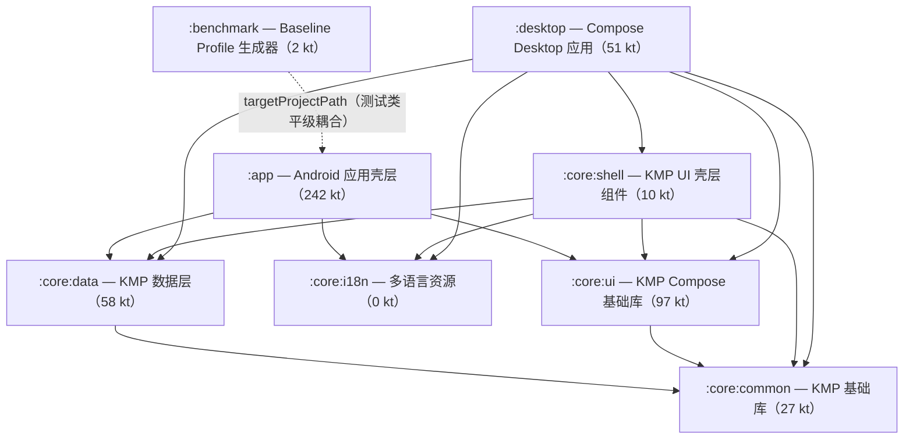

# EhViewer-Miuix 架构代码审查与重构建议报告

- 审查对象：EhViewer-Miuix（Kotlin Multiplatform + Compose，E-Hentai 阅读器的 Miuix/HyperOS 定制 fork）
- 报告日期：2026-10-11
- 审查性质：静态代码审查。本报告撰写过程中未运行任何编译、测试或构建任务（见第 6 章）
- 发现规模：8 个 Gradle 模块，main 源集合计 487 个 Kotlin 文件；六个领域共 43 条发现（高优先级 18 / 中优先级 20 / 低优先级 5），全部经独立复核

## 1. 执行摘要

本次静态审查覆盖 8 个 Gradle 模块（main 源集合计 487 个 Kotlin 文件），按数据层、业务引擎、UI 层、桌面端、构建配置、横切面六个领域产出 43 条重构发现（高 18 / 中 20 / 低 5），每条均经独立读码复核并原样附复核备注，无未复核条目。风险集中于四类：CI 与发布流水线自 2026-09-12 起持续产出缺原生库的 APK（R06，2026-10-11 补充复核确认为现行缺陷，见附录 A.1）、沿用上游公开签名密钥的取舍未文档化（R13，同日复核确认非私有密钥泄露，见附录 A.2）构成的安全与构建可信缺口；下载队列三套锁混用（R04）、SpiderQueen 共享状态锁内写锁外读（R05）、收藏落库协程无异常防护（R16）、Room 多步写不开事务（R02）等并发与正确性缺陷；收藏/历史一致性规则未下沉数据层致 `:app` 与 `:desktop` 行为漂移（R01）、站点搜索协议与 Rust 桥双端各持一份（R12/R20）、shell 组件复制中间态（R08/R29）等单一事实源缺失；以及 Rust 产物路径跨模块硬编码 8 处（R15/R18/R19/R28）等构建层反向耦合。报告按「安全与构建可信度 → 运行时正确性 → 数据与协议单源下沉 → shell 迁移闭环与 UI 收敛 → 构建体系收敛 → 清理与长期可测性」六个阶段给出路线图，阶段间仅存少量硬依赖（如 R10→R09、R01→R30、R16→R36），其余可并行小步实施，每阶段附验证方式与回滚策略。全部 43 条发现复核状态均为 verified；本报告为静态审查，各条「验证方式」需在实施阶段实际执行。

## 2. 架构概览

### 2.1 模块拓扑

| 模块 | 职责 | Kotlin 文件数（main 源集） | 直接依赖 |
|---|---|---|---|
| `:app` | Android 应用壳层（namespace com.hippo.ehviewer）：EhApplication、MainActivity、下载/爬虫/客户端粘合层与全部屏幕 UI | 242 | `:core:data`、`:core:i18n`、`:core:ui` |
| `:benchmark` | Macrobenchmark / Baseline Profile 生成器，通过 targetProjectPath 打测 `:app` | 2 | 无（`targetProjectPath=":app"`） |
| `:core:common` | KMP 最底层基础库（com.ehviewer.core.{files,model,util}），api 暴露 coroutines/datetime/okio/cbor/arrow | 27 | 无 |
| `:core:data` | KMP 数据层：Room 数据库、ktor/okhttp 网络、DataStore 偏好、主线程调度；desktop 侧承载 Rust 解析器加载 | 58 | `:core:common` |
| `:core:i18n` | moko-resources 多语言字符串模块（0 个 kt，纯资源），base strings.xml/plurals.xml + 11 个语言目录 | 0 | 无 |
| `:core:shell` | KMP UI 壳层组件（com.ehviewer.core.shell.{list,nav}）：列表条目、筛选面板、导航壳等共享 UI | 10 | `:core:common`、`:core:data`、`:core:i18n`、`:core:ui` |
| `:core:ui` | KMP Compose 基础 UI 库：Miuix/Material3 封装、scrollbar、material3 fork、动效（com.ehviewer.core.ui 等） | 97 | `:core:common` |
| `:desktop` | Compose Desktop JVM 应用（com.ehviewer.desktop.MainKt），聚合全部 core 模块并产出胖 jar/Msi/Exe | 51 | `:core:common`、`:core:data`、`:core:i18n`、`:core:shell`、`:core:ui` |

统计口径：KMP 模块 main 源集 kt 数 = commonMain + androidMain + desktopMain 之和（`core/shell` 的 10 个文件含 git status 中未跟踪的 3 个新文件）；`benchmark` 的 2 个文件在其 src/main 下。

### 2.2 模块依赖关系

依赖方向总述：`:core:common` 为唯一零依赖底层；`:core:data` 与 `:core:ui` 仅依赖 `:core:common`；`:core:shell` 依赖除自身外全部 core 模块；`:desktop` 聚合全部 5 个 core 模块；`:app` 仅直接依赖 `:core:data`、`:core:i18n`、`:core:ui`（`:core:common` 经 api 传递获得，`:core:shell` 未被 app 消费）。可疑方向详见 2.6。

### 2.3 关键入口

| 入口 | 角色 |
|---|---|
| `app/src/main/kotlin/com/hippo/ehviewer/EhApplication.kt` | Android Application 入口（AndroidManifest.xml:24 注册；:116 System.loadLibrary("ehviewer") 加载原生库） |
| `app/src/main/kotlin/com/hippo/ehviewer/ui/MainActivity.kt` | 唯一 Activity 入口（MainActivity.kt:214，Manifest:42），Compose UI 宿主 + compose-destinations 路由（:142-151 引用 destinations） |
| `desktop/src/desktopMain/kotlin/com/ehviewer/desktop/Main.kt` | 桌面 main() 函数（Main.kt:129）；compose.desktop mainClass="com.ehviewer.desktop.MainKt"（desktop/build.gradle.kts:93），胖 jar Main-Class 同名（:74） |
| `app/src/main/cpp/CMakeLists.txt` | C 原生库 libehviewer 的 CMake 构建（archive.c/gifutils.c/hash.c/natsort，FetchContent liblzma 5.8.3）；仅在 -PbuildNative 时接入 Gradle（app/build.gradle.kts:92-98） |
| `app/src/main/rust/Cargo.toml` | Rust crate ehviewer_rust：staticlib（Android 链入 so）+ cdylib（桌面 ehviewer_rust.dll），jvm/android/android-26 feature；无 corrosion，cargo 独立构建 |
| `app/src/main/jniLibs/arm64-v8a/libehviewer.so` | Android 侧预编译原生产物（gitignore 内本地构建），由 EhApplication 加载 |
| `app/src/main/kotlin/com/hippo/ehviewer/jni/` | Android JNI 边界：Archive.kt/GifUtils.kt/Hash.kt 的 external fun 声明 |
| `core/data/src/desktopMain/kotlin/com/hippo/ehviewer/client/parser/GalleryListParser.kt` | 桌面 Rust 边界：System.loadLibrary("ehviewer_rust")（:25），dll 资源解压加载（:32-36）与回退路径（:75-76） |
| `desktop/build.gradle.kts` | copyRustDll 任务（:26-30）把 app/src/main/rust/target-desk 的 dll 复制进 desktop 资源；desktopFatJar（:71-82）单文件分发 |

### 2.4 数据流简述

- Android 在线链路：UI/Service → EhEngine（Ktor + OkHttp/Cronet 双引擎，Rust 解析返回 CBOR，EhError 经 EhEngine.rethrowExactly 翻译为 Cloudflare/IpBanned/NotLoggedIn 等异常族）→ EhDB/文件系统；下载侧由 DownloadManager 单任务串行调度 SpiderQueen，进度经 notifyFlow 与 Compose 状态回流 UI。
- 桌面在线链路：desktop 自建网络栈（DesktopHttp + NetworkModule，共享 core:data 的 EhCookieStore）→ Rust 库 ehviewer_rust 解析（core:data desktopMain 的 JNI 壳，包名沿用 com.hippo.ehviewer 以对齐 JNI 符号）→ CBOR 反序列化为共享模型 → Compose UI；偏好经 DesktopSettings(DataStorePreferences) 与同 schema 的 Room 落盘。
- 设置/收藏横切：设置系统由 core/data commonMain 的 DataStorePreferences/PrefDelegate 双端共享，启动靠 prefScope 异步预热 cachedSnapshot；收藏变更经 FavouriteStatusRouter 广播至 EhDB 落库与 UI 层 detailCache。

### 2.5 各领域概述与关键事实

#### 2.5.1 数据层

core/data 是 KMP 数据层模块（android + jvm("desktop") 双 JVM 目标），职责分四块：1) Room KMP 数据库——EhDatabase(version 23，11 个 DAO，含 FTS4 全文索引) 与 SearchDatabase(version 2)，KSP 为两平台各生成 Impl；2) DataStore 偏好——DataStorePreferences 抽象基类 + 内存快照缓存 + PrefDelegate 委托属性 + edit() 扩展；3) Cookie/网络身份——CookieManager expect/actual（Android 走 webkit CookieManager，桌面走自实现 PersistentCookieStore + JNA DPAPI 加密落盘），EhCookieStore 作为 Ktor CookiesStorage 单例；4) 从 :app 下沉的站点解析器——commonMain 的 URL/HTML/JSON 解析（挂在 database.client 包）与 desktopMain 的 Rust JNI/CBOR 桥。数据流：上层（:app 的 EhDB 门面、:desktop 直接裸用 DAO）→ DAO → Room（AndroidSQLiteDriver / BundledSQLiteDriver）；偏好经 prefScope 异步 edit + 快照读取。expect/actual 共 5 组：roomDb/getDatabasePath、isMainThread、getCookieManager、getDateStore，质量整体良好（桌面 actual 支持 ehviewer.data.dir 重定向并被 desktopTest 复用做隔离）。模块无 Repository 层：核心一致性规则（画廊行与收藏/历史行配对、孤儿清理、多表写原子性）散落在 :app 消费层，:desktop 各自复刻且行为漂移。测试全部位于 desktopTest（18 文件约 1019 行），覆盖数据库 actual 冒烟、Cookie 持久化语义、DataStore 落盘与解析器（Rust 桥经 Assume 环境自适应跳过），commonMain 逻辑无独立测试源集。

关键事实：

- 数据库为 Room 2.8.4 KMP，Android 端 AndroidSQLiteDriver、desktop 端 sqlite-bundled-jvm 2.7.1 的 BundledSQLiteDriver（core/data/build.gradle.kts:37,42-43）
- EhDatabase version 23，autoMigrations 覆盖 4→23 但缺 17→18（Database.kt:40-59），由手动 Migration Schema17to18（DatabaseMigrations.kt:108-115）补位，且仅注册在 :app 端
- commonMain 实为 JVM-common：直接 import java.nio.ByteBuffer 与 io.ktor.util.moveToByteArray（ByteBufferSource.kt:3-4），因双目标均为 JVM 后端而可编译，未来非 JVM 目标不可复用
- Room 实体直接继承 core:common 领域模型：GalleryEntity : BaseGalleryInfo（GalleryEntity.kt:53），持久化模型与领域模型合一，无 DTO 转换层
- 模块无 Repository 层：:app 的 EhDB object（app/src/main/kotlin/com/hippo/ehviewer/EhDB.kt:44）是事实门面，:desktop 的 DesktopDatabase 直接暴露原始 DAO（desktop/src/desktopMain/kotlin/com/ehviewer/desktop/DesktopDatabase.kt:8）
- 桌面 Cookie 落盘经 JNA Crypt32Util DPAPI CurrentUser 加密（CookiePersistence.kt:59），非 Windows 回退明文，旧明文格式一次性迁移
- Rust 绑定双轨：:app 符号在 libehviewer.so（EhApplication.kt:116 启动加载），desktop 端为独立 ehviewer_rust.dll，loadLibrary→classpath 资源→相对路径三级回退（GalleryListParser.kt:22-57）
- desktopTest 为唯一测试源集（commonTest 仅声明依赖未放用例），含 Assume.assumeTrue(rustGalleryBindingsAvailable) 的 CI 环境自适应跳过（GalleryDetailParserDesktopTest.kt:14）

#### 2.5.2 业务引擎

业务引擎层指 :app 中非 UI 的 Kotlin 代码与原生边界，分四块：E-Hentai 访问栈（Ktor + OkHttp/Cronet 双引擎、内嵌 okhttp3 包的 DNS shim、EhEngine/EhUrl 与下沉到 Rust 的 HTML 解析器）、下载器（DownloadManager 全局单例调度 + SpiderQueen/SpiderDen 抓图落盘 + DownloadService 前台通知）、全局状态（Settings/DataStore、EhDB/Room、EhTagDatabase、FavouriteStatusRouter）与原生边界（CMake 门控集成 libarchive/libwebp/nettle 并经 Corrosion 导入 ehviewer_rust，JNI 暴露解析/归档/图像能力）。数据流：UI/Service → EhEngine（Ktor 请求，Rust 解析返回 CBOR，EhError 再翻译为 Kotlin 异常族）→ EhDB/文件系统；下载侧由 DownloadManager 单任务串行调度 SpiderQueen，进度经 notifyFlow 与 Compose 状态回流 UI。关键入口是 EhApplication.onCreate（初始化 Settings、ktorClient 单例、EhTagDatabase 更新、DownloadManager 元数据回填）。HTML 解析大部分在 app/src/main/rust（tl + serde CBOR），Kotlin 侧 parser 仅保留薄封装与异常翻译；CMakeLists 实测确认 Android 侧用 Corrosion 导入 Rust crate（与侦查事实中『无 corrosion』需限定为仅 desktop 侧成立）。整体代码密度高、工程化程度好，但并发锁契约不一致、原生库加载与构建脱节、以及若干 UI/引擎反向依赖是主要结构风险。

关键事实：

- okhttp3 shim：app/src/main/kotlin/okhttp3 下仅 2 个 vendored 文件（AsyncDns + AndroidAsyncDns，Apache-2.0 Square 2022 头），唯一消费点是 ktor/OkhttpExtensions.kt:8-14，在 API 29+ 给 OkHttp 引擎装 IPv4+IPv6 双栈异步 DNS；实测本机解析到的 okhttp-jvm-5.3.2.jar 不含 AsyncDns 类，即该 shim 填补的是依赖工件中不存在的类
- 网络双引擎：EhApplication.ktorClient 惰性单例按 Settings.enableCronet 选 Cronet（自写 CronetEngine，Android Sv2+）或 OkHttp，共享 configureCommon（EhCookieStore、UA、请求超时 10s，ktor/Common.kt:33-52）
- 解析分工：列表/详情/预览/种子/档案等 HTML 解析在 app/src/main/rust（tl + serde），Kotlin parser 仅 unmarshalParsingAs 薄封装；Rust 的 EhError 经 CBOR 由 EhEngine.rethrowExactly（EhEngine.kt:116-168）翻译为 Cloudflare/IpBanned/NotLoggedIn 等异常族
- API 限速常量硬编码于 EhEngine.kt:97-100（每批 25、连续 5 组、间隔 5s），与 ehwiki API 规范一致；addFavorites 有逐条 1s 节流（EhEngine.kt:515-524）
- 下载调度：DownloadManager 为全局 object + Dispatchers.IO scope，单任务串行（mCurrentTask/mWaitList），状态经 MutableSharedFlow notifyFlow 与 Compose mutableStateOf 双轨暴露，且对象初始化用 runBlocking（OSUtils.kt:54）做 DB 查询
- 原生边界：Android 侧 CMake 仅在 -PbuildNative 时接入（app/build.gradle.kts:92-98），经 FetchContent+Corrosion 导入 ehviewer_rust（CMakeLists.txt:141-156），C 侧 archive.c 复用 vendored natsort/strnatcmp（archive.c:35,109）；desktop 侧才走独立 cargo 无 corrosion，产物均不入库
- libehviewer.so 经 jniLibs 加载，该目录被 .gitignore:13 忽略（git check-ignore 实测），而 System.loadLibrary("ehviewer") 无条件执行（EhApplication.kt:116）
- 全局单例密度高：DownloadManager/EhDB/Settings/EhTagDatabase/EhFilter/FavouriteStatusRouter 均为 object，其中多个自建永不取消的 CoroutineScope；detailCache 全局缓存定义在 UI screen 文件里被 Application 反向依赖

#### 2.5.3 UI 层

UI 层由三部分组成：:app 的 com.hippo.ehviewer.ui 包（约 60 个 kt、19.5k 行，含 screen/reader/settings/main/tools 子包）、core/ui 共享 Compose 组件库（101 个 kt：LiquidGlass/MutableSideSheet/FloatingBottomBar 等液态玻璃组件、MiuixThemeController 主题、AdaptiveLayout 统一断点、8 个 androidx fork 文件）、core/shell 跨端壳组件（GalleryListBody/LibrarySearchBarScaffold 等 10 个 kt）。数据流：compose-destinations 路由（KSP 生成 destinations）→ 各 Screen Destination Composable → 直接访问全局单例（Settings/DownloadManager/EhDB/searchDatabase）或 viewModel paging flow → Miuix 组件渲染；跨组件通信依赖 CompositionLocal（LocalWindowLayout/LocalSideSheetState/LocalSnackBarHostState 等）与 Kotlin context receiver 隐式传参（GalleryDetailContent 声明 7 个 receiver）。关键入口是 MainActivity.setMiuixContent → EhTheme → SharedTransitionLayout + DestinationsNavHost。主题为双树结构：MiuixTheme(controller=core/ui 硬编码 HyperOS 基底) 内嵌 MaterialTheme(M3 动态取色)。core/ui 对 app 无反向依赖（grep com.hippo 零命中，边界干净），但 core/shell 正在把 app 的胶囊组件逐行'同构移植'过去而 :app 无法依赖该模块，复制正在发生且 app 侧旧副本未删。

关键事实：

- Compose Multiplatform 1.12.1 + Miuix 0.9.4 + material3-adaptive；core/ui commonMain api(JB material3/miuix-ui/preference/icons/blur/backdrop)，androidMain 另 api(compose-bom + foundation)（core/ui/build.gradle.kts:17-29）
- :app 仅 implementation core:data/i18n/ui 不含 core:shell；:desktop 依赖全部 5 个 core 模块（app/build.gradle.kts:179-181、desktop/build.gradle.kts:47-51）
- core/ui 与 core/shell 源码 0 处 com.hippo 引用（本次 grep 验证为空），底层模块边界干净无反向依赖
- 导航用 compose-destinations（KSP 生成）+ SharedTransitionLayout 包裹 NavHost（MainActivity.kt:518-531）
- 状态流模式：页面 Composable 直接读全局单例（Settings.xxx.asMutableState()/DownloadManager/searchDatabase），单文件普遍平铺 10+ 个 remember/rememberSaveable 状态位
- context receiver 是主流隐式传参：GalleryDetailContent.kt:195 声明 CoroutineScope/DestinationsNavigator/DialogState/MainActivity/SnackbarHostState/SharedTransitionScope/TransitionsVisibilityScope 7 个 receiver，moe.tarsin 的顶层 navigate/snackbar/string 函数消费它们
- core/ui commonMain 含 8 个 AOSP fork 文件：foundation.gestures×3 与 foundation.scrollbar×3 用原 androidx 包名，material3.fork×2 用 .fork 子包，两种命名并存
- 主题双树：EhTheme 内先包 MiuixTheme(rememberMiuixThemeController) 再包 MaterialTheme(M3 dynamic/wallpaper/materialkolor 取色)（app Theme.kt:74-88）；desktop 端只消费 MiuixTheme（desktop Main.kt:379-389）

#### 2.5.4 桌面端

桌面端领域由 :desktop（KMP jvm("desktop") 单目标 Compose Desktop 应用，54 个 main 源集 kt + 38 个测试 kt）与 :core:shell（10 个 commonMain kt + 2 个测试 kt）组成。:desktop 是单窗口宿主：Main.kt main() 持有页面栈（DesktopPageStack：库/详情/阅读/设置）、托盘驻留、窗口尺寸与位置记忆，经 core:shell 的 AppShell 渲染 Rail/悬浮底栏导航外壳；LibraryScreen.kt（2307 行）承载数据拉取（自建 HttpURLConnection desktopGet + Rust parseGalleryList）、Room Flow（DesktopDatabase.eh）、本地筛选排序与全部库页 UI；ReaderScreen 走 desktopGet→GalleryPageParser 的逐页阅读链路。core:shell 是「移动端同构 UI」共享层：AppShell/NavItemSpec 导航外壳、LibrarySearchBarScaffold 搜索顶栏、GalleryListBody/GalleryInfoItems 列表体、GalleryItemVisuals 视觉规则，数据面全部经参数注入（SearchSuggestion/GalleryItemStatus/CategoryChipSpec），无内部状态、无 expect/actual、无对 desktop/app 的反向依赖。数据流：desktop 自建网络栈（DesktopHttp + NetworkModule，共享 core:data 的 EhCookieStore）→ Rust 库 ehviewer_rust 解析（core:data desktopMain 的 JNI 壳，包名沿用 com.hippo.ehviewer 以对齐 JNI 符号）→ CBOR 反序列化为共享模型 → Compose UI；偏好经 DesktopSettings(DataStorePreferences) 与同 schema 的 Room 落盘。核心风险集中在：LibraryScreen 巨型函数、三份内联的在线搜索管线、与 :app 逐参数复制的搜索 URL 构造、shell 迁移中间态的双份视觉/类目映射，以及 Rust dll 路径对 :app 目录的反向耦合。

关键事实：

- 依赖方向：:desktop 依赖 core:{common,data,i18n,shell,ui}（desktop/build.gradle.kts:47-51）；core:shell 仅依赖 core:{common,data,i18n,ui}（core/shell/build.gradle.kts），commonMain 无反向依赖，shell 内无 expect/actual
- core:shell 目前只被 :desktop 消费（desktopMain 仅 LibraryScreen.kt 与 Main.kt import com.ehviewer.core.shell）；:app 全仓 0 处 import com.ehviewer.core.shell，未消费 shell
- :desktop 与 :app 是两套并行在线栈：desktop 走 desktopGet(HttpURLConnection，DesktopHttp.kt:46-79)+parseGalleryList(Rust)；app 走 ListUrlBuilder(app/src/main/kotlin/com/hippo/ehviewer/client/data/ListUrlBuilder.kt:151)+EhEngine(ktor)
- Rust 解析执行体在 ehviewer_rust 库，core:data desktopMain 的 com.hippo.ehviewer.client.parser 包是 JNI 符号绑定壳（GalleryListParser.kt:10-11 注释自证类名/包名须与 jni_fn 逐字一致），app 委托该实现
- :desktop 未使用 build-logic 约定插件，手工配置 jvmToolchain 与 spotless（desktop/build.gradle.kts:12-35）；桌面 Main dispatcher 由 kotlinx-coroutines-swing 经 ServiceLoader 提供（desktop/build.gradle.kts:41-42）
- shell/core:ui 的 androidMain 额外 api compose-bom+foundation（core/shell/build.gradle.kts:23-28），桌面侧走 JB compose-multiplatform 插件注入依赖，两端 Compose 版本源不同
- desktopMain 无 TODO/FIXME 遗留；纯模型（SearchUrl/SortOrder/QuickSearch/NotificationState/PageStack 等）均从 UI 抽出且各有对应 desktopTest
- desktopFatJar 单文件分发 + Msi/Exe 双配置（desktop/build.gradle.kts:71-102）；Rust dll 由 copyRustDll 复制进 resources（desktop/build.gradle.kts:24-30）

#### 2.5.5 构建配置

构建层由 Gradle wrapper 9.7.1 驱动，AGP 9.3.1 / Kotlin 2.4.20 / Compose Multiplatform 1.12.1 等版本统一收敛于 gradle/libs.versions.toml 单一目录，主构建与 included build（build-logic）共享同一 catalog（build-logic/settings.gradle.kts:12-16）。build-logic/convention 提供 3 个约定插件（AndroidApplication / MultiplatformLibrary / MultiplatformLibraryCompose），统一 JVM 21 工具链、Kotlin 与 Compose 编译器 opt-in、lint、spotless 与 desugaring，并按模块 path 自动生成 Android namespace（MultiplatformLibraryConventionPlugin.kt:47）。settings.gradle.kts:34-40 经 com.android.settings 插件集中声明 SDK 约束（compileSdk/targetSdk 37、minSdk 24、NDK 29.0.14206865），7 个项目模块中 :app 与 5 个 core KMP 库走约定插件，:desktop 与 :benchmark 直接组合底层插件。原生构建三源：C/C++ 走 CMake（默认关闭，需 -PbuildNative，app/build.gradle.kts:92-98），Android Rust 由该 CMake 轨道内 FetchContent 的 corrosion v0.6.1 构建（app/src/main/cpp/CMakeLists.txt:141-156），桌面 Rust 走独立 cargo、Gradle 仅做 dll 复制（desktop/build.gradle.kts:24-30）。core/i18n 为纯资源模块（moko-resources 0.26.4，base+11 语言目录），词条被 :app 的 localeFilters 打包过滤与 :desktop 的 desktopTest 守卫双侧消费。发布版本号手工维护在 app 脚本内，desktop 原生分发版本为独立死值；Renovate 负责更新 catalog、CMake GIT_TAG、rust nightly 与 NDK 自定义数据源。

关键事实：

- Gradle 9.7.1 wrapper、AGP 9.3.1、Kotlin 2.4.20、Compose Multiplatform 1.12.1、Miuix 0.9.4、moko-resources 0.26.4，版本单点收敛于 gradle/libs.versions.toml
- build-logic/settings.gradle.kts:12-16 把主 catalog 复用进 included build，约定插件经 Project.libs 访问器取版本（ProjectExtensions.kt:7-8）
- settings.gradle.kts:34-40 集中声明 SDK 约束（compileSdk 37 / minSdk 24 / targetSdk 37 / NDK 29.0.14206865 / buildTools 37.0.0），:app default flavor 单独覆盖 minSdk 26（app/build.gradle.kts:82）
- 3 个约定插件注册于 build-logic/convention/build.gradle.kts:16-29；namespace 按模块 path 生成（MultiplatformLibraryConventionPlugin.kt:47），lint 全局关闭 release 检查（Lint.kt:5-9）
- 5 个 core KMP 模块各自重复声明 jvm("desktop") 目标，hierarchy template 已把 android 编译并入 jvm 组（MultiplatformLibraryConventionPlugin.kt:31-38）
- :desktop 是唯一不走约定插件的常规模块，手写 spotless（desktop/build.gradle.kts:12-22），且缺 configureKotlin 的 progressiveMode / optIn / -Xcollection-literals（Kotlin.kt:7-24）
- 桌面 Rust 产物路径在 desktop/build.gradle.kts:24 与 GalleryListParser.kt:75-80 共 8 处硬编码；Android Rust 经 CMake 轨道内 corrosion v0.6.1 构建（app/src/main/cpp/CMakeLists.txt:141-156）
- Renovate（renovate.json）管理 catalog / CMake GIT_TAG / rust nightly / NDK，AGP 组规则覆盖 com.android.settings（renovate.json:65-71），但 ignorePaths 排除 app/build.gradle.kts；CI 以带 Release 后缀的任务名构建（ci.yml:124），但自 ee9a51e58（2026-09-12）引入 buildNative 门控后 CI workflow 未同步，流水线产出 APK 缺原生库（见附录 A.1）

#### 2.5.6 横切面

横切面层无单一目录，覆盖全仓的协程作用域治理、错误处理风格与测试基建。错误处理以 arrow Either.catch + .onLeft { logcat } 为主流（PostLogin/EhTagDatabase/PathUtils 等），空 catch 全仓仅 1 处且为 sendfile 失败回退，一致性尚可；真正的缺口在无监督的后台常驻收集协程与 DataStore 快照失效后的静默降级。协程作用域分三类：Compose rememberCoroutineScope、类内自建（SpiderQueen/PageLoader/AnimatedWebPDrawable/UpdateDownloadManager）、进程级顶级 scope（7 处手建，含 1 处 GlobalScope、3 处缺 SupervisorJob、1 处 public 顶级可变单例）。设置系统由 core/data commonMain 的 DataStorePreferences/PrefDelegate 双端共享，读路径存在 runBlocking 冷读分支；Rust 原生绑定加载在 core:data desktopMain 内三级回退，末端硬编码 :app 构建产物的相对路径。测试基建共 454 个 @Test，desktopTest 是主宿主（284 个），app 侧以"提取纯函数"方式绕开 Android 全局单例，核心业务类本体（SpiderQueen/SpiderDen/DownloadManager/EhEngine）缺少直接测试。

关键事实：

- 错误处理主风格为 arrow.core.Either.catch + .onLeft { logcat }（如 app/src/main/kotlin/com/hippo/ehviewer/ui/login/PostLogin.kt:16-23、client/EhTagDatabase.kt:169-176），全仓空 catch 仅 1 处且为 sendfile 失败回退（core/common/src/androidMain/kotlin/com/ehviewer/core/files/AndroidFileSystem.kt:67）
- 进程级手建 CoroutineScope 共 7 处：GlobalScope（app/.../ui/login/PostLogin.kt:26）、collectScope（SettingsCollector.kt:28）、progressScope（gallery/PageLoader.kt:35）、limitScope（ui/main/AvatarIcon.kt:72）、dataStoreScope（ui/tools/DateStoreState.kt:24，public）、prefScope（core/data/.../preferences/Edit.kt:23）、listenerScope（util/FavouriteStatusRouter.kt:41），其中 progressScope/limitScope/listenerScope 3 处缺 SupervisorJob
- 生产代码 runBlocking 共 4 处：PrefDelegate.kt:43（读冷启动）、Edit.kt:13（blocking 写，有 checkNotMainThread 防护）、desktop/.../DesktopHttp.kt:61（cookie 获取）、AnimatedWebPDrawable.kt:139（dispose）；Thread.sleep 仅测试内 1 处（core/data/src/desktopTest/.../DataStorePreferencesDesktopTest.kt:36）
- 设置系统 core/data commonMain 的 DataStorePreferences/PrefDelegate 双端共享，启动靠 prefScope 异步预热 cachedSnapshot，读路径存在 runBlocking 冷读兜底
- Rust 绑定加载在 core/data desktopMain GalleryListParser.kt:22-57 三级回退（loadLibrary→classpath 资源→候选路径），末级 6 条候选路径全部指向 :app 的 cargo 产物目录
- 测试总量 454 个 @Test（rg -c 静态统计，未运行）：desktopTest 284、app test 82、core-data desktopTest 49、core-ui commonTest 26、core-shell commonTest 10、core-common desktopTest 3；benchmark 2 个文件在 src/main 下属 baseline profile 代码
- app 生产代码 242 个 kt 文件对 17 个测试文件，核心类 SpiderQueen(718 行)/SpiderDen(419 行)/DownloadManager(869 行)/EhEngine(525 行) 仅有提取纯函数级测试（如 SpiderQueenBackoffTest 只测 calculateBackoffDelay）
- `!!` 生产代码密集点：SpiderDen.kt 5 处、EhTagDatabase.kt 5 处（后者均在 Either.catch 保护内）

### 2.6 依赖方向评估

依赖方向：core:common 为唯一零依赖底层；core:data → core:common；core:ui → core:common；core:shell → {core:common, core:data, core:i18n, core:ui}；:desktop 聚合全部 5 个 core 模块；:app 仅直接依赖 {core:data, core:i18n, core:ui}（core:common 经 api 传递获得，core:shell 未被 app 消费）。benchmark 无常规依赖，但 targetProjectPath=":app"（benchmark/build.gradle.kts:13）且被 :app 以 baselineProfile(project(":benchmark")) 消费（app/build.gradle.kts:246），属测试类平级耦合，正常。可疑方向：1) core:shell 名义在 core 下却是依赖 core:data 的上层壳组件，命名层级与实际依赖方向不符（更接近 feature 层）；且 git status 显示 3 个未跟踪新组件（CategoryFilterStrip/HomeFloatingActionCapsule/SearchFilterPanel）正在往 core:shell 迁移，而 :app 尚未依赖该模块，疑似抽取中间态，待确认。2) core:data 的 desktopMain GalleryListParser.kt:75-76 硬编码 "../../app/src/main/rust/target-desk/..." 回退路径——底层 core 模块源码反向引用上层 :app 的构建产物位置，属可疑反向耦合。3) core:ui 的 androidMain api(compose-bom/foundation) 而桌面侧 compose 依赖走 commonMain 的 JB material3，两端 Compose 版本源不同（BOM 2026.08.00 vs JB 1.12.1），依赖面偏宽需留意。

## 3. 重构机会清单

编号规则：按优先级分组内顺序编号 R01-R43，标注领域归属。同一问题被多个领域独立报告时（Rust 产物路径硬编码：R15/R18/R19/R28；shell 组件迁移中间态：R08/R29），各条目原文保留并在「关联条目」互指，实施时合并处理（见第 4 章）。字段含：位置、现状、问题、证据、重构建议、预期收益、风险与兼容性、实施步骤、验证方式、优先级、复核状态与复核备注（reviewNote 原样保留）；「待确认」为发现者标注的 unverified 内容原样保留。

### 3.1 高优先级（18 条）

#### R01. [数据层] Repository/门面层未下沉 core:data，收藏与历史的一致性规则在 :app 与 :desktop 两端漂移

- **优先级**：high ｜ **复核状态**：verified ｜ **关联条目**：R30
- **位置**：core/data/src/commonMain/kotlin/com/ehviewer/core/database/（缺层）；证据：app/src/main/kotlin/com/hippo/ehviewer/EhDB.kt:177-202,54-65 与 desktop/src/desktopMain/kotlin/com/ehviewer/desktop/LibraryScreen.kt:444-472、Main.kt:930-940
- **现状**：core/data 只到 DAO 层。:app 的 EhDB object 封装了多表一致性规则：putLocalFavorites=putGalleryInfo+收藏行 upsert（EhDB.kt:193-196）、removeLocalFavorites 删收藏行后调 cleanOrphanGallery 清理无引用画廊行（EhDB.kt:177-180→54-61）。:desktop 的 DesktopDatabase 直接暴露 EhDatabase 原始 DAO，UI 层自行两步写（LibraryScreen.kt:471-472、Main.kt:933-934），且取消收藏/删历史只删 LOCAL_FAVORITES/HISTORY 行。
- **问题**：「画廊行与收藏/历史行配对 + 孤儿清理」这一核心一致性规则只有 app 端有实现，desktop 端复刻了不同版本且完全没有孤儿清理（desktop 全仓无任何 galleryDao().delete 调用），GALLERIES 表随取消收藏永久累积残留行；SearchDao.suggestions 的组合逻辑甚至散落在 app UI 层（SearchBarScreen.kt:132）。上层绕过数据层直写 DAO 使两端行为无法一致验证。
- **证据**：EhDB.kt:194-195 `putGalleryInfo(galleryInfo.asEntity()); db.localFavoritesDao().upsert(LocalFavoriteInfo(galleryInfo.gid))`；LibraryScreen.kt:471-472 `DesktopDatabase.eh.galleryDao().upsert(entity); DesktopDatabase.eh.localFavoritesDao().upsert(LocalFavoriteInfo(gallery.gid))`；EhDB.kt:178-179 `db.localFavoritesDao().deleteByKey(galleryInfo.gid); deleteGalleryInfo(galleryInfo.asEntity())`
- **重构建议**：在 core:data 新建 Repository（如 FavoritesRepository/HistoryRepository），把 putLocalFavorites/removeLocalFavorites/putHistoryInfo/cleanOrphanGallery 及其事务封装下沉为公共 API；:app 的 EhDB 改为薄委托，:desktop 的 LibraryScreen/Main 改调 repository。desktop 的收藏撤销依赖「GALLERIES 行保留」（LibraryScreen.kt:452 注释），可为清理提供延迟/开关参数。
- **预期收益**：多表一致性规则单一实现；desktop 修复 GALLERIES 孤儿行累积；两端行为可被同一套 desktopTest 覆盖
- **风险与兼容性**：desktop 撤销收藏语义（保留画廊行用于 undo）须在 repository 参数化保留，否则撤销窗口后立即清孤儿会破坏现交互；app 端调用点均为同名方法迁移，破坏面小
- **实施步骤**：1) 在 core:data commonMain 定义 FavoritesRepository/HistoryRepository 接口与 Room 实现；2) 迁移 EhDB 中 putLocalFavorites/removeLocalFavorites/putHistoryInfo/cleanOrphanGallery 逻辑并加 withTransaction；3) EhDB 改薄委托保持 app 调用点不变；4) LibraryScreen/Main.kt 改调 repository；5) desktopTest 补往返与孤儿清理用例
- **验证方式**：gradlew :core:data:desktopTest 全绿 + 新增用例：收藏后取消收藏→断言 GALLERIES 行按策略清理或延迟保留；app 冒烟收藏/历史/下载路径
- **待确认**：desktop 端 GALLERIES 孤儿行累积的实际严重度取决于线上使用时长，未做数据统计

> **复核备注（reviewNote 原样保留）**：全部读码核实。EhDB.kt:193-196 putLocalFavorites=putGalleryInfo+收藏行upsert、:177-180 removeLocalFavorites 删收藏行后经 deleteGalleryInfo→cleanOrphanGallery（:54-61）清理无引用画廊行，均为真实代码；desktop 端 LibraryScreen.kt:471-472 与 Main.kt:933-934 确为 UI 层两步直写 DAO，取消收藏/删历史（LibraryScreen.kt:446,963,1034,1321,1345、Main.kt:963）只删 LOCAL_FAVORITES/HISTORY 行。grep -rn "galleryDao().delete" desktop/src 无任何匹配（exit 1），证实 desktop 全仓无孤儿清理。core/data/src/commonMain/kotlin/com/ehviewer/core/database/ 下仅 Database.kt/DatabaseMigrations.kt/Room.kt 与 client/dao/model/util 子包，无 Repository 层。SearchBarScreen.kt:132 确为 `suspend fun SearchDao.suggestions(...)` 组合逻辑落在 app UI 层。唯一小误差：suggestion 中引用的撤销注释「GALLERIES 行未被删除，联表视图自动恢复」在 LibraryScreen.kt:453（非 452），行号差 1 不影响结论。

#### R02. [数据层] EhDB 误用 useWriterConnection 充当事务边界，多步写不具备原子性

- **优先级**：high ｜ **复核状态**：verified
- **位置**：app/src/main/kotlin/com/hippo/ehviewer/EhDB.kt:88-92,95-100,105-112,263-268
- **现状**：putDownloadInfo、removeDownloadInfo(单个/批量)、deleteHistoryInfo 等多步写都包在 db.useWriterConnection{} 块内，意图是让「先写 GALLERIES 再写 DOWNLOADS / 先删 DOWNLOADS 再清画廊」成为原子操作。
- **问题**：Room 2.8.4 的 useWriterConnection 只是获取独占写连接执行块，不开事务：本次反编译 room-runtime jar 确认其内部仅调 useConnection(true, block)，无 beginTransaction/transactor.withTransaction；真正的事务 API 是同文件存在的 androidx.room.withTransaction。块内两个 DAO suspend 调用是两个独立原子语句，中途取消/失败会留下部分写入（如 GALLERIES 已插而 DOWNLOADS 未插，或删完 DOWNLOADS 未清画廊）。
- **证据**：EhDB.kt:88-91 `db.useWriterConnection { putGalleryInfo(downloadInfo.galleryInfo); db.downloadsDao().upsert(downloadInfo.downloadInfo) }`；javap 反编译 RoomDatabaseKt__RoomDatabaseKt$useWriterConnection$2 仅含 `invokevirtual RoomDatabase.useConnection$room_runtime_release(Z, Function2, Continuation)`，无事务调用；RoomDatabaseKt 另有 withTransaction/withTransactionContext API
- **重构建议**：将这 4 处 useWriterConnection 改为 androidx.room.withTransaction { ... }（room-ktx 已在依赖面内，import androidx.room.withTransaction）；vacuumDB/exportDB 的 PRAGMA/VACUUM 用法（EhDB.kt:299-309）可保留原样
- **预期收益**：多表写原子性，崩溃或协程取消后无半写状态；外键约束（DOWNLOADS→GALLERIES 无级联）下的数据完整性可依赖事务保证
- **风险与兼容性**：withTransaction 块内 suspend DAO 调用走同一事务上下文，若现有代码隐式依赖「失败后部分可见」（如 importDB 的渐进导入语义）需逐一确认；API 同为 suspend，迁移本身机械
- **实施步骤**：1) import androidx.room.withTransaction；2) 逐处替换 useWriterConnection 块为 withTransaction；3) 检查块内无 runBlocking/主线程切换；4) 跑下载增删与历史删除路径冒烟
- **验证方式**：app 下载添加/删除、历史删除手测；可在 desktopTest 用注入异常验证回滚（若该逻辑下沉 repository 则随 R01 一起测）

> **复核备注（reviewNote 原样保留）**：EhDB.kt:88-92（putDownloadInfo）、95-100（removeDownloadInfo 单个）、105-112（removeDownloadInfo 批量）、263-268（deleteHistoryInfo）四处多步写确均包在 db.useWriterConnection{} 内，块内为两个独立 suspend DAO 调用；:299-309 vacuumDB/exportDB 为 PRAGMA/VACUUM 用法。Room 侧事实我亲自验证：解包本地缓存 room-runtime-android AAR 的 classes.jar，javap -c 反编译 RoomDatabaseKt__RoomDatabaseKt$useWriterConnection$2，invokeSuspend 唯一关键调用为 `invokevirtual androidx/room/RoomDatabase.useConnection$room_runtime_release(Z, Function2, Continuation)`，无 beginTransaction/transactor 调用，与发现的 javap 证据逐字一致；同 jar 内确认存在 withTransaction/withTransactionContext/Transactor 等事务 API 类（即 androidx.room.withTransaction 可用）。一点出入需说明：版本目录 libs.versions.toml:14 声明 androidx-room=2.8.4，但 gradle 缓存中不存在 2.8.4 artifact，我实际反编译的是缓存中唯一的 room-runtime-android 2.7.1——发现声称「本次反编译 Room 2.8.4」无法在本地按同版本复现，但其证据描述与我在 2.7.1 上的反编译结果完全吻合，核心结论（useWriterConnection 仅获取写连接、不开事务）经亲自验证成立。

#### R03. [数据层] EhDatabase 构建配置两端漂移：desktop 端漏注册唯一的 17→18 手动迁移

- **优先级**：high ｜ **复核状态**：verified
- **位置**：desktop/src/desktopMain/kotlin/com/ehviewer/desktop/DesktopDatabase.kt:8 对照 app/src/main/kotlin/com/hippo/ehviewer/EhDB.kt:46-48
- **现状**：:app 打开主库为 roomDb<EhDatabase>("eh.db") { addMigrations(Schema17to18()) }（EhDB.kt:46-48，importDB 的临时库同款，EhDB.kt:318-321）；:desktop 为 roomDb<EhDatabase>("eh.db") 无任何 addMigrations（DesktopDatabase.kt:8）。autoMigrations 列表覆盖 4→23 但唯独缺 17→18（Database.kt:40-59），17→18 是全库唯一手动 Migration（重建 GALLERIES 表剔除 TOKEN 为空行）。
- **问题**：同一 schema 在两端构建分叉。desktop 打开 version≤17 的 eh.db（从 Android 设备复制的数据库文件，或桌面早期版本数据）时 Room 找不到 17→18 迁移直接抛 IllegalStateException，而 DesktopDatabase.kt:6 注释明确声称「与 Android 同一 schema」；importDB 若未来移植到桌面也会踩同一坑。
- **证据**：DesktopDatabase.kt:8 `val eh: EhDatabase by lazy { roomDb<EhDatabase>("eh.db") }`；EhDB.kt:46-48 `private val db = roomDb<EhDatabase>(DB_NAME) { addMigrations(Schema17to18()) }`；Database.kt:53-54 `AutoMigration(from = 16, to = 17), ... AutoMigration(from = 18, to = 19, spec = Schema18to19::class)`（17→18 缺失）
- **重构建议**：在 core:data commonMain 提供 ehDatabase 工厂（如 fun ehDatabase(name: String): EhDatabase = roomDb(name) { addMigrations(Schema17to18()) }），EhDB、DesktopDatabase、importDB 临时库三处共用，使迁移注册成为数据层单一事实源
- **预期收益**：迁移链不再随消费端漂移；消除 EhDB 内部两处重复注册；未来新增手动迁移只需改一处
- **风险与兼容性**：纯注册归拢，无 schema 变化；desktop 的 roomDb actual 支持传完整路径（Room.desktop.kt:20-24），工厂若限制为纯文件名需同步覆盖该分支
- **实施步骤**：1) core:data 增加 EhDatabase 工厂函数并注册 Schema17to18；2) EhDB 主库与 importDB 临时库改用工厂；3) DesktopDatabase 改用工厂；4) desktopTest 增加低版本库打开用例
- **验证方式**：desktopTest：用 schemas 目录中 17.json 预建 v17 库文件后经工厂打开，断言成功迁移至 v23 且旧 TOKEN 空行被剔除；两端正常启动
- **待确认**：桌面端是否存在 version≤17 的存量数据文件（含用户从 Android 复制 eh.db 的场景）未能在代码中确认，崩溃触发面待人工评估

> **复核备注（reviewNote 原样保留）**：全部核实。DesktopDatabase.kt:8 `val eh: EhDatabase by lazy { roomDb<EhDatabase>("eh.db") }` 无任何 addMigrations；EhDB.kt:46-48 主库与 :318-321 importDB 临时库均注册 Schema17to18；Database.kt:40-59 autoMigrations 列表 4→5 至 22→23，:53-54 恰为 `AutoMigration(from=16,to=17),` 与 `AutoMigration(from=18,to=19,spec=Schema18to19::class)`，17→18 确缺失；DatabaseMigrations.kt:108-115 Schema17to18 是全文件唯一 `Migration(17,18)` 手动迁移，经 _new_GALLERIES 重建并以 `WHERE TOKEN IS NOT NULL` 剔除空 TOKEN 行。Room.desktop.kt:19-24 确认 desktop actual roomDb 对含路径分隔符的 name 原样使用完整路径。发现描述的「desktop 打开 v≤17 库时 Room 缺迁移抛 IllegalStateException」属 Room 标准语义（未在本次运行中实跑复现），代码层事实全部成立。

#### R04. [业务引擎] DownloadManager 三套锁混用且关键可变集合无锁变更，队列可被并发写坏

- **优先级**：high ｜ **复核状态**：verified
- **位置**：app/src/main/kotlin/com/hippo/ehviewer/download/DownloadManager.kt:224-241,261-279,369-394
- **现状**：全局 object 持有可变 mWaitList(ArrayDeque, :93)、mAllInfoMap(HashMap, :84)、allInfoList；ensureDownload/startDownload/stopAllDownload 用 mutex 保护（:139-147、:189、:353-361），addDownload/sortDownloads 用 sortMutex（:292-293、:414），而 startRangeDownload:238 与 startAllDownload:276 直接 mWaitList.addAll 不持锁，deleteDownload:380 与 deleteRangeDownload:399 直接 mAllInfoMap.remove 不持锁；同一 mAllInfoMap 在 startDownload 里由 mutex 守护（:205）、在 addDownload 里却由 sortMutex 守护（:293）。
- **问题**：Kotlin ArrayDeque 与 HashMap 非线程安全：DownloadService.onStartCommand 每个 intent 独立 launch（DownloadService.kt:106-109），UI 又从 launchIO 直接调 stopRangeDownload/deleteRangeDownload（DownloadsScreen.kt:844、CommonOperations.kt:372），并发路径真实存在。mWaitList 的无锁 addAll 与 mutex 内 removeFirst/clear 并发可致结构损坏或异常；mAllInfoMap 无锁 remove 与 mutex 内写并发可致读写竞态。两把锁交叉守护同一集合使不变量无法推理。
- **证据**：DownloadManager.kt:84 `private val mAllInfoMap = allInfoList.associateBy { it.gid } as MutableMap<Long, DownloadInfo>`（实际为 LinkedHashMap，HashMap 子类，非线程安全）；其余 evidence 行号与引用全部核实无误：:238 `mWaitList.addAll(updateList)`（mutex 外）vs :146-147 mutex 内 removeFirst；:380 `mAllInfoMap.remove(info.gid)`（无锁）vs :205 `mAllInfoMap[galleryInfo.gid] = info`（mutex 内）；:293 sortMutex 内写同一 map。
- **重构建议**：统一锁契约：mWaitList/mCurrentTask/mCurrentSpider 的全部读写收进 mutex；mAllInfoMap+allInfoList 的全部读写收进 sortMutex（或合并为一把状态锁）并在注释固化锁顺序。最小改动：给 DownloadManager.kt:238、:276 的 addAll 与 :380、:399 的 map remove 补 withLock。
- **预期收益**：消除下载队列并发损坏与偶发崩溃，锁语义单一可审查。
- **风险与兼容性**：锁粒度变大会引入嵌套持锁风险，需固定获取顺序（先 mutex 后 sortMutex）并避免在锁内做慢操作；纯加锁不改行为，兼容性好。
- **实施步骤**：1) 盘点 mWaitList/mAllInfoMap/allInfoList 全部读写触点（已 grep 确认 30+ 处）；2) startRangeDownload/startAllDownload 的状态变更+addAll 收进 mutex；3) deleteDownload/deleteRangeDownload 的 map 操作收进锁；4) 注释固化锁顺序；5) 并发场景手测。
- **验证方式**：编译通过；手测：任务下载中并发触发『全部开始/停止全部/批量删除』，确认无崩溃且下载状态与 DB 一致。

> **复核备注（reviewNote 原样保留）**：逐行读 DownloadManager.kt 全文核实：mWaitList(ArrayDeque):93、mAllInfoMap:84、allInfoList:78 属实；ensureDownload:139（:146-147 mutex 内 removeFirst）、startDownload:177（:189 mWaitList.add 锁内）、stopAllDownload:351-361（mutex 遍历+clear）、addDownload:281/:292-293 与 sortDownloads:413-415 走 sortMutex 均属实；startRangeDownload:238 与 startAllDownload:276 的 mWaitList.addAll 确在 mutex 外（startAllDownload 的 sortMutex 仅包 :262-269 的 filter，:276 锁外）；deleteDownload:380 与 deleteRangeDownload:399 的 mAllInfoMap.remove 确无锁（sortMutex 仅包 :377-379/:402-404 的 allInfoList 操作）；同一 mAllInfoMap 在 :205（mutex 内）、:293（sortMutex 内）两把锁下写属实。并发路径核实：DownloadService.kt:106-109 onStartCommand 每 intent 独立 `launch { handleIntent }` 且走 Dispatchers.IO，DownloadsScreen.kt:844 `DownloadManager.stopRangeDownload(gidList)`、CommonOperations.kt:370-372 `withIOContext { DownloadManager.deleteRangeDownload(...) }` 均真实存在。唯一引用小误差：mAllInfoMap 是 `associateBy` 产生的 LinkedHashMap（:84），并非裸 HashMap，但 LinkedHashMap 即 HashMap 子类，非线程安全语义一致，问题成立。另发现者未列 restoreDownload:319 的 mAllInfoMap 锁外写，属遗漏而非误读，进一步支持结论。

#### R05. [业务引擎] SpiderQueen 跨协程共享 pageStates 与 pTokenMap 的锁内写、锁外读

- **优先级**：high ｜ **复核状态**：verified
- **位置**：app/src/main/kotlin/com/hippo/ehviewer/spider/SpiderQueen.kt:510,553,576-577; app/src/main/kotlin/com/hippo/ehviewer/spider/SpiderInfo.kt:28
- **现状**：pageStates 是 @Volatile 引用的 IntArray（:66），写入（:392-393）在 mPageStateLock 下，但 worker 协程裸读（:510 pageStates[it]、:553 pageStates[index]、:560）；spiderInfo.pTokenMap 是普通 hashMapOf（SpiderInfo.kt:28），写路径 :335/:354 在 pTokenLock 下，读路径 :567、:576-577 无锁；writeSpiderInfoToLocal（:381-382 @Synchronized this）用第三把锁（对象监视器）读同一 HashMap。
- **问题**：multiThreadDownload 默认 3，多个 worker 并发跑 doInJob：HashMap 的锁外读（:576-577）与锁内写（getPTokenFromMultiPageViewer 全表回填 :354）并发可致 ConcurrentModificationException 或脏读；IntArray 元素读无 happens-before，可能长期读到陈旧页面状态导致重复请求或漏通知。另外 :350-356 的 forEachIndexed lambda 参数 index 遮蔽同名函数参数，易误读。
- **证据**：SpiderQueen.kt:576 `spiderInfo.pTokenMap[index]`（pTokenLock 外）对比 :354 `spiderInfo.pTokenMap[index] = s`（被 doInJob:587 在 pTokenLock.withLock 内调用）；SpiderInfo.kt:28 `val pTokenMap: MutableMap<Int, String> = hashMapOf()`；:510/:553 裸读 pageStates 对比 :391-393 synchronized(mPageStateLock) 写。
- **重构建议**：pTokenMap 改 ConcurrentHashMap（同为 MutableMap，CBOR 序列化不受影响）或统一所有读写走 pTokenLock；pageStates 裸读统一替换为已有的 getPageState(index)（:274-282 带锁）；writeSpiderInfoToLocal 读 pTokenMap 改为在 pTokenLock 内做快照；顺手消除 :353 的参数遮蔽。
- **预期收益**：消除多线程下载/预读混合场景下的并发损坏；行为无变化。
- **风险与兼容性**：getPageState 带锁读有极小开销（每页一次）；需复核 pTokenMap 的遍历点是否依赖顺序。
- **实施步骤**：1) SpiderInfo.pTokenMap 改 ConcurrentHashMap；2) SpiderQueen.kt:510/:553/:560 改用 getPageState；3) writeSpiderInfoToLocal 快照化；4) 重命名 forEachIndexed 参数；5) 回归下载与阅读。
- **验证方式**：编译通过；开启多线程下载后『边翻页边下载』混合操作无崩溃；grep 确认无 pageStates[ 裸读与 pTokenMap 锁外写残留。

> **复核备注（reviewNote 原样保留）**：读 SpiderQueen.kt 与 SpiderInfo.kt 全文核实：pageStates 为 @Volatile lateinit IntArray（:65-66，@Volatile 仅护引用、元素读写无同步）；写 :391-393 在 mPageStateLock 下；裸读 :510（synchronized(jobs) 而非 mPageStateLock）、:553、:560 属实。SpiderInfo.kt:28 `val pTokenMap: MutableMap<Int, String> = hashMapOf()` 属实；:354 写经 doInJob:587 → getPToken:568 → getPTokenFromMultiPageViewer 在 pTokenLock.withLock(:586) 内调用属实；读 :567/:576-577 在 pTokenLock 外属实；writeSpiderInfoToLocal :381-382 @Synchronized（对象监视器），经 SpiderInfo.kt:37 cbor.encodeToByteArray 序列化遍历 pTokenMap，确为第三把锁。multiThreadDownload 默认 3 核实：Settings.kt:105 `intPref("download_thread_2", 3)`。:350-353 参数遮蔽属实（:350 函数参数 index 被 :353 forEachIndexed lambda 参数 index 遮蔽）。补充核实（加强而非削弱结论）：:335 写还有一条完全无锁的调用链 doInJob:584 `previousCachedToken ?: getPToken(index - 1)`（pTokenLock 外）→ getPToken:571 getPTokenFromInternet:372 → readPreviews:335，即 pTokenMap 存在锁外并发写，竞态面比发现描述的更大，问题结论不变。

#### R06. [业务引擎] 无条件 System.loadLibrary 但原生构建被 -PbuildNative 门控且 .so 目录被 gitignore，标准命令产出的 APK 必崩

- **优先级**：high ｜ **复核状态**：verified
- **【2026-10-11 补充复核修正】**门控由本仓提交 `ee9a51e58`（2026-09-12）引入而 CI workflow 未同步修改，CI 与 releases 流水线自该日起构建的 APK 均缺 libehviewer.so，定性由「全新 clone 隐患」升级为「流水线现行缺陷」；最新 tag 1.15.0 晚于门控引入，其发布包是否缺库待联网核对 Actions 记录（详见附录 A.1）。修复建议改为恢复上游无条件构建语义或 CI 显式补属性。
- **位置**：app/src/main/kotlin/com/hippo/ehviewer/EhApplication.kt:116; app/build.gradle.kts:92-98; .gitignore:13
- **现状**：Application.onCreate 无条件执行 System.loadLibrary("ehviewer")（EhApplication.kt:116）；externalNativeBuild 仅在 hasProperty("buildNative") 时注册 CMake（app/build.gradle.kts:92-98）；预置 .so 目录 app/src/main/jniLibs/ 被 .gitignore:13 忽略——本机存在 arm64-v8a/libehviewer.so，git check-ignore -v 确认其为不入库的本地产物。CMake 侧经 FetchContent+Corrosion 集成 Rust（CMakeLists.txt:141-156），Windows 主机构建 nettle 依赖 WSL（CMakeLists.txt:43-50）。
- **问题**：全新 clone 按仓库标准命令 ./gradlew assembleDefaultRelease（AGENTS.md 定义完成标准=编译通过）产出的 APK 内没有 libehviewer.so，首帧启动即 UnsatisfiedLinkError；『必须先手工放一个本地产物到 gitignored 目录或带 -PbuildNative 全量编译』这一隐式前提无任何构建期校验与文档提示，编译通过≠可运行。
- **证据**：EhApplication.kt:116 `System.loadLibrary("ehviewer")`；app/build.gradle.kts:92 `if (project.hasProperty("buildNative"))`；实测 `git check-ignore -v app/src/main/jniLibs/arm64-v8a/libehviewer.so` 输出 `.gitignore:13:app/src/main/jniLibs/`。
- **重构建议**：在 app 构建脚本加 fail-fast 校验：未启用 buildNative 且 jniLibs/<abi>/libehviewer.so 缺失时让 assemble 失败并提示两条补库路径（-PbuildNative 或放置预编译 .so，附 -PskipNativeCheck 豁免）；同时在 AGENTS.md 构建章节补 -PbuildNative 与 Windows 需 WSL 的前置条件。
- **预期收益**：新环境首次构建即可发现缺库，避免『编译过了装上就崩』；隐式构建前提显式化。
- **风险与兼容性**：fail-fast 会挡住只想编译验证 UI 的场景，需提供豁免开关；不改运行时行为。
- **实施步骤**：1) app/build.gradle.kts 增加校验 task 挂在 preBuild/mergeJniLibs 之前；2) 错误信息写明两种补库方式与豁免参数；3) 更新 AGENTS.md 构建说明。
- **验证方式**：干净 clone（jniLibs 为空）跑 assembleDefaultRelease 应报缺库；带 -PbuildNative 跑通 CMake 产出可安装包，启动无 UnsatisfiedLinkError。
- **待确认**：待确认：本机 jniLibs 中 .so 的确切产生方式（手工 CMake 还是历史构建遗留）；CI 是否始终带 -PbuildNative（仓内未见 CI 脚本核实）。

> **复核备注（reviewNote 原样保留）**：逐项核实：EhApplication.kt:116 `System.loadLibrary("ehviewer")` 在 onCreate 中无条件执行，属实；app/build.gradle.kts:92-98 `if (project.hasProperty("buildNative")) { externalNativeBuild { cmake { path = File("src/main/cpp/CMakeLists.txt") } } }` 门控属实；.gitignore 第 13 行确为 `app/src/main/jniLibs/`；本会话实测 `git check-ignore -v app/src/main/jniLibs/arm64-v8a/libehviewer.so` 输出 `.gitignore:13:app/src/main/jniLibs/\tapp/src/main/jniLibs/arm64-v8a/libehviewer.so`（exit=0），且 ls 确认本机存在 app/src/main/jniLibs/arm64-v8a/libehviewer.so。CMakeLists.txt:141-156 FetchContent(Corrosion v0.6.1)+corrosion_import_crate 属实；:43-49 Windows host 分支设 `set(WSL wsl)`、:50 CONFIGURE_COMMAND 用 ${WSL}，Windows 需 WSL 属实。工作区 AGENTS.md 确写『编译生产包：./gradlew assembleDefaultRelease，完成标准 = 编译通过』，与发现引用一致。『全新 clone 产出 APK 无 .so、启动 UnsatisfiedLinkError』为基于上述已核实事实的推断（未实际做干净 clone 构建，无 CI 脚本），发现者已在 unverified 字段如实标注 .so 产生方式与 CI 待确认，未发现误读。

#### R07. [UI 层] GalleryDetailContent 三个布局分支复制同四段结构（header 卡/双按钮/三态块/预览网格）

- **优先级**：high ｜ **复核状态**：verified
- **位置**：app/src/main/kotlin/com/hippo/ehviewer/ui/screen/GalleryDetailContent.kt:358-623
- **现状**：主函数 GalleryDetailContent（194-624 行，430 行）按 useDualPane/!isExpanded/else 三分支各写一份布局：GalleryDetailHeaderCard 在 390-398、493-501、565-573 三处参数完全相同；下载/阅读双按钮在 400-414、511-524、579-593 三处；错误/加载中/BelowHeader 三态块在 415-426、526-537、604-615 三处；FastScrollLazyVerticalGrid 配置（contentPadding/spacing）在 462-467、481-486、552-557 三处；galleryPreview 调用在 470、541、619 三处。
- **问题**：1073 行文件中约四成是三次复制；改任一回调签名（如 onCoverClick）需同步 3 处，分支间极易漂移（第三分支按钮已是固定 192.dp 宽、顺序也反转为先读后下）。文件同时承担布局模式常量、业务回调（收藏/评分/archive/torrent 下载）、paging 数据源三重职责，可读性差。
- **证据**：app/src/main/kotlin/com/hippo/ehviewer/ui/screen/GalleryDetailContent.kt:390-398、493-501 与 565-573 的 GalleryDetailHeaderCard 六个回调参数逐一相同（第三处 modifier 为 width(dimensionResource(...)).padding(vertical=keylineMargin)，与前两处 fillMaxWidth 不同）；三分支区域 358-623 共 266 行，约占全文 1073 行的 25%。
- **重构建议**：抽出三个无状态 Composable：GalleryDetailActions（下载/阅读按钮对，参数化排布方向）、GalleryDetailStatusBlock（错误/加载/BelowHeader 三态）、并把 header 回调组打包成 data class 传入；三分支只保留容器差异（Row 双栏 vs grid item 头部）；进一步把 BelowHeader（628-999 行，370 行）里的收藏/archive/torrent/评分挂起逻辑迁到 CommonOperations 或独立 holder，Composable 只留 UI。
- **预期收益**：消除约 200 行复制，布局逻辑单点修改；文件降回 700 行以内；分支差异显式化后新增第四种布局（如平板三栏）成本可控。
- **风险与兼容性**：三分支在 grid item 与常驻 Column 下的 LocalPinnableContainer pin 行为不同（508、602 行的 pin 只在 grid item 里），抽取时需保持 pin 位置不变；双栏分支不 pin 的注释（379-381）应随代码移动。
- **实施步骤**：1) 先抽 GalleryDetailActionsRow（三处按钮）与 GalleryDetailStatusBlock（三处三态块）为私有 Composable 并回填三处调用；2) 抽 GalleryDetailHeaderCard 调用参数为 data class GalleryDetailActions（五个回调一次声明）；3) 三分支瘦身为容器选择 + 复用组件；4) BelowHeader 的 showArchiveDialog/showTorrentDialog/showRateDialog 等挂起函数迁出到 CommonOperations.kt 同层；5) 每步编译 assembleDefaultRelease 验证。
- **验证方式**：./gradlew :app:compileDefaultDebugKotlin 编译通过；手测画廊详情页三种布局（竖屏/横屏窄/强制双栏设置）下 header、按钮、评分卡、标签长按菜单行为一致；对比 git diff 确认三态块逻辑无变化。

> **复核备注（reviewNote 原样保留）**：亲自 Read GalleryDetailContent.kt 全文核实。三分支结构属实：when 位于 358-623 行；GalleryDetailHeaderCard 三处调用在 390-398/493-501/565-573，六个回调参数（info/onInfoCardClick/onUploaderChipClick/onBlockUploaderIconClick/onCategoryChipClick/onCoverClick）逐一相同；下载/阅读双按钮在 400-414/511-524/579-593，第三分支确实顺序反转（先读 579-585 后下 587-593）且固定 width(192.dp)；错误/加载/BelowHeader 三态块在 415-426/526-537/604-615；FastScrollLazyVerticalGrid 配置在 462-467/481-486/552-557；galleryPreview 调用在 470/541/619；195 行 context 声明确为 7 个 receiver 且含 MainActivity；379-381 为不 pin 的注释，508/602 两处 LocalPinnableContainer pin 只在 grid item 分支；BelowHeader 628-999。文件总行数 1073。两点小出入：第三分支 GalleryDetailHeaderCard 的 modifier 与前两处不同（width(gallery_detail_card_landscape_width)），「参数完全相同」仅指六个回调参数；「约四成是三次复制」量化偏高——三分支区域 358-623 共 266 行约占全文 25%，但复制与漂移问题本身成立。

#### R08. [UI 层] app 与 core/shell 的液态玻璃胶囊组件处于复制中间态：新壳组件已落地而 app 旧副本未替换

- **优先级**：high ｜ **复核状态**：verified ｜ **关联条目**：R29
- **位置**：app/src/main/kotlin/com/hippo/ehviewer/ui/screen/HomeFloatingActionCapsule.kt:1-152
- **现状**：core/shell 新增三个未跟踪组件是 app 同名/同构实现的手工移植：shell HomeFloatingActionCapsule.kt（147 行）与 app HomeFloatingActionCapsule.kt（152 行）逐行相同，仅字符串源不同（shell 用 moko MR、app 用 android stringResource）且 snackBarPadding modifier 移交宿主；shell CategoryFilterStrip.kt 的 CategoryAllPill/CategoryPill（114-188 行）与 app SearchFilter.kt:98-178 的'全部+10 分类'胶囊、app GalleryCategoryFilterStrip.kt 全文件同构；shell SearchFilterPanel.kt 的 FilterChipPill（117-148 行）与 app SearchFilter.kt:341-380 的私有 SearchFilterChip 同构（选中 primary 0.2f 衬底+加粗、未选中 surfaceContainer、同一 haptic/clickable 模板）。
- **问题**：同一交互组件存在 app 版与 shell 版两份活代码：app 侧仍被 GalleryListScreen.kt:549/564/578 调用，而 :app 不依赖 core:shell（app/build.gradle.kts:179-181 仅 core.data/i18n/ui），无法替换为 shell 版；shell 侧三个新文件当前在 desktop 零调用（desktop LibraryScreen 只 import GalleryListBody/LibrarySearchBarScaffold 等）。两份并行意味着分类胶囊交互规则（位掩码选择/取消/回全类）后续任何修改要改两处，且 shell 注释自证'同构移植'，属持续性复制而非一次性兼容层。
- **证据**：shell 注释「移动端 GalleryCategoryFilterStrip 同构移植」在 core/shell/.../list/CategoryFilterStrip.kt:45（非 46）；app SearchFilter.kt 的「全部+10 分类」胶囊段实际为 98-175 行（176 行起是下半段 chip 行 Row）；私有 SearchFilterChip 实际为 341-382 行（发现写 341-380）。
- **重构建议**：完成迁移闭环：1) :app 增加 implementation(projects.core.shell)；2) app 三个文件删除，GalleryListScreen 改 import shell 版，SearchFilter 上半段换 CategoryPillRow、SearchFilterChip 换 shell 公开的 FilterChipPill（或把 FilterChipPill 提为 public）；3) 分类数据统一由宿主注入（shell 已是 CategoryChipSpec 参数化，app 侧用 EhUtils 表生成 spec）；4) 迁移期间冻结 shell 版再加新胶囊组件，禁止第三份复制。
- **预期收益**：移动/桌面两端胶囊 UI 单源；分类选择规则、液态玻璃样式改动一次生效；desktop 三个新组件从死代码变为被复用。
- **风险与兼容性**：core:shell 依赖 core:data/coil/moko，:app 引入后编译依赖面变宽（但 app 本就依赖 core:data，无环）；moko MR 与 core.i18n 的 R 是同一资源包两种生成物，替换后文案行为不变；LiquidGlassSurface 在 Android 上的表现不受包名影响。
- **实施步骤**：1) :app build.gradle.kts 增加 implementation(projects.core.shell)；2) GalleryListScreen 三处调用切换 import 并删除 app 三个组件文件；3) SearchFilter.kt 的 categoryTable+FlowRow 段替换为 CategoryPillRow（spec 由 EhUtils+R 构建），SearchFilterChip 替换为 shell 公开版；4) ./gradlew assembleDefaultRelease 验证；5) 提交时把 3 个 shell 新文件一并入库。
- **验证方式**：./gradlew assembleDefaultRelease 编译通过；手测首页胶囊（随机/刷新/跳转/末页）与搜索筛选面板（分类位掩码切换、语言/评分下拉、页数区间）交互与迁移前一致；grep 确认 app 内无残留同名私有实现。

> **复核备注（reviewNote 原样保留）**：亲自 Read 双方文件核实。shell HomeFloatingActionCapsule.kt 共 147 行、app 版共 152 行，除字符串源（shell 用 com.ehviewer.core.i18n.MR + moko stringResource，app 用 com.ehviewer.core.i18n.R + androidx stringResource）、snackBarPadding（app:57 在内部调用，shell:52 移交宿主 modifier）与注释行数外逐行相同；shell:54-59 与 app:59-64 的 LiquidGlassSurface(shape=CircleShape, elevation=6.dp, height=48.dp) 结构一致。shell CategoryFilterStrip.kt 的 CategoryAllPill/CategoryPill 在 113-188，与 app GalleryCategoryFilterStrip.kt（145 行全文件）及 app SearchFilter.kt 的分类胶囊段同构（同一 LiquidGlassSurface 参数、位掩码选择/取消/回全类逻辑一致）；shell SearchFilterPanel.kt 的 FilterChipPill 117-148 与 app SearchFilter.kt 私有 SearchFilterChip 同构（选中 primary.copy(alpha=0.2f) 衬底+加粗、未选中 surfaceContainer、同一 haptic/clickable 模板）。grep 实测 app/build.gradle.kts:179-181 仅 core.data/i18n/ui，无 core.shell；GalleryListScreen.kt:549(GalleryCategoryFilterStrip)/564(SearchFilter)/578(HomeFloatingActionCapsule) 调用 app 版属实；grep desktop/src 确认三个 shell 新组件零调用，desktop LibraryScreen.kt:95-100 仅 import GalleryListBody/LibrarySearchBarScaffold 等。shell/build.gradle.kts:12-19 确实依赖 core.data/coil/moko。

#### R09. [桌面端] LibraryScreen.kt 单文件 2307 行，主 Composable 约 1214 行，六种职责揉在一个函数里

- **优先级**：high ｜ **复核状态**：verified ｜ **关联条目**：R10
- **位置**：desktop/src/desktopMain/kotlin/com/ehviewer/desktop/LibraryScreen.kt:149-1363
- **现状**：fun LibraryScreen(...) 从 149 行延伸到 1363 行，内嵌远程搜索状态机（remoteSearch 265-310）、游标栈双向分页（cursorStack 174-175 与翻页 UI 770-839）、触底加载（loadMoreOnline 321-354）、收藏切换（toggleFavorite 438-480）、全量键盘路由（onPreviewKeyEvent 532-628）、上下文菜单构建（buildGalleryContextMenu 973-1058）及通知/确认框/预览覆盖层（1196-1360）。
- **问题**：单 Composable 超 1200 行：远程搜索重入防抖、游标截断这类关键行为以闭包形式钉死在组合内，desktopTest 只能绕道测 DesktopSearchUrl 等纯对象，行为级回归覆盖不到；后续接 shell 的 CategoryFilterStrip/SearchFilterPanel 只能继续往里加行，重组范围也随状态增多而扩大。
- **证据**：149 行 `fun LibraryScreen(` 起至 1363 行 `}`；内含 `fun remoteSearch(query: String, nextGid: Long? = null, pushCursor: Boolean = true) { if (remoteSearching) return ... }`（LibraryScreen.kt:265-267）与 `suspend fun loadMoreOnline()`（LibraryScreen.kt:321）等内嵌状态机
- **重构建议**：按仓库既有纯模型惯例拆三块：①把 remoteSearch/loadMoreOnline/refreshGalleries/cursorStack 收敛为 DesktopOnlineSearchController（在 Composable 内 remember，暴露状态与 suspend 接口，紧挨 DesktopSearchUrl 落文件）；②buildGalleryContextMenu/toggleFavorite 提为独立函数；③UI 按区块拆 OnlinePaginationBar、覆盖层 Box 等子 Composable，单文件控制在约 500 行内。
- **预期收益**：重入防抖与游标语义可被 desktopTest 直接断言；接 shell 筛选组件时改动面隔离；缩小重组范围。
- **风险与兼容性**：属机械提取，行为不变；注意 mutableStateListOf(cursorStack) 与各 mutableStateOf 须随状态迁入 controller，仍由 Composable 侧 remember 持有以保持生命周期。
- **实施步骤**：先建 DesktopOnlineSearchController 收敛三段网络逻辑并补状态机测试；再提取 context menu/favorite 工厂函数；最后按区块拆 UI 子组件逐段搬家；每步跑 :desktop:desktopTest。
- **验证方式**：./gradlew :desktop:desktopTest 全绿；手测 F5 刷新、Ctrl+F 搜索、游标 prev/next 翻页、收藏后撤销四条路径行为不变。

> **复核备注（reviewNote 原样保留）**：逐行核实。wc -l 确认 LibraryScreen.kt 共 2307 行；fun LibraryScreen 起于 149 行、终结于 1363 行。remoteSearch 定义于 265-310（266 行 `if (remoteSearching) return` 重入防抖属实）；cursorStack 于 174-175（mutableStateListOf<Long?>(null)）；翻页 UI（prev 胶囊/页码/next 胶囊）于 770-839；loadMoreOnline 于 321-354；toggleFavorite 于 438-480；onPreviewKeyEvent 键盘路由于 532-628；buildGalleryContextMenu 于 973-1058；批量操作栏/通知气泡/封面预览/确认对话框覆盖层于 1196-1360。六种职责全部以内嵌闭包形式存在于该 Composable 内，描述无误。主 Composable 149-1363 实测 1215 行（发现称约 1214 行，属约数无误差实质）。

#### R10. [桌面端] 「取 HTML → 2xx 门槛 → Rust parseGalleryList」管线在 LibraryScreen 内联三份，且与 :app 在线栈完全并行

- **优先级**：high ｜ **复核状态**：verified ｜ **关联条目**：R09、R12
- **位置**：desktop/src/desktopMain/kotlin/com/ehviewer/desktop/LibraryScreen.kt:282-297
- **现状**：remoteSearch（282-297）、loadMoreOnline（328-347）、refreshGalleries（370-393）三处各自 runCatching{ withContext(Dispatchers.IO){ desktopGet(url) } } → 检查 200..299 → parseGalleryList(response.toByteBuffer()) → 更新状态/弹通知，构成同一管线的三份手工拷贝。
- **问题**：错误分支语义已漂移：remoteSearch 失败经 DesktopConnectionState.cleanErrorMessage 清洗（LibraryScreen.kt:302），loadMoreOnline 解析失败却直接把原始 e.message 塞进 loadMoreErrorText（LibraryScreen.kt:342）；同一站点协议变化要三处各改一次；桌面栈与 :app 的 ListUrlBuilder+EhEngine 亦无共享。
- **证据**：`withContext(Dispatchers.IO) { desktopGet(url) }`（LibraryScreen.kt:283，同构出现于 329、371-372）；`parseGalleryList(response.toByteBuffer() ?: error("HTTP ${response.status}"))`（LibraryScreen.kt:289、334、381 共三处）
- **重构建议**：先在 desktop 内收敛为 DesktopGalleryListFetcher.fetch(url): Result<List<BaseGalleryInfo>>（统一 2xx 门槛、cleanErrorMessage、logcat 事件名），三处改调用方；长期把「filters+游标→查询参数」纯函数下沉 core:data commonMain（与既有 GalleryDetailUrlParser 对称），desktop/app 共用。
- **预期收益**：错误语义与站点协议单点维护；后续接 shell SearchFilterPanel/分类过滤（DesktopSearchFilters 已建好但尚未接 UI，DesktopSearchUrl.kt:16-31）只改一处。
- **风险与兼容性**：三处错误展示通道不同（连接状态徽章 vs loadMoreErrorText），收敛时须保留两路输出形态；不动 desktopGet 的代理/cookie 约定以免影响 ReaderScreen 与封面抓取。
- **实施步骤**：抽 fetcher 并补非 2xx/解析失败/网络失败三态测试 → 替换三处调用 → 跑 :desktop:desktopTest。
- **验证方式**：./gradlew :desktop:desktopTest 全绿；手测在线搜索、触底加载、断网重试三链路错误提示正常。

> **复核备注（reviewNote 原样保留）**：三份管线逐一核实：remoteSearch 的 runCatching+desktopGet+2xx 门槛+parseGalleryList 位于 282-297（desktopGet 于 283 行），loadMoreOnline 同构于 328-347（desktopGet 于 329 行），refreshGalleries 同构于 370-393（desktopGet 于 371-372 行）；parseGalleryList(response.toByteBuffer() ?: error("HTTP ${response.status}")) 恰好三处于 289、334、381 行。错误语义漂移属实：remoteSearch 网络失败经 DesktopConnectionState.cleanErrorMessage 清洗（302 行），而 loadMoreOnline 解析失败在 342 行直接 `loadMoreErrorText = e.message` 塞原始 message。与 :app 在线栈并行属实（:app 为 ListUrlBuilder+EhEngine，已核 ListUrlBuilder.kt，desktop 用 DesktopSearchUrl+desktopGet，无共享）。

#### R11. [桌面端] DesktopGalleryItems.kt 整文件成死代码：生产端已切 shell 组件，仅剩与 shell 逐值重复的视觉表被测试引用

- **优先级**：high ｜ **复核状态**：verified ｜ **关联条目**：R08/R29
- **位置**：desktop/src/desktopMain/kotlin/com/ehviewer/desktop/DesktopGalleryItems.kt:59-315
- **现状**：DesktopGalleryListItem（118-229）与 DesktopGalleryGridItem（235-315）在全仓生产代码零调用（grep 全仓仅 desktopTest 引用 DesktopGalleryVisuals）；LibraryScreen 实际渲染 shell 的 GalleryInfoListItem/GalleryInfoGridItem（LibraryScreen.kt:1099、1139）。DesktopGalleryVisuals 的分类色表、LSTAR_70 阈值、收藏红心色与 shell GalleryItemVisuals 逐值相同。
- **问题**：双份视觉常量并存：站点新增分类或调色时 shell 与 desktop 两张表会漂移（desktop 死表先腐化）；300 行死 UI 误导后续「看齐移动端」改造改错文件。
- **证据**：`CATEGORY_DOUJINSHI -> 0xfff44336u`（DesktopGalleryItems.kt:62）与 GalleryItemVisuals.kt:36 同值；`private const val LSTAR_70_LUMINANCE = 0.4076f`（DesktopGalleryItems.kt:87）与 GalleryItemVisuals.kt:68 `luminance() > 0.4076f` 同规则
- **重构建议**：删除 DesktopGalleryListItem/GridItem/DesktopGalleryVisuals；DesktopGalleryItemsTest 中仍需保留的视觉断言改为指向 shell 的 GalleryItemVisuals（:desktop 已依赖 core:shell，desktopTest 同 JVM 源集可直接引用，desktop/build.gradle.kts:50）。
- **预期收益**：分类视觉单点维护（shell GalleryItemVisuals 已带 harmonize 融合，GalleryItemVisuals.kt:51-57）；消除迁移中间态歧义。
- **风险与兼容性**：纯删除无行为影响；仅需确认 desktopTest 源集能解析 core:shell 符号（依赖已存在）。
- **实施步骤**：删除死组件 → 迁移测试断言到 shell 对象 → 跑 :desktop:desktopTest 并 grep 确认无残余引用。
- **验证方式**：./gradlew :desktop:desktopTest 全绿；grep "DesktopGalleryListItem|DesktopGalleryVisuals" 生产源集零命中。

> **复核备注（reviewNote 原样保留）**：grep 全仓（--include=*.kt）证实：DesktopGalleryListItem（118-229）与 DesktopGalleryGridItem（235-315）除定义文件 DesktopGalleryItems.kt 外生产代码零调用，DesktopGalleryVisuals 唯一外部引用是 desktopTest 的 DesktopGalleryItemsTest.kt（32-41 行）。LibraryScreen 实际渲染 shell 的 GalleryInfoListItem（LibraryScreen.kt:1099）与 GalleryInfoGridItem（1139），import 位于 95-97 行。视觉表逐值相同属实：CATEGORY_DOUJINSHI -> 0xfff44336u 于 DesktopGalleryItems.kt:62 与 GalleryItemVisuals.kt:36 同值；LSTAR_70_LUMINANCE = 0.4076f 于 DesktopGalleryItems.kt:87 与 GalleryItemVisuals.kt:68 `luminance() > 0.4076f` 同规则。desktop/build.gradle.kts:50 确为 implementation(projects.core.shell)，desktopTest 源集可解析 shell 符号的前提成立。

#### R12. [桌面端] DesktopSearchUrl 逐参数复刻 :app ListUrlBuilder/AdvanceTable，站点搜索协议双端各持一份

- **优先级**：high ｜ **复核状态**：verified ｜ **关联条目**：R10
- **位置**：desktop/src/desktopMain/kotlin/com/ehviewer/desktop/DesktopSearchUrl.kt:36-128
- **现状**：DesktopSearchUrl.buildWithBase（77-104）与 app ListUrlBuilder.build()（app/src/main/kotlin/com/hippo/ehviewer/client/data/ListUrlBuilder.kt:151-230）构造同构参数：f_cats 排除掩码、f_search 语言前缀注入（含 gid:/l:/language: 防重判断）、prev/next/range、advsearch 与 f_sh/f_sto/f_sfl/f_sfu/f_sft/f_srdd/f_spf/f_spt。DesktopAdvanceSearchBits 位值（DesktopSearchUrl.kt:8-12）与 app AdvanceTable（app/src/main/kotlin/com/hippo/ehviewer/ui/main/AdvanceTable.kt:7-11）相同。
- **问题**：注释自证「与移动端 ListUrlBuilder 同语义」（DesktopSearchUrl.kt:15），但两份实现无编译期关联；站点搜索协议（参数、掩码语义、分页）调整必须双端同步手改，漏一端即静默产生错误 URL；语言前缀防重等细节已在双份中各自维护。
- **证据**：`params.add("f_cats" to (category.inv() and DesktopSearchFilters.CATEGORY_ALL).toString())`（DesktopSearchUrl.kt:90）对照 `addQueryParameter("f_cats", "${EhUtils.invCategory(category)}")`（ListUrlBuilder.kt:155）
- **重构建议**：把「filters+游标→查询参数对列表」的纯函数下沉 core:data commonMain（如 client/GalleryListQuery.kt，不依赖 Settings/EhUrl），app ListUrlBuilder.build() 与 desktop buildWithBase 都消费该参数集；desktop 侧仅保留 base URL 拼接与 Tab 路由（watched/popular/toplist，DesktopSearchUrl.kt:45-75）。
- **预期收益**：站点协议单点演进；语言注入与掩码语义免双端同步；core:data 已有 GalleryListUrlParser 作对称解析侧，可互为校验。
- **风险与兼容性**：app ListUrlBuilder 是 @Serializable 持久化结构（ListUrlBuilder.kt:30-31），只动 build() 内部参数生成、不动字段与序列化形态即兼容；app 未登录回退 NON_H 等宿主差异（ListUrlBuilder.kt:153）须留在宿主侧钩子。
- **实施步骤**：core:data 建纯函数并以 app/desktop 两端数据写 commonTest → desktop DesktopSearchUrl 接入跑 DesktopSearchUrlTest → app ListUrlBuilder.build() 接入跑 app 既有单测。
- **验证方式**：./gradlew :desktop:desktopTest :app:testDefaultDebugUnitTest 全绿；手测桌面订阅/Toplist/高级搜索生成的 URL 参数与移动端一致。

> **复核备注（reviewNote 原样保留）**：DesktopAdvanceSearchBits（DesktopSearchUrl.kt:8-12）SH=0x1/STO=0x2/SFL=0x4/SFU=0x8/SFT=0x10 与 app AdvanceTable.kt:7-11 逐值相同。buildWithBase 于 77-104 行，f_cats 排除掩码在 90 行 `category.inv() and CATEGORY_ALL`，对照 ListUrlBuilder.kt:155 `addQueryParameter("f_cats", "${EhUtils.invCategory(category)}")`，构造同构属实。15 行注释确为「与移动端 ListUrlBuilder 的 category/language/advanceSearch/minRating/pageFrom/pageTo 同语义」。语言前缀防重双份维护属实：DesktopSearchUrl.kt:110-111 与 ListUrlBuilder.kt:161 均判 "gid:"/"l:"/"language:"。ListUrlBuilder.kt:30-31 确为 @Serializable data class，153 行确有未登录回退 NON_H（`if (!Settings.hasSignedIn.value && category <= 0) EhUtils.NON_H`），prev/next/range/advsearch 全套参数两份实现各自维护（DesktopSearchUrl 96-100/117-128 对照 ListUrlBuilder 173-176/178-210）。Tab 路由（watched/toplist/popular）位于 DesktopSearchUrl.kt:45-75。

#### R13. [构建配置] 发布签名密钥文件被 Git 跟踪且签名口令硬编码在构建脚本

- **优先级**：high ｜ **复核状态**：verified ｜ **建议优先级调整：high → medium**
- **【2026-10-11 补充复核修正】**该密钥与上游历史提交字节级相同（git hash-object 一致），上游构建脚本同样公开口令 000000，属上游 EhViewer 刻意公开的社区构建签名钥（CN=tarsin，有效期至 2047），非本仓私有密钥泄露；建议由「出库」改写为决策项——维持沿用以保持与上游官方包覆盖安装/无损迁移，或换钥建立独立分发身份（详见附录 A.2）。
- **位置**：app/build.gradle.kts:33-40
- **现状**：release signingConfig 把 storeFile 指向 app/keystore/androidkey.jks，storePassword/keyPassword 为硬编码明文常量（app/build.gradle.kts:33-40），enableV3/V4Signing 开启并由 release buildType 引用（:152）；git ls-files 确认 app/keystore/androidkey.jks 被版本库跟踪，由提交 b9729e94f 引入。
- **问题**：私钥与口令同时进公开仓库，任何能拉取仓库的人都能用同一私钥签出可冒充官方的包，且无法区分公开占位密钥与真实发布密钥；口令写死在脚本里也无法按环境覆盖。
- **证据**：app/build.gradle.kts:33-35 `val signConfig = signingConfigs.create("release") { storeFile = File(projectDir.path + "/keystore/androidkey.jks") ...`；`git ls-files app/keystore` → app/keystore/androidkey.jks
- **重构建议**：androidkey.jks 移出版本库并加入 .gitignore；signingConfig 改为条件注入——从 gradle.properties/local.properties 或 CI 环境变量读取 keystore 路径与口令，属性缺失时不挂自定义签名（保持现状可回退 debug 签名），构建文档记录所需属性名。
- **预期收益**：私钥不再随仓库扩散，签名信息可按环境替换，符合公开仓库保密底线
- **风险与兼容性**：现有本地/CI release 构建流依赖仓库内该文件；迁移后构建机需保留同路径密钥，否则 release 产出变为未签名或 debug 签名，releases.yml 发布流程需同步调整
- **实施步骤**：1) .gitignore 追加 app/keystore/ 并 git rm --cached androidkey.jks；2) 构建脚本改为 providers.gradleProperty 条件创建 signingConfig；3) 文档记录属性名与本机密钥存放约定；4) 用 -P 注入重跑 assembleDefaultRelease 并用 apksigner verify 比对迁移前后证书指纹
- **验证方式**：带/不带属性两种情况下 gradlew assembleDefaultRelease 均可构建；带属性时 apksigner verify 输出的证书指纹与迁移前一致

> **复核备注（reviewNote 原样保留）**：逐行核实 app/build.gradle.kts:33-40：signingConfigs.create("release") 内 storeFile 指向 projectDir/keystore/androidkey.jks（:34），storePassword/keyPassword 均为硬编码明文 "000000"（:35/:37），enableV3Signing/enableV4Signing 开启（:38-39）；release buildType 引用 signConfig 于 :152。运行 `git ls-files app/keystore` 输出 app/keystore/androidkey.jks（确被跟踪）；`git log --oneline -1 --diff-filter=A -- app/keystore/androidkey.jks` 输出 b9729e94f "Enable LinkBuffer Composer"，与发现一致；.gitignore 中无 keystore/jks 条目；`gh repo view 137458/EhViewer-Miuix` 返回 visibility=PUBLIC，「公开仓库」前提成立。引用与语义全部相符。

#### R14. [构建配置] :desktop 游离于约定插件体系，spotless 三处重复、编译器选项漂移

- **优先级**：high ｜ **复核状态**：verified ｜ **关联条目**：R31
- **位置**：desktop/build.gradle.kts:4-22
- **现状**：:desktop 直接应用 kotlin-multiplatform / compose.multiplatform / compose.compiler / spotless 四个底层插件，手写与 build-logic Spotless.kt 逐行相同的 spotless 块与 jvmToolchain（desktop/build.gradle.kts:12-22、35），未获得 configureKotlin 的 progressiveMode、optIn 集合与 -Xcollection-literals、-Xwhen-expressions=indy（Kotlin.kt:7-24），也没有任何 lint 配置。
- **问题**：同一份 spotless 配置在三处重复（Spotless.kt:11-21、build-logic/convention/build.gradle.kts:37-47、desktop/build.gradle.kts:12-22），ktlint 升级要改三处；desktop 与 core 模块编译器选项漂移，core 侧依赖 opt-in/实验语法（如 collection literals）的共享代码在 desktop 侧可能直接编译失败，且 desktopMain 无 lint 兜底。
- **证据**：desktop/build.gradle.kts:14-17 `kotlin { target("src/**/*.kt"); ktlint(ktlintVersion) }` 与 Spotless.kt:13-17 完全相同；desktop 脚本内无任何 optIn/progressiveMode 配置
- **重构建议**：在 build-logic 新增桌面约定插件（如 ehviewer.kotlin.desktop），封装 spotless、jvmToolchain 与 configureKotlin(includeKotlinX = true)（不含 AGP/desugaring），:desktop 改用该插件并删除手写 spotless 块
- **预期收益**：格式化规则单点维护；desktop 与 core 的语言等级、实验特性开关一致，消除『core 能编、desktop 不能编』类问题
- **风险与兼容性**：configureKotlin 引入 progressiveMode 后若 Kotlin 新版移除旧语法会有一次性适配；插件只做共性配置，fat jar / jpackage / rust 复制逻辑保留在模块脚本
- **实施步骤**：1) build-logic 新增 DesktopConventionPlugin 并注册 id；2) 迁移 spotless/toolchain/configureKotlin；3) desktop 脚本改 alias 并删手写块；4) 全量编译 + spotlessCheck
- **验证方式**：gradlew :desktop:spotlessCheck :desktop:desktopTest :desktop:desktopFatJar 通过（对应 ci.yml:77-80 既有门禁）；此后 ktlint 升级只需改 libs.versions.toml

> **复核备注（reviewNote 原样保留）**：Read desktop/build.gradle.kts 全文：plugins 块（:4-10）直接应用 kotlin-multiplatform/compose.multiplatform/compose.compiler/spotless 等底层插件，无任何 ehviewer.* 约定插件；:12-22 手写 spotless 块与 build-logic/convention/src/main/kotlin/com/ehviewer/Spotless.kt:11-21 逐行相同（evidence 引 :14-17 与 Spotless.kt:13-17 的 kotlin{} 块核对一致）；:35 jvmToolchain。脚本内无 compilerOptions/optIn/progressiveMode，也无 lint 配置——configureKotlin 的 progressiveMode、optIn 集合与 -Xcollection-literals/-Xwhen-expressions=indy 位于 Kotlin.kt:7-24（已核实），desktop 未调用。spotless 三处重复核实：Spotless.kt:11-21、build-logic/convention/build.gradle.kts:37-47、desktop/build.gradle.kts:12-22。ci.yml:77 desktopTest、:80 compileKotlinDesktop/desktopFatJar 门禁与引用一致。小差异：plugins 块共 5 个插件（另有 kotlin.serialization，:6），发现只列 4 个，不影响结论。

#### R15. [构建配置] 桌面 Rust dll 产物路径跨模块硬编码 8 处，平台三元组写死

- **优先级**：high ｜ **复核状态**：verified ｜ **关联条目**：R18、R19、R28（同一问题的不同视角，实施时合并）
- **位置**：desktop/build.gradle.kts:24-30
- **现状**：copyRustDll 用 rootProject.file 硬编码 :app 下 cargo 产物路径（x86_64-pc-windows-gnu 的 target-desk 目录），onlyIf 产物存在才复制进资源；运行时 core:data 的 GalleryListParser.candidateDllPaths 再硬编码 6 条相对路径（3 层目录 × target-desk/target）兜底加载。
- **问题**：底层 core:data 与 :desktop 都反向引用 :app 的产物物理位置，『桌面 rust 三元组 + 构建目录』这一知识分散在两个文件 8 个字符串里；换 target 三元组（如 aarch64 Windows）、改 target-desk 目录名或移动模块都会静默失效，onlyIf 与环境变量覆盖还会掩盖缺产物的事实。
- **证据**：desktop/build.gradle.kts:24 `val rustDesktopDllFile = rootProject.file("app/src/main/rust/target-desk/x86_64-pc-windows-gnu/release/ehviewer_rust.dll")`；GalleryListParser.kt:75-80 六条 add("...app/src/main/rust/target(-desk)?/x86_64-pc-windows-gnu/release/ehviewer_rust.dll")
- **重构建议**：建立单一事实源：gradle.properties 定义 ehviewer.rust.desktop.targetTriple 与 targetDir 属性，desktop 构建脚本据此拼路径；运行时加载收敛为『资源内 native/ehviewer_rust.dll 为主、EHVIEWER_RUST_DLL 环境变量/系统属性为辅』两级，删除 6 条相对路径罗列，改为 1 条按属性派生的路径
- **预期收益**：三元组或目录调整只改一处属性；加载链清晰，降低静默降级与排查成本
- **风险与兼容性**：旧工作流（从特定工作目录直接运行 desktopMain）失去相对路径兜底，需文档化 EHVIEWER_RUST_DLL；Linux/CI 桌面本就无 dll（GalleryListParser.kt:68-69 有测试跳过机制），行为应保持不变
- **实施步骤**：1) gradle.properties 增两个属性；2) desktop 脚本引用属性拼 copyRustDll 源路径；3) GalleryListParser 改为环境变量/系统属性 + 资源主路径两级；4) desktopTest 验证加载与跳过分支
- **验证方式**：gradlew :desktop:desktopFatJar 后 jar 内含 native/ehviewer_rust.dll；无产物环境跑 :desktop:desktopTest，rustGalleryBindingsAvailable=false 的跳过分支用例仍通过

> **复核备注（reviewNote 原样保留）**：desktop/build.gradle.kts:24 与 evidence 逐字一致（rootProject.file("app/src/main/rust/target-desk/x86_64-pc-windows-gnu/release/ehviewer_rust.dll")），copyRustDll :26-30、onlyIf :29。Read core/data/src/desktopMain/kotlin/com/hippo/ehviewer/client/parser/GalleryListParser.kt:75-80：确为 6 条相对路径（../../、../、空 三层目录 × target-desk/target，与『3 层目录 × 2』计法相符）；:68-69 测试跳过机制存在；:73-74 已有 EHVIEWER_RUST_DLL 系统属性/环境变量候选。「8 个字符串」的构成=desktop:24 产物路径+desktop:28 native 资源目录（2 条）+parser:75-80（6 条），计数成立。core/data（底层模块）硬编码 :app 产物路径的反向依赖属实。

#### R16. [横切面] FavouriteStatusRouter 单例收集协程无监督无异常处理，失败后收藏落库静默停摆

- **优先级**：high ｜ **复核状态**：verified ｜ **关联条目**：R36
- **位置**：app/src/main/kotlin/com/hippo/ehviewer/util/FavouriteStatusRouter.kt:41-49
- **现状**：object 单例内 listenerScope = CoroutineScope(Dispatchers.IO)（无 SupervisorJob、无 CoroutineExceptionHandler），globalFlow（MutableSharedFlow，extraBufferCapacity = 1）创建时 launch 一个永续 collect，对每条收藏变更调 EhDB.updateFavoriteSlot 写库；UI 侧 Observe/collectAsState 也依赖该 flow（FavouriteStatusRouter.kt:55-68）
- **问题**：落库协程没有任何异常保护：updateFavoriteSlot（Room 写盘）一旦抛非 Cancellation 异常，协程直接终止，无日志、无重启；此后 notify() 的 tryEmit 依旧成功但无人消费，收藏槽位持久化静默停摆直到进程重启，且 scope 内若再挂其他协程会被无监督异常连带取消
- **证据**：FavouriteStatusRouter.kt:41 `private val listenerScope = CoroutineScope(Dispatchers.IO)`；:44-47 `listenerScope.launch { collect { info -> EhDB.updateFavoriteSlot(info.gid, info.favoriteSlot) } }`；:38 `globalFlow.tryEmit(galleryInfo)`
- **重构建议**：给 listenerScope 补 SupervisorJob + CoroutineExceptionHandler；collect 体内用 runSuspendCatching/catch 包住 updateFavoriteSlot 并 logcat，失败时按 gid 做一次退避重试；或将落库从常驻收集改为 notify() 内直接 launch 单次写，随调用方作用域自然取消
- **预期收益**：收藏状态持久化不再静默丢失，故障可见可恢复
- **风险与兼容性**：行为兼容风险低：updateFavoriteSlot 按 gid 更新语义幂等，重试安全；改动仅涉该 object 单文件
- **实施步骤**：listenerScope 增加 SupervisorJob 与 CoroutineExceptionHandler；collect 体 catch + logcat；为落库加单次重试；补一个注入 fake DAO 的 JVM 单测模拟首次写失败
- **验证方式**：新增单测：fake DAO 首次抛异常、二次成功，断言最终落库成功；手测收藏变更后杀进程重启，收藏槽位保持

> **复核备注（reviewNote 原样保留）**：代码引用逐字属实：FavouriteStatusRouter.kt:41 `private val listenerScope = CoroutineScope(Dispatchers.IO)` 无 SupervisorJob/ExceptionHandler；:43-48 globalFlow（extraBufferCapacity=1）创建时 launch 永续 collect，体内直调 EhDB.updateFavoriteSlot；:38 notify() tryEmit；:51/:55-69 UI 侧 collect/collectAsState/Observe 依赖同一 flow。EhDB.updateFavoriteSlot（EhDB.kt:249-255）为 Room dao.load+dao.update，无内部 catch；全仓 grep 无任何 CoroutineExceptionHandler。机制断言（无异常保护、失败即终止、无自动恢复）成立。但后果定性有偏差：Android 上 launch 协程未捕获异常会经 kotlinx-coroutines 默认链交给线程 UncaughtExceptionHandler 使进程崩溃（本项目 CrashHandler.install 于 CrashHandler.kt:21-26 仅先存 crash log 再调用原 handler，不吞异常），因此'无日志、静默停摆直到进程重启'不准确——实际表现是闪退（logcat 必有 FATAL EXCEPTION，crash log 视 Settings.saveCrashLog），并非静默丢失。问题本身站得住，修复必要性不受影响。

#### R17. [横切面] PrefDelegate 读路径 runBlocking 冷读无主线程防护，DataStore 快照收集器失败后永久陈旧

- **优先级**：high ｜ **复核状态**：verified
- **位置**：core/data/src/commonMain/kotlin/com/ehviewer/core/preferences/PrefDelegate.kt:42-46
- **现状**：PrefDelegate.value getter 依次尝试本地缓存→currentSnapshot()→runBlocking { preferences.snapshot() } 同步等磁盘 IO；DataStorePreferences.init 里 prefScope.launch 收集 dataStore.data 维护 cachedSnapshot，失败用 .catch { logcat } 吞掉后收集终止
- **问题**：runBlocking 冷读没有 checkNotMainThread 防护，而同目录 Edit.kt:12 的 blocking 写路径有 checkNotMainThread——防护不一致；快照未预热窗口内（启动竞态）UI 线程同步读设置会直接阻塞主线程做磁盘 IO；收集器 catch 后 flow 终止且不重订阅，cachedSnapshot 永久停留在旧值，此后 currentSnapshot() 优先的读路径读到陈旧设置且无任何恢复路径（源码注释自认了这一后果）
- **证据**：PrefDelegate.kt:42-43 `preferences.currentSnapshot()?.let { return it[this] }` / `val v = runBlocking { preferences.snapshot() }[this]`；DataStorePreferences.kt:35 `.catch { logcat("DataStorePreferences", it) }`（注释明言"收集器一旦崩掉，cachedSnapshot 会永远停留在旧值"）
- **重构建议**：冷读分支改为显式契约：启动时（EhApplication/Desktop Main）await 一次 snapshot() 预热，getter 冷读改为抛错或返回默认值，至少加 checkNotMainThread 与 Edit.kt 对齐；DataStorePreferences 的 catch 后接 retryWhen（带退避）保持订阅，文件损坏时上报并可迁移重建
- **预期收益**：消除主线程阻塞窗口与设置静默陈旧，读路径防护两端一致
- **风险与兼容性**：损坏文件时行为从"停在旧值"变为"重试/重建"，需保留 catch 兜底并确认重建不丢用户设置；冷读改抛错需排查所有启动早期读点（如 EhApplication.kt:98 已在 launchIO 中，影响面小）
- **实施步骤**：getter 冷读加 checkNotMainThread（或改契约）；启动入口显式预热快照；DataStorePreferences 收集加重试；扩展 DataStorePreferencesDesktopTest 覆盖损坏文件场景
- **验证方式**：现有 DataStorePreferencesDesktopTest 扩展：写坏偏好文件后触发重订阅，断言快照能恢复新值；编译两端目标无回归

> **复核备注（reviewNote 原样保留）**：全部引用逐字核实：PrefDelegate.kt:42-43 与发现一致，getter 冷读 runBlocking 无 checkNotMainThread；同目录 Edit.kt:12 blocking 分支确有 checkNotMainThread()，防护不一致属实；DataStorePreferences.kt:31-38 prefScope.launch 收集 dataStore.data，:35 `.catch { logcat("DataStorePreferences", it) }`，:33-34 注释明言'收集器一旦崩掉，cachedSnapshot 会永远停留在旧值，之后所有读取都会拿到过期数据'。catch 后无 retry/retryWhen，收集终止；且 snapshot()（:45）在 cachedSnapshot 非 null 时直接返回缓存，陈旧快照确无恢复路径（仅 cachedSnapshot 从未赋值时 data.first() 会重试并再抛）。EhApplication.kt:98 首次设置读确在 launchIO 中。DataStorePreferencesDesktopTest.kt 存在于 core/data/src/desktopTest。

#### R18. [横切面] core:data 硬编码 :app 的 cargo 产物相对路径，底层模块反向引用上层构建产物

- **优先级**：high ｜ **复核状态**：verified ｜ **关联条目**：R15、R19、R28（同一问题的不同视角，实施时合并）
- **位置**：core/data/src/desktopMain/kotlin/com/hippo/ehviewer/client/parser/GalleryListParser.kt:72-81
- **现状**：Rust 绑定加载三级回退（System.loadLibrary → classpath 资源 → candidateDllPaths()），末级硬编码 6 条相对路径，全部指向 :app 的 cargo 产物目录，target 目录（target-desk/target）、平台三元组（x86_64-pc-windows-gnu）与变体（release）均写死；desktop/build.gradle.kts:24 构建脚本引用同一源路径做资源复制
- **问题**：分层反向耦合：core:data 与 :app 无依赖关系，源码却与其产物目录形成隐式路径契约；平台三元组与变体硬编码导致 Linux/CI 或切换 cargo target 即失效，路径随工作目录漂移需要 6 条候选逐一猜测，实际靠 lastLoadError 拼串诊断
- **证据**：GalleryListParser.kt:75 `add("../../app/src/main/rust/target-desk/x86_64-pc-windows-gnu/release/ehviewer_rust.dll")`；:76-80 另有 5 条同类候选；desktop/build.gradle.kts:24 `val rustDesktopDllFile = rootProject.file("app/src/main/rust/target-desk/x86_64-pc-windows-gnu/release/ehviewer_rust.dll")`
- **重构建议**：契约上移到构建层：根脚本或约定插件解析 rust 产物绝对路径，经 -DEHVIEWER_RUST_DLL 系统属性/环境变量注入测试与运行任务（代码已支持该属性，GalleryListParser.kt:73-74）；GalleryListParser 只保留"系统属性/环境变量 + classpath 资源"两级，删除全部相对路径候选；desktop 的 Copy 任务改为从 rust 构建任务输出或同一属性取源
- **预期收益**：core 模块零 :app 路径引用，跨平台/CI 可移植，路径契约单点维护
- **风险与兼容性**：开发机 IDE 直跑 desktopTest 未设属性时只剩 classpath 兜底（需 copyRustDll 先行执行），无 dll 时按 rustGalleryBindingsAvailable 跳过用例——现有 lastLoadError 诊断保留即可
- **实施步骤**：构建层统一解析 dll 路径并注入系统属性；删除 candidateDllPaths 相对路径候选；copyRustDll 改读同一来源；更新 desktopTest 任务依赖确保资源先行
- **验证方式**：干净 checkout 未设环境变量跑 desktopTest：无 dll 时相关用例正确跳过且错误信息完整；设置属性后 Rust 解析用例通过

> **复核备注（reviewNote 原样保留）**：引用逐字核实：GalleryListParser.kt:75 `add("../../app/src/main/rust/target-desk/x86_64-pc-windows-gnu/release/ehviewer_rust.dll")` 与 :76-80 另 5 条候选全部指向 :app 的 cargo 产物，target-desk/target、三元组、release 变体均硬编码；:73-74 已支持 EHVIEWER_RUST_DLL 系统属性/环境变量；三级回退结构属实（loadLibrary :24-27 → classpath 资源 :28-47 → candidateDllPaths :48-54），lastLoadError :20/:55 拼串诊断。desktop/build.gradle.kts:24 `val rustDesktopDllFile = rootProject.file("app/src/main/rust/target-desk/x86_64-pc-windows-gnu/release/ehviewer_rust.dll")` 逐字相符，copyRustDll Copy 任务 :26-30。core/data/build.gradle.kts 仅 api(projects.core.common)，与 :app 无依赖关系，反向耦合成立。

### 3.2 中优先级（20 条）

#### R19. [数据层] core:data desktopMain 硬编码 :app 构建产物相对路径，且 dll 复制任务未接入任务图

- **优先级**：medium ｜ **复核状态**：verified ｜ **关联条目**：R15、R18、R28（同一问题的不同视角，实施时合并）
- **位置**：core/data/src/desktopMain/kotlin/com/hippo/ehviewer/client/parser/GalleryListParser.kt:72-81
- **现状**：ensureRustLoaded 三级回退的最后一级 candidateDllPaths() 硬编码 6 条相对 cwd 的路径（"../../app/src/main/rust/target-desk/..." 等）定位 cargo 产物；第二级 classpath 资源依赖 desktop/build.gradle.kts:26-30 的 copyRustDll 把 dll 复制进 src/desktopMain/resources/native，但该任务注册后全仓无任何 dependsOn 引用，不会自动执行。
- **问题**：底层 core 模块源码反向引用上层 :app 的构建输出位置，属于抽象倒置；相对路径对 cwd 敏感（IDE 运行目录、fat jar 启动目录一变即静默失效），6 条候选只是对目录猜测的堆叠；而正规通道（classpath 资源）因 copyRustDll 未挂接 processResources/desktopJar 实际不自动生效，正是路径回退存在的根因。
- **证据**：GalleryListParser.kt:75-76 `add("../../app/src/main/rust/target-desk/x86_64-pc-windows-gnu/release/ehviewer_rust.dll")` `add("../../app/src/main/rust/target/x86_64-pc-windows-gnu/release/ehviewer_rust.dll")`；desktop/build.gradle.kts:26 `val copyRustDll = tasks.register<Copy>("copyRustDll")`（无任何 dependsOn 接线）
- **重构建议**：把 copyRustDll 接入任务图（tasks.named("processResources") { dependsOn(copyRustDll) } 或并入 desktopJar 依赖）；随后删除 candidateDllPaths 的 6 条相对路径，仅保留 EHVIEWER_RUST_DLL 系统属性/环境变量与 classpath 资源两级加载
- **预期收益**：消除底层模块对 :app 目录布局的反向耦合；dll 加载路径确定性（资源随 fat jar 内置）；加载失败诊断信息不再罗列目录猜测
- **风险与兼容性**：开发者在既未触发复制任务又未设环境变量时直接 IDE run 会得到「无 dll」报错而非自动定位（报错已含 lastLoadError 诊断，可接受）；copyRustDll 的 onlyIf 存在性检查保留即可
- **实施步骤**：1) desktop/build.gradle.kts 给 processResources 加 dependsOn(copyRustDll)；2) 验证 desktopJar/desktopFatJar 内含 native/ehviewer_rust.dll；3) 删除 candidateDllPaths 相对路径分支；4) 跑 GalleryListParserDesktopTest 回归
- **验证方式**：gradlew :desktop:desktopFatJar 后 unzip 检查 jar 内 native/ehviewer_rust.dll 存在；gradlew :core:data:desktopTest 全绿（含 Assume 跳过语义）

> **复核备注（reviewNote 原样保留）**：全部核实。core/data/src/desktopMain/kotlin/com/hippo/ehviewer/client/parser/GalleryListParser.kt:72-81 candidateDllPaths 共 8 条候选（2 条 EHVIEWER_RUST_DLL 属性/环境变量 + 6 条相对 cwd 的 cargo 产物路径，:75-80），evidence 引用的 :75-76 逐字一致；ensureRustLoaded（:22-57）确为 loadLibrary→classpath 资源→候选路径三级回退。desktop/build.gradle.kts:26-30 `tasks.register<Copy>("copyRustDll")` 属实；`grep -rn copyRustDll` 全仓仅命中定义处 1 条，无任何 dependsOn 接线，证实任务未接入任务图、classpath 资源通道不自动生效。附注：desktop/src/desktopMain/resources/native/ehviewer_rust.dll 当前文件系统中存在（应为此前手动执行过复制或手工放置），但这不改变「构建任务图未接线」的事实。

#### R20. [数据层] Rust 解析桥在 :app 与 core:data desktopMain 双份维护，CBOR 模型与加载检查行为分叉

- **优先级**：medium ｜ **复核状态**：verified
- **位置**：core/data/src/desktopMain/kotlin/com/hippo/ehviewer/client/parser/GalleryListParser.kt:83-114 与 app/src/main/kotlin/com/hippo/ehviewer/client/parser/GalleryListParser.kt:19-26；GalleryDetailParser 两份：core/data 同目录:13-36 vs app:31-53
- **现状**：同包名 com.hippo.ehviewer.client.parser 下，GalleryListResult、GalleryDetailParser.Result 等 CBOR 模型与 external fun 声明在两个模块各有一份，字段名与 Rust 端 CBOR 输出仅靠注释约定一致；加载机制两端不同（app 经 EhApplication.kt:116 loadLibrary("ehviewer")，desktop 三级回退）。同一文件内行为也不一致：GalleryListParser.parseGalleryList 有 check(rustGalleryBindingsAvailable) 带诊断消息（:93-95），而 core/data 版 GalleryDetailParser.parse/parseComments/parsePreviews 裸调 ensureRustLoaded() 忽略 Boolean 返回值（:19,24,29），dll 缺失时抛裸 UnsatisfiedLinkError。
- **问题**：模型与声明漂移只能人工同步，Rust 端改 CBOR 字段时两份 Kotlin 模型必须逐字段对齐，无编译期约束；加载失败的错误语义在两个入口不一致，desktop 详情页解析在环境异常时抛 UnsatisfiedLinkError 丢失 lastLoadError 诊断，排障成本不对称。
- **证据**：app GalleryDetailParser.kt:31-53 应为 app/src/main/kotlin/com/hippo/ehviewer/client/parser/GalleryDetailParser.kt:28-54（object 从 :28 起，parse/parseComments/parsePreviews :29-45，Result :47-49，external :51-53）；「app GalleryListParser.kt:22-26 独立 @Serializable data class GalleryListResult + private external fun parseGalleryInfoList」应为 :19-26（@Serializable :19，data class :20-24，external :26）；「GalleryDetailUrlParser.kt:28-33 已有先例」应为 :23-28（object GalleryDetailUrlParser :23，fun parse 委托 CoreGalleryDetailUrlParser.parse :24，data class Result :28）。
- **重构建议**：core:data desktopMain 作为唯一桥实现：CBOR 模型、external 声明、加载检查三件套统一（GalleryDetailParser 三入口补 check(rustGalleryBindingsAvailable)）；:app 版改薄委托（复用已下沉的 GalleryDetailUrlParser 转发模式，app/.../parser/GalleryDetailUrlParser.kt:28-33 已有先例），Result 类型先保留类型别名过渡
- **预期收益**：消除双份模型同步负担；加载失败统一为带诊断的 IllegalStateException；后续下沉 VoteTagParser 等剩余 external 时有既定模式
- **风险与兼容性**：Android 端 JNI 符号在 libehviewer.so 而非独立 dll，桥的加载分支需按平台拆分（app 端委托后加载时序仍由 EhApplication 承担）；app 侧 Result 类型 import 面广，需 typealias 兼容期
- **实施步骤**：1) core/data GalleryDetailParser 三入口补 check；2) app 的 GalleryListParser/GalleryDetailParser 改为对 core/data 模型的 typealias+委托；3) 验证两端 CBOR 往返一致；4) 处理 parseGalleryList 的 direct buffer 转换与 unmarshalParsingAs 的能力差异（GalleryListParser.kt:96-105 的 heap→direct 复制逻辑可并入 ByteBufferSource）
- **验证方式**：现有 GalleryListParserDesktopTest/GalleryDetailParserDesktopTest（Assume 机制）全绿；app 端详情/列表解析手测

> **复核备注（reviewNote 原样保留）**：核心事实全部核实无误：core/data 与 app 在同包名 com.hippo.ehviewer.client.parser 下各持一份 GalleryListResult（core/data GalleryListParser.kt:83-88 vs app:19-24）与 GalleryDetailParser.Result+external 声明；加载机制两端不同（EhApplication.kt:116 `System.loadLibrary("ehviewer")` vs desktop 三级回退）属实；core/data GalleryListParser.kt:92-95 确有 `check(rustGalleryBindingsAvailable) { "Rust bindings unavailable: ..." }` 带诊断，而同模块 GalleryDetailParser.kt:19,24,29 三入口均裸调 `ensureRustLoaded()` 忽略 Boolean 返回值，dll 缺失时将抛裸 UnsatisfiedLinkError；GalleryListParser.kt:96-105 的 heap→direct 复制逻辑属实；app GalleryDetailUrlParser.kt:23-28 确有对 core/data CoreGalleryDetailUrlParser 的委托先例；ffi/jvm.rs:44 `#[jni_fn("com.hippo.ehviewer.client.parser.GalleryListParserKt")]` 证实 desktopMain 包名/类名与 JNI 符号硬绑定的风险描述成立（:51-67 同样绑定 GalleryDetailParser）。仅行号有小偏移，问题真实。

#### R21. [业务引擎] okhttp3 包内嵌 AsyncDns shim：填补依赖工件缺失的类，但与 OkHttp 升级存在同类冲突隐患

- **优先级**：medium ｜ **复核状态**：verified
- **【2026-10-11 补充复核修正】**已实测 Maven Central 的 okhttp-jvm/okhttp-android 5.5.0 工件均无 okhttp3.AsyncDns 与 okhttp3.android.AndroidAsyncDns，同名类冲突风险对 5.5.0 排除；官方 okhttp-android 5.5.0 已内置等价能力的 AndroidDns（基于 android.net.DnsResolver），建议升级为评估替换 vendored shim 并删除两个文件（详见附录 A.3）。
- **位置**：app/src/main/kotlin/okhttp3/AsyncDns.kt:85-117; app/src/main/kotlin/okhttp3/android/AndroidAsyncDns.kt:38-96
- **现状**：仓库以 OkHttp 同名包 okhttp3/okhttp3.android 原样内嵌 Square 的 AsyncDns 接口与基于 android.net.DnsResolver 的实现（Apache-2.0，Copyright 2022 Square），共 2 个文件；唯一消费点是 OkhttpExtensions.kt:8-14，在 API 29+ 用 AsyncDns.toDns(IPv4, IPv6) 给 Ktor 的 OkHttp 引擎装 A+AAAA 并发解析的异步 DNS。
- **问题**：vendored 代码与 catalog 的 okhttp=5.5.0（gradle/libs.versions.toml:33）无版本绑定且文件内未标注来源版本；实测本机解析到的 okhttp-jvm-5.3.2.jar 与 okhttp-android-5.3.2 aar 均不含 okhttp3.AsyncDns——若未来 OkHttp 正式带出同名类，同包同名类将编译冲突或静默遮蔽。另 AsyncDns.toDns 的 latch.await()（AsyncDns.kt:117）无超时，DNS 回调若缺失则调用线程永久挂起。
- **证据**：实测命令 `unzip -l ~/.gradle/caches/modules-2/files-2.1/com.squareup.okhttp3/okhttp-jvm/5.3.2/*/okhttp-jvm-5.3.2.jar | grep -i dns` 仅列出 Dns/Dns$Companion/Dns$Companion$DnsSystem；okhttp-android-5.3.2 的 classes.jar 同样无 AsyncDns；OkhttpExtensions.kt:11 `dns(AsyncDns.toDns(AndroidAsyncDns.IPv4, AndroidAsyncDns.IPv6))`。
- **重构建议**：给两个 shim 文件头注明 vendored 的上游 commit 与用途说明，并加维护检查项『升级 OkHttp 前核对是否已内置 okhttp3.AsyncDns』；latch.await() 改带超时版本（如 10s）并在超时后汇总异常抛 UnknownHostException；记录到构建/升级文档。
- **预期收益**：OkHttp 升级不再踩隐藏的重复类冲突；DNS 解析卡死有兜底，网络栈更稳。
- **风险与兼容性**：加超时会把极端慢的 DNS 解析转为失败重试，需与 Cronet 路径行为对齐观察；代码本体不动则无行为回归。
- **实施步骤**：1) 文件头补来源与用途注释；2) AsyncDns.kt:117 改 await(timeout) 并保留 suppressed 异常聚合；3) 在升级检查清单记录该 shim。
- **验证方式**：编译通过；用代理屏蔽 DNS 场景验证请求在超时后抛 UnknownHostException 而非永久阻塞；确认 OkHttp 升级后无类冲突。
- **待确认**：待确认：catalog 声明的 okhttp 5.5.0 工件本机缓存中不存在，无法验证该版本是否已内置 okhttp3.AsyncDns；shim 摘自上游 OkHttp 的具体 commit 未在文件内标注。

> **复核备注（reviewNote 原样保留）**：读两文件全文核实：AsyncDns.kt（okhttp3 包，Copyright (c) 2022 Square, Inc.，Apache-2.0）companion toDns 起于 :85，:117 `latch.await()` 无参数无超时属实；AndroidAsyncDns.kt（okhttp3.android 包，:38-96，基于 android.net.DnsResolver，@RequiresApi(Q)）属实；vendored 目录 app/src/main/kotlin/okhttp3/ 实测 ls 恰为 AsyncDns.kt + android/AndroidAsyncDns.kt 共 2 文件，文件头无来源 commit/版本标注属实。唯一消费点核实：OkhttpExtensions.kt:8-14 configureClient 在 isAtLeastQ（API 29+）下 :11 `dns(AsyncDns.toDns(AndroidAsyncDns.IPv4, AndroidAsyncDns.IPv6))`。gradle/libs.versions.toml:33 `okhttp = "5.5.0"` 属实。实测命令及输出：`unzip -l .../okhttp-jvm/5.3.2/f31e8de27feebe1e56d6c9d354a0986b65be0e1d/okhttp-jvm-5.3.2.jar | grep -i dns` 仅列出 okhttp3/Dns.class、Dns$Companion.class、Dns$Companion$DnsSystem.class，无 AsyncDns；解包 okhttp-android-5.3.2 okhttp-release.aar 的 classes.jar 后 `unzip -l classes.jar | grep -i dns` 结果相同，无 AsyncDns。find gradle 缓存确认 com.squareup.okhttp3 下仅 4.12.0 与 5.3.2 版本，无 5.5.0——与发现 unverified 字段『catalog 声明的 5.5.0 工件本机缓存不存在，无法验证该版本是否内置 AsyncDns』的描述一致。

#### R22. [业务引擎] 全局详情缓存 detailCache 定义在 UI screen 文件，被 Application 业务初始化反向依赖

- **优先级**：medium ｜ **复核状态**：verified
- **位置**：app/src/main/kotlin/com/hippo/ehviewer/EhApplication.kt:73,118-124; app/src/main/kotlin/com/hippo/ehviewer/ui/screen/GalleryDetailScreen.kt:89
- **现状**：EhApplication 启动时通过 FavouriteStatusRouter.collect 把收藏变更写入 detailCache（EhApplication.kt:118-124），而该缓存定义在 UI 屏幕文件 GalleryDetailScreen.kt:89（val detailCache = SieveCache<Long, GalleryDetail>(25)），多个 screen 直接 import 使用。
- **问题**：Application 级跨组件缓存寄宿在 UI 屏幕文件里，业务初始化层反向依赖 UI 模块内部符号：屏幕文件重构/删除会连带破坏 Application 逻辑；缓存职责散落导致无法脱离 Compose 屏幕做单元测试或桌面端复用。
- **证据**：EhApplication.kt:73 `import com.hippo.ehviewer.ui.screen.detailCache`；:119-123 `detailCache[info.gid]?.apply { favoriteSlot = ... }`；GalleryDetailScreen.kt:89 `val detailCache = SieveCache<Long, GalleryDetail>(25)`。
- **重构建议**：把 detailCache 提升到非 UI 位置（如 com.hippo.ehviewer 包下独立 holder 或 client 层对象），GalleryDetailScreen 与 EhApplication 统一引用新位置；纯移动定义，不改语义。
- **预期收益**：UI 与引擎边界清晰，缓存可独立测试，删除 screen 不再牵连全局状态。
- **风险与兼容性**：极低：纯移动引用；注意保持单一定义避免两份缓存。
- **实施步骤**：1) 新建非 UI holder 文件；2) 移动定义并全局替换引用（grep detailCache 共 8+ 触点）；3) 编译并回归画廊详情/收藏链路。
- **验证方式**：编译通过；打开画廊详情→改收藏→返回列表，收藏状态即时刷新（缓存联动仍生效）。

> **复核备注（reviewNote 原样保留）**：逐行核实：GalleryDetailScreen.kt:89 `val detailCache = SieveCache<Long, GalleryDetail>(25)` 定义在 UI screen 文件顶层属实；EhApplication.kt:73 `import com.hippo.ehviewer.ui.screen.detailCache`、:118-124 `FavouriteStatusRouter.collect { info -> detailCache[info.gid]?.apply { favoriteSlot/favoriteName/favoriteNote = ... } }` 属实，Application 初始化层反向依赖 UI screen 文件符号成立。实测 `grep -rn detailCache app/src --include="*.kt"` 命中 11 行：EhApplication.kt 2 处（:73/:119）、GalleryCommentsScreen.kt 2 处（:224/:235，证实『多个 screen 直接 import 使用』）、GalleryDetailScreen.kt 7 处（:89 定义及 :138/:142/:159/:223/:251），与发现『grep 共 8+ 触点』相符。

#### R23. [UI 层] MainActivity.onCreate 内联 420 行巨型 Composable，七个职责无拆分

- **优先级**：medium ｜ **复核状态**：verified
- **位置**：app/src/main/kotlin/com/hippo/ehviewer/ui/MainActivity.kt:251-672
- **现状**：setMiuixContent 的单个 lambda 内联了：更新检查（276-301）、下载目录/appLink 校验（259-274、681-729）、intent 分发（313-359）、剪贴板画廊链接监听（386-409）、导航 chrome 选择与双导航列表（426-462、535-585、590-643）、snackbar/安全屏/启动弹窗（294-309、661-671）、CompositionLocal 组装（484-492）。导航项还有第三份镜像：顶层 navItems 数组（203-212 固定 8 项 Triple）与 primaryNavItems（434-439，经 MainNavItems.decode 得到的可配置项）并存，440 行 isPrimaryDestination 用 navItems 而 560 行底栏渲染用 primaryNavItems。
- **问题**：onCreate 的 Composable 无法单独预览或测试，任何职责（如剪贴板解析）出错都要在 420 行里定位；navItems 与 MainNavItem enum（MainNavItems.kt:5-14）是同一集合的两份手工镜像，新增导航页要同时改 enum、navItems 数组、BottomNavItemsScreen 三处，且 rail 固定 navItems 与底栏可配置 primaryNavItems 的差异埋在两个 forEach 里不易察觉。
- **证据**：app/src/main/kotlin/com/hippo/ehviewer/ui/MainActivity.kt:280-301：AppConfig.isBenchmark 的 guard 覆盖 checkDownloadLocation(283)、checkAppLinkVerify(284) 与 AppUpdater.checkForUpdate(288) 三项启动副作用。
- **重构建议**：按职责抽顶层私有 Composable：StartupEffects（更新检查/appLink/剪贴板/intent 四个 LaunchedEffect 收口）、AppNavigationChrome（底栏+rail+MutableSideSheet）、保留 onCreate 只做状态与 CompositionLocal 组装；navItems 数组由 MainNavItem enum 派生（enum 加 direction/icon 属性），消除 Triple 镜像。
- **预期收益**：onCreate 回到 100 行内；启动副作用集中一处便于加 guard（现在 benchmark 判断 AppConfig.isBenchmark 只包住更新检查）；导航项单源，新增页面从三处改一处。
- **风险与兼容性**：LaunchedEffect 抽出后 key 语义要保持（needSignIn/hasNetwork 在 lambda 里捕获），抽函数时把依赖作参数显式传入；navItems 派生化要保证 BottomNavItemsScreen 的 icon() 映射不变。
- **实施步骤**：1) 把 313-409 四个 LaunchedEffect 原样搬入顶层 @Composable StartupEffects(navigator, snackbarState)，依赖显式传参；2) 535-657 的底栏/rail/侧板结构搬入 AppNavigationChrome；3) MainNavItem enum 增加 direction/icon 字段，navItems 数组改为由 MainNavItem.entries 构建或直接删除；4) 编译 + 双形态手测。
- **验证方式**：./gradlew :app:compileDefaultDebugKotlin 通过；手测：冷启动更新弹窗、剪贴板粘贴画廊链接 snackbar、底栏 8→4 项配置后 rail/底栏均正确高亮、ACTION_SEND 分享图片进以图搜图。

> **复核备注（reviewNote 原样保留）**：亲自 Read MainActivity.kt 全文核实。setMiuixContent lambda 位于 251-672 行（单一 Composable）属实；各职责行号段逐一命中：更新检查 276-301、checkDownloadLocation 259-274、checkAppLinkVerify 681-729、intent 分发 LaunchedEffect 313-359、剪贴板 LifecycleResumeEffect 386-409、导航 chrome 选择 426-462、底栏 535-585、rail 590-643、安全屏/启动弹窗 294-310/661-671、CompositionLocalProvider 484-492。navItems 顶层数组 203-212 为固定 8 项 Triple；primaryNavItems 在 434-439 经 MainNavItems.decode 得到；440 行 isPrimaryDestination 用 navItems、560 行底栏渲染用 primaryNavItems.forEachIndexed、634 行 rail 用 navItems.forEach，双轨差异属实；MainNavItems.kt:5-14 为 8 项 enum。一处 risk 陈述不准确：280 行 if (!AppConfig.isBenchmark) 包住 282-300 的 LaunchedEffect，内含 checkDownloadLocation、checkAppLinkVerify 与更新检查三个副作用，并非「只包住更新检查」。

#### R24. [UI 层] 导航项配置纯逻辑 MainNavItems 与 DesktopNavItems 五函数逐行镜像

- **优先级**：medium ｜ **复核状态**：verified
- **位置**：app/src/main/kotlin/com/hippo/ehviewer/ui/MainNavItems.kt:21-72
- **现状**：MainNavItems（app）与 DesktopNavItems（desktop/src/desktopMain/kotlin/com/ehviewer/desktop/DesktopNavItems.kt:42-101）的 visible/toggleHidden/move/encode/decode 五个函数逐行同构，仅枚举类型不同；HIDDEN_PREFIX='!'、decode 的 LinkedHashSet 去重+缺失项补尾、'拒绝隐藏最后一个可见项'守卫、move 的越界钳制全部一致，连注释都相同。core/shell 已有 NavItemSpec/NavPrimaryPolicy（core/shell/src/commonMain/kotlin/com/ehviewer/core/shell/nav/NavItemSpec.kt:14-25，注释注明'移植自 :app MainNavPolicy'）证明宿主注入模式可行。
- **问题**：编解码约定被两份代码各自承诺（MainNavItems.kt:3 注释'编解码约定与桌面 DesktopNavItems 一致'），一致性靠人工维护：decode 容错规则若单边修复，另一端读旧配置行为分裂；该逻辑无 UI 依赖，放 app/desktop 各一份属于纯复制。
- **证据**：desktop/src/desktopMain/kotlin/com/ehviewer/desktop/DesktopNavItems.kt 的 object DesktopNavItems 实际位于 42-88 行（发现写 42-101，该文件仅 88 行）。
- **重构建议**：把编解码算法抽成泛型纯函数放 core:shell 的 nav 包（与 NavItemSpec 同处）：NavConfigCodec(order: List<T>, hidden: Set<T>, decode: (String) -> T?)，MainNavItems/DesktopNavItems 保留枚举与 defaultConfig 差异（app 默认隐藏 Toplist/History，desktop 全显），算法体删除。
- **预期收益**：编解码约定单源；desktop 修复 decode bug 自动惠及移动端；为将来 shell 的 AppShell 接管两端导航配置铺路。
- **风险与兼容性**：序列化格式不能变（'!' 前缀+逗号分隔），抽取是纯重构不迁移数据；两端枚举命名一致（Home..Settings），泛型化后默认配置差异留在宿主。
- **实施步骤**：1) 在 core/shell/nav 新建 NavConfigCodec（encode/decode/visible/toggleHidden/move 泛型版）+ commonTest 单测（红：先用两端现有行为写断言）；2) MainNavItems/DesktopNavItems 改为委托调用；3) 两端 BottomNavItemsScreen/DesktopSettings 的调用点签名不变；4) 删除两端重复函数体。
- **验证方式**：core/shell commonTest 新增 codec 测试通过（含重复 token、未知 token、隐藏最后一项被拒、越界 move）；./gradlew :app:assembleDefaultRelease 与 desktop 跑 DesktopNavItemsTest（若存在）通过；两端设置页改顺序/显隐后重启保持。

> **复核备注（reviewNote 原样保留）**：亲自 Read 两文件核实。MainNavItems.kt:21-72 与 DesktopNavItems.kt 的五函数 visible/toggleHidden/move/encode/decode 逐行同构属实：visible 30↔68、toggleHidden 33-37↔71-75（均含「拒绝隐藏最后一个可见项」守卫，注释措辞仅「底栏导航」vs「导航外壳」之差）、move 40-49↔78-87（越界钳制一致）、encode 51-53↔47-49、decode 56-71↔51-66（LinkedHashSet 去重+缺失项补尾+「重复 token 保留首次出现的显隐语义」注释字符级相同）；HIDDEN_PREFIX="!" 两端一致；MainNavItems.kt:3 注释「编解码约定与桌面 DesktopNavItems 一致」属实。evidence 的 decode 尾段 MainNavItems.kt:64-70 ↔ DesktopNavItems.kt:60-66 对齐一致。core/shell/nav/NavItemSpec.kt:14-25 的 NavPrimaryPolicy 存在，12 行注释「移植自 :app MainNavPolicy」属实。app 默认隐藏 Toplist/History（27 行）、desktop 默认全显（45 行 emptySet），两端枚举命名 Home..Settings 一致。location 行号偏差：DesktopNavItems.kt 文件共 88 行，42-101 的 101 超出文件末尾。

#### R25. [UI 层] 滑动删除（确认对话框+dismissState.reset）样板三屏重复，含逐字相同的注释

- **优先级**：medium ｜ **复核状态**：verified
- **位置**：app/src/main/kotlin/com/hippo/ehviewer/ui/screen/DownloadsScreen.kt:415-445
- **现状**：DownloadsScreen.kt:415-445 与 GalleryListScreen.kt:365-392 的 SwipeToDismissBox 用法几乎逐行相同：同样的双行注释（'Not using rememberSwipeToDismissBoxState to prevent LazyColumn from reusing it / SQLite may reuse ROWIDs...'）、同样的 remember { SwipeToDismissBoxState(Settled, positionalThreshold) } 构造、同样的 deleteAction 挂起 lambda（awaitConfirmationOrCancel→删除→onFailure dismissState.reset()）、同样的 Modifier.dismissDeleteAction 无障碍修饰；HistoryScreen.kt:161-170 则用第三种写法 rememberSwipeToDismissBoxState()。core/ui 已收口背景与无障碍（DismissDeleteBackground.kt:23 注释'消除重复样板代码'），但 state 构造与确认/回滚语义未收口。
- **问题**：三处独立实现同一删除语义，行为细节已经开始漂移（History 用 rememberSwipeToDismissBoxState，另两屏刻意不用；Downloads 多 gesturesEnabled=editEnable 参数）；修一个 bug（如 reset 时机）要改三处；新手容易在 LazyColumn 复用场景误用 rememberSwipeToDismissBoxState 而三屏注释没共享。
- **证据**：app/src/main/kotlin/com/hippo/ehviewer/ui/screen/DownloadsScreen.kt:417 val dismissState = remember { SwipeToDismissBoxState(SwipeToDismissBoxValue.Settled, positionalThreshold) } 与 app/src/main/kotlin/com/hippo/ehviewer/ui/screen/GalleryListScreen.kt:367 完全一致；两处 onDismiss = { deleteAction() } 与 onFailure { dismissState.reset() } 结构相同
- **重构建议**：在 core/ui（或 shell）新增 SwipeToDeleteItem(state, enabled, confirmTitle/message 内容 lambda, onDelete: suspend () -> Unit, content)：内部封装 SwipeToDismissBoxState 构造、dismissDeleteAction 修饰、删除成功后不复位/失败 reset 的语义；三屏替换调用，删除各自的 deleteAction 样板。
- **预期收益**：删除交互单点维护；History 与另两屏的 state 策略差异显式化为参数；每屏减 20-30 行。
- **风险与兼容性**：Downloads 的 enableDismissFromStartToEnd=false 与 gesturesEnabled 动态开关需保留为参数；GalleryList 删除后手动维护 quickSearchList 位置回退的逻辑留在 onDelete 回调内不受影响。
- **实施步骤**：1) core/ui 新建 SwipeToDeleteItem，签名覆盖三屏现有差异（enabled/enableDismissFromStartToEnd/confirm content）；2) DownloadsScreen/GalleryListScreen/HistoryScreen 逐屏替换并删除本地样板；3) 若 core/ui 不合适（依赖 i18n 文案）则放 core:shell；4) 编译后三屏手测。
- **验证方式**：./gradlew assembleDefaultRelease 编译通过；手测：下载列表标签滑动删除（取消则不删）、快捷搜索滑动删除（失败回弹）、历史条目滑动删除三处行为与重构前一致；TalkBack 下自定义'删除'操作仍可用。

> **复核备注（reviewNote 原样保留）**：亲自 Read 三屏相关段核实。DownloadsScreen.kt:415-445 与 GalleryListScreen.kt:365-393（SwipeToDismissBox 至 393）的样板几乎逐行相同：415-416/365-366 双行注释字符级相同、417/367 的 remember { SwipeToDismissBoxState(SwipeToDismissBoxValue.Settled, positionalThreshold) } 完全一致、deleteAction 均为 awaitConfirmationOrCancel→删除→onFailure { dismissState.reset() }、均用 Modifier.dismissDeleteAction + DismissDeleteBackground、enableDismissFromStartToEnd=false；Downloads 额外有 gesturesEnabled=editEnable（441 行）。HistoryScreen.kt:161 确用第三种写法 rememberSwipeToDismissBoxState()（且无确认对话框、onDismiss 直接删除）。core/ui DismissDeleteBackground.kt:23 KDoc 注释「消除重复样板代码」属实，背景与 dismissDeleteAction 无障碍修饰确已在该文件收口（49-59 行）。evidence 引用准确。

#### R26. [UI 层] 窗口自适应双轨并存：自研 WindowLayout 已成体系，WindowSizeClass 残留三个消费页

- **优先级**：medium ｜ **复核状态**：verified
- **位置**：app/src/main/kotlin/com/hippo/ehviewer/ui/MainActivity.kt:415-425
- **现状**：MainActivity 同时构造并向树注入两条轨道：LocalWindowSizeClass ← currentWindowAdaptiveInfoV2().windowSizeClass（M3 adaptive 库，415/490 行），LocalWindowLayout ← 自研 WindowLayout(widthDp/heightDp)（422/491 行）。AdaptiveLayout.kt:20-23 已声明'全应用统一的自适应断点…所有页面一律从这里取窗口级判定'，desktop 也已统一（DesktopLayoutPolicy.kt:3-9 注释'断点常量不再桌面自持，避免与移动端双轨漂移'），但移动端仍有 3 个文件消费 WindowSizeClass：GalleryDetailScreen.kt:201/237、SignInScreen.kt:229、GalleryDetailContent.kt:206/476。GalleryDetailContent 同一 when 中混用两轨（useDualPane 用 windowLayout.isLargeLandscape=宽高 600dp 判定，第二分支用 windowSizeClass.isExpanded=宽 840dp 判定）。
- **问题**：两轨断点口径不同（isExpanded=840dp vs isLargeLandscape=600dp/isWide=840dp），同一页面混用使分支语义难以推理：700dp 横屏时 useDualPane 命中第一分支、!isExpanded 也为真，靠 when 顺序才不出错；双轨还要求 MainActivity 同时维护两个 CompositionLocal，后续加断点时容易只加一边。
- **证据**：core/ui/build.gradle.kts:14 api(libs.compose.material3.adaptive)；app 内 currentWindowAdaptiveInfoV2 全仓仅 MainActivity.kt:415 一处调用。
- **重构建议**：以 WindowLayout 为唯一轨道：GalleryDetailScreen/SignInScreen 的 isExpanded 判定改用 windowLayout.isWide（840dp 同值），GalleryDetailContent 第二分支改 windowLayout.isWide；随后删除 LocalWindowSizeClass provides 与 core/ui 的 WindowSizeClass.kt（10 行），MainActivity 不再调用 currentWindowAdaptiveInfoV2（若无其他 material3.adaptive 消费）。
- **预期收益**：断点单源，AdaptiveBreakpoints 注释的'避免各页面各自定义阈值'承诺闭环；删一个 CompositionLocal 与一个依赖入口；desktop/移动端判定链完全同构。
- **风险与兼容性**：isExpanded 基于窗口宽度而 WindowLayout 基于 configuration.screenWidthDp，分屏/自由窗口下两者可能有偏差，替换前后需在分屏场景对比；material3.adaptive 仍被 core/ui api 引用（build.gradle.kts:15），删除 Consumer 前确认无其他 currentWindowAdaptiveInfoV2 调用。
- **实施步骤**：1) grep 全仓 currentWindowAdaptiveInfoV2/LocalWindowSizeClass 确认消费面（本次已确认 3 个 app 文件）；2) 三处 isExpanded 语义映射（宽 840 判定→isWide，GalleryDetailScreen 若意图是'能并排放两栏'则对照 isLargeLandscape 语义核对设计意图）；3) 删 MainActivity:490 的 provides 与 core/ui/util/WindowSizeClass.kt；4) 编译+分屏手测。
- **验证方式**：./gradlew assembleDefaultRelease 编译通过；手测分屏宽度扫过 600/840dp 时画廊详情分支、登录页卡片限宽、详情页 topbar 显隐与替换前一致；core/ui commonTest 的 WindowLayoutTest 继续通过。

> **复核备注（reviewNote 原样保留）**：亲自 Read 相关文件核实。MainActivity.kt:415 currentWindowAdaptiveInfoV2()、490 LocalWindowSizeClass provides adaptiveInfo.windowSizeClass、422-425 WindowLayout(configuration.screenWidthDp/screenHeightDp)、491 LocalWindowLayout provides windowLayout，双轨注入属实。grep 实测 app 内 LocalWindowSizeClass/currentWindowAdaptiveInfoV2 消费面：GalleryDetailScreen.kt:176/201/237、SignInScreen.kt:82/229、GalleryDetailContent.kt:206/476，加上 MainActivity 的 provide 恰为发现所称 3 个消费文件。core/ui WindowSizeClass.kt:9-10 isExpanded = isWidthAtLeastBreakpoint(WIDTH_DP_EXPANDED_LOWER_BOUND) 属实；isLargeLandscape=RAIL_MIN_WIDTH_DP(600)、isWide=CONTENT_WIDE_WIDTH_MIN_DP(840) 见 AdaptiveLayout.kt:27/36/118/124；WIDTH_DP_EXPANDED_LOWER_BOUND 为 androidx.window 公开常量（840dp），依赖内源码未在本仓读取，此值未在本会话直接验证。AdaptiveLayout.kt:20-23 与 DesktopLayoutPolicy.kt:3-5 注释属实。GalleryDetailContent.kt:356 与 :476 混用两轨属实。两点小出入：(1) 356 行的 else 分支属于计算 useDualPane 的 when（353-357），476 行属于外层布局 when（358-623），二者不在同一 when 表达式，但同属一条布局决策链（useDualPane 为外层 when 首分支条件），问题成立；(2) material3.adaptive 的 api 引用在 core/ui/build.gradle.kts:14（非 15）。

#### R27. [UI 层] 双主题树中 M3 动态取色管线只剩 3 处直接消费，与 Miuix 色板不同源

- **优先级**：medium ｜ **复核状态**：verified
- **位置**：app/src/main/kotlin/com/hippo/ehviewer/ui/theme/Theme.kt:45-90
- **现状**：EhTheme 先装配 M3 色板（S+ 用 dynamicDark/LightColorScheme 系统取色，<S 走 WallpaperManager 提色+materialkolor dynamicColorScheme，49-72 行）并包 MaterialTheme，再包 MiuixTheme(rememberMiuixThemeController)（74-76 行），后者是 core/ui 硬编码的 HyperOS 低饱和基底（MiuixThemeController.kt:16-27）。MaterialTheme.colorScheme 在 app 全仓的直接消费只剩 Theme.kt:80/81/84 三处（滚动条 thumb 色 + LocalContentColor）；Dialog.kt:33-40 的 M3 DatePicker/TimePicker 组件走 M3 取色，与同弹窗内 Miuix TextButton/Text 走的 Miuix 色板不同源。desktop 端只消费 MiuixTheme（desktop Main.kt:379-389），无 M3 树。
- **问题**：整套 M3 动态取色（含 API<26 的 WallpaperManager 提色分支与 materialkolor 依赖）服务于 3 处取值与 2 个 M3 组件，维护成本与消费面严重不对称；同一对话框里 M3 日历主色（系统动态色）与 Miuix 确认按钮主色（固定基底）可能不一致，移动端与桌面端 DatePicker 也会因是否包 MaterialTheme 而观感不同。
- **证据**：app/src/main/kotlin/com/hippo/ehviewer/ui/tools/Dialog.kt：M3 DatePicker 使用在 584 行（awaitSelectDate），TimeInput/TimePicker 使用在 646-650 行（awaitSelectTime）；33-40 为 import 声明。
- **重构建议**：收敛双树：滚动条与 LocalContentColor 改取 MiuixTheme.colorScheme（primary/onBackground 同名可得）；评估 awaitSelectDate/awaitSelectTime 的 M3 DatePicker/TimePicker 是否换 Miuix 等价物或保留但接受其独立配色；若保留 M3 组件，则把 MaterialTheme 移到仅包住这两个对话框的作用域，删除全树包裹；materialkolor/wallpaper 分支随之评估删除。
- **预期收益**：主题取色单源（Miuix），两端观感一致；减少 materialkolor 依赖与 <S 设备的 wallpaper 提色死代码；主题改动从两套变一套。
- **风险与兼容性**：M3 DatePicker/TimePicker 的对比度依赖 dynamicColorScheme，切到 Miuix 派生 scheme 需检查深色/AMOLED 下日期格子可读性；LocalContentColor 供 M3 组件回退取色，改动影响 Dialog.kt 内残留 M3 组件的默认内容色。
- **实施步骤**：1) grep 确认 MaterialTheme.colorScheme 与 LocalContentColor 全部消费点；2) Theme.kt 三处改为 MiuixTheme.colorScheme 取值；3) 决策 DatePicker 去留（若留，用 MaterialTheme(colorScheme = 由 Miuix primary 构造的最小 scheme) 局部包裹）；4) 删掉不再走的 wallpaper/materialkolor 分支并清理导入；5) assembleDefaultRelease 验证。
- **验证方式**：./gradlew assembleDefaultRelease 编译通过；手测：FilterScreen 的日期筛选弹窗（DatePicker）与时间弹窗在浅色/深色/AMOLED 三态下文字与按钮可读且主色一致；滚动条颜色与迁移前一致；桌面端不受影响（本来只用 Miuix）。

> **复核备注（reviewNote 原样保留）**：亲自 Read Theme.kt/MiuixThemeController.kt/Dialog.kt 及 grep 核实。Theme.kt:45-90 EhTheme：49-72 装配 M3 色板（S+ dynamicDark/LightColorScheme 49-54；<S WallpaperManager 提色 56 行 extractWallPaperPalette + materialkolor dynamicColorScheme 58-64）；76 行 MiuixTheme(rememberMiuixThemeController) 在外层、77 行 MaterialTheme(colorScheme) 在内层。grep 实测 app 全仓 MaterialTheme. 非导入消费恰为 Theme.kt:80/81/84 三处（滚动条 thumb 色 + LocalContentColor provides onBackground）。MiuixThemeController.kt:16-27 为硬编码 HyperOS 基底，17 行 background = Color(0xFFF6F7F9) 属实。desktop Main.kt:379/389 只消费 rememberMiuixThemeController/MiuixTheme，grep desktop 无 MaterialTheme 非 import 消费，desktop 无 M3 树属实。Dialog.kt 确有 M3 DatePicker/TimePicker（import 33-40），与同弹窗内 Miuix Text/TextButton 混用（awaitSelectDate 560-612：DatePicker 584 + MiuixText 587 + MiuixTextButton 600/605；awaitSelectTime 626-668：TimeInput/TimePicker 647/649）。两点小出入：(1) 发现引用「Dialog.kt:33-40」是 import 行号，组件实际使用在 584 与 646-650；(2) desktop 无任何 DatePicker/TimePicker 消费（grep 零结果），problem 中「移动端与桌面端 DatePicker 因是否包 MaterialTheme 观感不同」的对照无从成立，其余事实与消费面不对称的判断成立。

#### R28. [桌面端] Rust 产物路径反向耦合：core:data 源码与 desktop 构建脚本均硬编码 :app 目录下的 cargo 产物路径

- **优先级**：medium ｜ **复核状态**：verified ｜ **关联条目**：R15、R18、R19（同一问题的不同视角，实施时合并）
- **位置**：core/data/src/desktopMain/kotlin/com/hippo/ehviewer/client/parser/GalleryListParser.kt:72-81
- **现状**：core:data（底层模块）desktopMain 的 candidateDllPaths 枚举 6 条相对路径全部指向 app/src/main/rust/target*/x86_64-pc-windows-gnu/release/ehviewer_rust.dll（75-80 行）；desktop/build.gradle.kts:24 也以 rootProject.file("app/src/main/rust/target-desk/...") 取 dll 复制进资源。
- **问题**：Rust 源码物理属 :app，但 desktop 与 core:data 的运行链路都依赖它；仓库布局或 cwd 一变（CI 子目录执行、目录改名）即静默走完三段加载失败，只剩运行时探针（GalleryListParserKtProbe，同文件 60-66）；底层 core 模块源码内嵌上层模块路径，破坏依赖方向约定。
- **证据**：`add("../../app/src/main/rust/target-desk/x86_64-pc-windows-gnu/release/ehviewer_rust.dll")`（GalleryListParser.kt:75）；`val rustDesktopDllFile = rootProject.file("app/src/main/rust/target-desk/x86_64-pc-windows-gnu/release/ehviewer_rust.dll")`（desktop/build.gradle.kts:24）
- **重构建议**：以系统属性/环境变量 EHVIEWER_RUST_DLL 为唯一显式通道（candidateDllPaths 已支持，GalleryListParser.kt:73-74）：Gradle 侧在 test/desktopRun 任务注入绝对路径，裁掉 6 条相对路径兜底；或将 rust 源码上移顶层 rust/ 并由 build-logic 暴露共享路径属性，desktop copyRustDll 与 app 各自从该属性取。
- **预期收益**：core:data 不再引用上层路径；任意 cwd/CI 下加载路径确定；Rust 产物位置改名单点维护。
- **风险与兼容性**：本地裸跑 fat jar（无 Gradle 注入）失去相对路径兜底，需启动脚本/文档补 EHVIEWER_RUST_DLL；正常分发链路不受影响——copyRustDll 已把 dll 放入 resources，资源分支（GalleryListParser.kt:28-47）优先于候选路径。
- **实施步骤**：desktop test/run 任务注入 -DEHVIEWER_RUST_DLL=<abs> → 裁剪 candidateDllPaths → 验证资源分支仍是主链路 → 如走顶层目录方案同步改 app 的 cargo 输出配置。
- **验证方式**：无 dll 时启动报「Rust bindings unavailable」明确错误而非静默空列表；有 dll 时 :desktop:desktopTest 与 desktopRun 解析正常（本次未运行构建，验证需在实施时执行）。

> **复核备注（reviewNote 原样保留）**：GalleryListParser.kt（core/data desktopMain）72-81 行 candidateDllPaths 核实：73-74 行 System.getProperty/getenv("EHVIEWER_RUST_DLL") 显式通道在前，75-80 行共 6 条相对路径全部指向 app/src/main/rust/target*/x86_64-pc-windows-gnu/release/ehviewer_rust.dll（75 行确为 "../../app/src/main/rust/target-desk/..."）。desktop/build.gradle.kts:24 确为 `rootProject.file("app/src/main/rust/target-desk/x86_64-pc-windows-gnu/release/ehviewer_rust.dll")` 并复制进资源。加载顺序核实：ensureRustLoaded 依次 loadLibrary（24-27）→ classpath 资源（28-47）→ 候选路径（48-54），资源分支确优先于候选路径；探针 GalleryListParserKtProbe 位于 60-66 行。core:data 底层模块源码内嵌上层 :app 路径、依赖方向倒挂属实。

#### R29. [桌面端] core:shell 三个新筛选组件全仓零消费方，:app 未依赖 shell，类目文案/交互状态机仍是三份

- **优先级**：medium ｜ **复核状态**：verified ｜ **关联条目**：R08
- **位置**：core/shell/src/commonMain/kotlin/com/ehviewer/core/shell/list/CategoryFilterStrip.kt:47-188
- **现状**：CategoryFilterStrip/SearchFilterPanel/HomeFloatingActionCapsule（git 未跟踪新文件）无任何外部 import；:app 0 处 import com.ehviewer.core.shell，保留本地 GalleryCategoryFilterStrip.kt 与 HomeFloatingActionCapsule.kt（同 ALL=0x3ff/单选互斥语义）；desktop 的 DesktopQuickSearch（DesktopQuickSearch.kt:19-56）仅有测试消费，LibraryScreen 未接筛选 UI；desktop DesktopCategories.displayName（DesktopCategories.kt:22-37）与 shell GalleryItemVisuals.categoryLabelRes（GalleryItemVisuals.kt:77-90）是同一张 when(category)→StringResource 映射。
- **问题**：shell 抽取处于「复制先行、两端未切换」中间态：分类选中/取消/回全类的位运算状态机目前 shell/app 各一份人工同步（drift 只能靠人眼）；DesktopQuickSearch 数据模型建好却无 UI 消费；shell 作为「app 收敛桌面 UI」共享层的价值尚未兑现。
- **证据**：`onSelectCategory(if (newCat == 0) CategoryChipFlags.ALL else newCat)`（CategoryFilterStrip.kt:164）；app 侧同语义 `val isAllSelected = selectedCategory == EhUtils.ALL_CATEGORY || selectedCategory == EhUtils.NONE || selectedCategory <= 0`（app/src/main/kotlin/com/hippo/ehviewer/ui/screen/GalleryCategoryFilterStrip.kt:57）
- **重构建议**：明确迁移终点并按序切换：①desktop LibraryScreen 在线 Tab 先接 CategoryFilterStrip+SearchFilterPanel（构造 CategoryChipSpec 用 shell GalleryItemVisuals.categoryColor），DesktopCategories 删除并改用 GalleryItemVisuals.categoryLabelRes；②:app 加 core:shell 依赖后以 shell 版替换 GalleryCategoryFilterStrip/HomeFloatingActionCapsule 本地实现；③切换完成前不再向三处新增语义。
- **预期收益**：类目位运算/文案映射单点化；app 与桌面 UI 真正同源；DesktopCategories 等 desktop 私有重复可删。
- **风险与兼容性**：app 切 shell 需评估 compose 依赖对齐（app 走 compose-bom，shell commonMain 走 JB compose 插件注入），建议 desktop 先行验证组件再动 app；三个新文件尚未入库，应先提交固化基线。
- **实施步骤**：desktop 接入筛选组件并跑 desktopTest → 删除 DesktopCategories 重复映射 → app 添加 core:shell 依赖替换本地实现 → app 对应屏幕手测。
- **验证方式**：两端 grep 确认本地重复实现删除、shell 组件均有消费方；:desktop:desktopTest 全绿。

> **复核备注（reviewNote 原样保留）**：git status --porcelain 确认 CategoryFilterStrip.kt/HomeFloatingActionCapsule.kt/SearchFilterPanel.kt 三个 shell 文件均为未跟踪（??）；git ls-files 证实 shell list 目录仅其余 5 文件已跟踪。grep 证实：:app 目录 0 处 import com.ehviewer.core.shell；CategoryFilterStrip/SearchFilterPanel 在 shell 外无消费方；HomeFloatingActionCapsule 仅 app 本地实现（GalleryListScreen.kt + 本地 HomeFloatingActionCapsule.kt）与 shell 版并存；DesktopQuickSearch.kt:19-56（object 定义）仅被 DesktopQuickSearchTest.kt 消费。LibraryScreen.kt 的 shell import（95-100 行）无 CategoryFilterStrip/SearchFilterPanel，未接筛选 UI 属实。分类交互状态机两份人工同步属实：CategoryFilterStrip.kt:164 `onSelectCategory(if (newCat == 0) CategoryChipFlags.ALL else newCat)` 对照 app GalleryCategoryFilterStrip.kt:57 `val isAllSelected = selectedCategory == EhUtils.ALL_CATEGORY || selectedCategory == EhUtils.NONE || selectedCategory <= 0`；shell CategoryChipFlags.ALL=0x3FF 与 app EhUtils.kt:61 ALL_CATEGORY=0x3ff 同值。DesktopCategories.kt:22-37 的 when(category)→MR.strings 映射与 GalleryItemVisuals.categoryLabelRes（77 行起）逐项相同（含 PRIVATE/unknown 分支），属同一张映射的复制品。

#### R30. [桌面端] 收藏切换、通知列表与封面预览弹层胶水在 Main.kt 与 LibraryScreen.kt 各复制一份

- **优先级**：medium ｜ **复核状态**：verified ｜ **关联条目**：R01、R09
- **位置**：desktop/src/desktopMain/kotlin/com/ehviewer/desktop/Main.kt:946-990
- **现状**：toggleFavorite（Main.kt:946-990 与 LibraryScreen.kt:438-480）重复同一流程：favoriteInFlight 防重入 → 写 GALLERIES+localFavoritesDao → DesktopNotificationManager.post 撤销通知（onAction 重新 upsert LocalFavoriteInfo）；通知样板 notifications+AtomicLong+showNotification 三屏各一份（Main.kt:877-903、LibraryScreen.kt:217-256、ReaderScreen.kt:115-116）；CoverPreviewDialog 覆盖块（Main.kt:1118-1139 与 LibraryScreen.kt:1280-1301）含相同的 currentIndex/hasPrev/hasNext 状态推导。
- **问题**：收藏写入流程改动（如加收藏夹槽位）须双处同步；通知样板三份意味着 maxKeep/TTL 语义漂移风险（DesktopNotificationState.kt 的 post maxKeep=3/expire ttl=2500 已单点，但挂接样板未单点）；撤回报文里的 DB 写回闭包两处各自实现，易一处改另一处漏。
- **证据**：`if (favoriteInFlight) return`（Main.kt:947 与 LibraryScreen.kt:439）；`DesktopDatabase.eh.galleryDao().upsert(entity); DesktopDatabase.eh.localFavoritesDao().upsert(LocalFavoriteInfo(currentGallery.gid))`（Main.kt:960-961）与 LibraryScreen.kt:470-473 同构；撤销写回 `localFavoritesDao().upsert(LocalFavoriteInfo(...))`（Main.kt:976-983 / LibraryScreen.kt:461-466）
- **重构建议**：抽 rememberDesktopNotifications(): 封 notifications+AtomicLong+post/dismiss+AutoExpireNotifications 挂接；抽 rememberFavoriteToggle（封防重入+DB 写入+undo 通知，文案与 scope 由调用方注入）；CoverPreviewDialog 覆盖块提为单一 GalleryCoverPreviewOverlay 组件供两屏复用。
- **预期收益**：收藏语义、通知上限、撤销行为单点维护；Main.kt 与 LibraryScreen 各减约百行，配合 R09 拆分。
- **风险与兼容性**：两处通知文案取自 stringResource（组合语境），抽出的 hook 必须在组合内调用并接收文案参数，勿把 Composable 语境带进纯模型；撤销后 isFavorite 同步（Main.kt:981）与 favorites Flow 刷新（LibraryScreen 依赖 Room Flow）两条路径行为需保持一致。
- **实施步骤**：先抽 notifications hook 三屏替换 → 再抽 favorite toggle → 最后抽预览覆盖层；每步跑 :desktop:desktopTest。
- **验证方式**：./gradlew :desktop:desktopTest 全绿；手测加收藏→撤销、连续通知上限 3 条自动过期、封面预览前后翻页。

> **复核备注（reviewNote 原样保留）**：toggleFavorite 双份核实：Main.kt:946-990（947 行 `if (favoriteInFlight) return`）与 LibraryScreen.kt:438-480（439 行同防重入）；DB 写入同构属实（Main.kt:959-961 galleryDao().upsert(entity)+localFavoritesDao().upsert 对照 LibraryScreen.kt:469-473）；撤销通知写回闭包两处各自实现属实（Main.kt:976-983 含 981 行 `isFavorite = true` 同步，LibraryScreen.kt:461-466 依赖 Room Flow 刷新）。通知样板三份核实：Main.kt:877-878+895-903、LibraryScreen.kt:217-218+248-256、ReaderScreen.kt:115-116 均为 notifications+AtomicLong+showNotification 手工挂接；DesktopNotificationState.kt 单点参数核实为 maxKeep 默认 3（16 行）、expire ttlMs 默认 2500（44 行）。CoverPreviewDialog 覆盖块含相同 currentIndex/hasPrev/hasNext 推导核实：Main.kt:1118-1139 与 LibraryScreen.kt:1280-1301 代码逐行同构。

#### R31. [构建配置] jvm("desktop") 目标在 5 个 core 模块重复声明，应下沉到约定插件

- **优先级**：medium ｜ **复核状态**：verified ｜ **关联条目**：R14
- **位置**：core/common/build.gradle.kts:7
- **现状**：5 个 core KMP 模块（common:7、data:9、i18n:7、shell:6、ui:6）各自手写 kotlin { jvm("desktop") }，而约定插件已统一 hierarchy template 把 android 编译并入 jvm 组（MultiplatformLibraryConventionPlugin.kt:31-38），却未顺带创建该目标。
- **问题**：『存在 desktop JVM 目标』是全项目统一约定却未下沉：新建 core 模块漏写这一行时 desktop 侧无法消费该模块且报错位置离根因很远；5 处声明纯属重复样板。
- **证据**：MultiplatformLibraryConventionPlugin.kt:33-36 `group("jvm") { withCompilations { it.target is KotlinMultiplatformAndroidLibraryTarget }; withJvm() }` 依赖模块自带 jvm 目标；grep 确认 5 个 core 模块各 1 处 jvm("desktop")
- **重构建议**：在 MultiplatformLibraryConventionPlugin 中于 applyHierarchyTemplate 之前统一创建 jvm("desktop") 目标，5 个模块删除重复声明，desktopMain/desktopTest 依赖块保持不动
- **预期收益**：新 core 模块零样板即获 desktop 支持；目标命名一处收敛，未来新增平台 target 有唯一落点
- **风险与兼容性**：目标创建与 hierarchy template 的调用顺序需验证；desktopTest 源集自动出现，个别模块空测试源集需确认不报错
- **实施步骤**：1) 插件内 kotlin { jvm("desktop") } 置于 hierarchy 之前；2) 删除 5 处模块声明；3) 全量编译验证
- **验证方式**：gradlew :core:common:compileKotlinDesktop :core:data:compileKotlinDesktop :core:i18n:compileKotlinDesktop :core:ui:compileKotlinDesktop :core:shell:compileKotlinDesktop 全绿，:desktop 对各模块依赖解析不变

> **复核备注（reviewNote 原样保留）**：`grep -rn "jvm(\"desktop\")" --include=build.gradle.kts` 输出：core/common:7、core/data:9、core/i18n:7、core/shell:6、core/ui:6（另 desktop:33 自身），与发现所列 5 个模块及行号完全一致。Read MultiplatformLibraryConventionPlugin.kt：:31-38 applyHierarchyTemplate 将 Android 编译并入 jvm 组（evidence 引 :33-36 逐行相符），插件确未创建 jvm("desktop") 目标，5 处重复声明且未下沉属实。

#### R32. [构建配置] 应用版本号分散三处，desktop 原生分发版本为死值 1.0.0

- **优先级**：medium ｜ **复核状态**：verified
- **位置**：desktop/build.gradle.kts:99
- **现状**：应用版本 versionCode 180064 / versionName 1.15.0(-SNAPSHOT) 手工写在 app 脚本（app/build.gradle.kts:59-66），desktop 原生分发 packageVersion 固定 "1.0.0"（desktop/build.gradle.kts:99），fat jar manifest（desktop/build.gradle.kts:71-82）也未写入版本信息。
- **问题**：同一产品的版本知识分散：MSI/EXE 的 ProductVersion 永远显示 1.0.0，用户无法区分新旧安装包；发版时需人肉同步 versionCode、versionName 与 CHANGELOG，desktop 侧完全脱钩。
- **证据**：app/build.gradle.kts:59-60 `versionCode = 180064` / `versionName = if (snapshot) ...`；desktop/build.gradle.kts:99 `packageVersion = "1.0.0"`
- **重构建议**：gradle.properties 定义 APP_VERSION_NAME 与 APP_VERSION_CODE 单一来源，app 脚本读属性替换字面量；desktop packageVersion 直接引用 APP_VERSION_NAME（1.15.0 满足 jpackage 的 x.y.z 格式），fat jar manifest 补 Implementation-Version
- **预期收益**：版本收敛为属性 + CHANGELOG 两处；MSI/EXE 版本随发版走，单文件 fat jar 也可报版本
- **风险与兼容性**：packageVersion 须符合各平台 jpackage 版本规范（Windows 要求 major.minor.micro，现值满足）；versionCode 四段式语义原样由属性承载，无行为变化
- **实施步骤**：1) gradle.properties 加两个属性；2) app 脚本读属性；3) desktop packageVersion 与 manifest 引用同名属性；4) 双端构建验证
- **验证方式**：gradlew :desktop:packageDistributionForCurrentApps 后 MSI 元数据显示 1.15.0；gradlew assembleDefaultRelease 产出的 APK versionName 与改动前一致

> **复核备注（reviewNote 原样保留）**：app/build.gradle.kts:59 `versionCode = 180064`，:60-64 versionName 按 snapshot 三元输出 1.15.0-SNAPSHOT/1.15.0（snapshot 判定在 :55）；desktop/build.gradle.kts:99 `packageVersion = "1.0.0"` 逐字核实；fat jar 任务 :71-82 的 manifest（:73-75）仅写 Main-Class，无版本信息。版本知识分散三处属实。gradle.properties 现无任何版本属性（已 Read），suggestion 所述属性化为现状不存在的新增。

#### R33. [构建配置] core/data 绕过版本目录硬编码 sqlite-bundled-jvm 与 JNA 坐标

- **优先级**：medium ｜ **复核状态**：verified
- **位置**：core/data/build.gradle.kts:36-44
- **现状**：顶层 dependencies 用字符串坐标硬编码 androidx.sqlite:sqlite-bundled-jvm:2.7.1 与 net.java.dev.jna:jna(-platform):5.6.0（:37-41），绕过全仓唯一的 libs.versions.toml；注释说明 JNA 锁 5.6.0 与 DPAPI 本地缓存一致。
- **问题**：坐标不进 catalog 则脱离统一视图：Renovate、冲突排查与人工盘点都看不到它们；且 catalog 内本就存在另一类内联版本（libs.versions.toml:86-99 material3 1.9.0、desugar 2.1.5 等未入 [versions]），版本来源两种风格并存加剧漂移。
- **证据**：core/data/build.gradle.kts:37 `add("desktopMainImplementation", "androidx.sqlite:sqlite-bundled-jvm:2.7.1")`；:40-41 `add("desktopMainImplementation", "net.java.dev.jna:jna:5.6.0")`（×2）
- **重构建议**：libs.versions.toml 增 androidx-sqlite-bundled 与 jna 条目（含内联版本的其他 9 个坐标可一并归入 [versions] 统一风格），core/data 改 alias 引用；JNA 保持 5.6.0 并在 catalog 注释保留锁定原因
- **预期收益**：全仓依赖坐标单文件可查、Renovate 可见、版本冲突排查有唯一入口
- **风险与兼容性**：纯配置迁移无行为变化；sqlite-bundled-jvm 与 Room 2.8.4 的兼容版本原样保留，JNA 升级不在本次范围（DPAPI 绑定锁定）
- **实施步骤**：1) catalog 增条目；2) core/data 改 alias；3) （可选）其余内联坐标归入 [versions]；4) 编译验证
- **验证方式**：gradlew :core:data:compileKotlinDesktop 编译通过，gradlew :desktop:dependencies 输出中 jna 仍为 5.6.0、sqlite-bundled-jvm 仍为 2.7.1

> **复核备注（reviewNote 原样保留）**：Read core/data/build.gradle.kts：:36-44 顶层 dependencies 块，:37 `add("desktopMainImplementation", "androidx.sqlite:sqlite-bundled-jvm:2.7.1")`，:40-41 jna/jna-platform 均 5.6.0 字符串坐标，:39 注释「DPAPI 绑定…锁 5.6.0 与本地缓存一致」，与 evidence 逐行相符。Read gradle/libs.versions.toml：:86-99 区间确有内联版本（:87 material3 1.9.0、:99 desugar 2.1.5 等）未入 [versions]；`ls gradle/*.toml` 确认 libs.versions.toml 为全仓唯一版本目录（rust-toolchain.toml 非依赖目录）；仓库根存在 renovate.json，Renovate 可见性论据成立。

#### R34. [构建配置] 语言集合分散三处维护：localeFilters 硬编码与 i18n 目录、desktop 守卫无联动

- **优先级**：medium ｜ **复核状态**：verified
- **位置**：app/build.gradle.kts:129-142
- **现状**：androidResources.localeFilters 硬编码 12 项语言标签（含 "zh"），而 core/i18n 实际目录为 base+11（de/es/fr/ja/ko/nb-rNO/th/tr/zh-rCN/zh-rHK/zh-rTW）；desktop 侧另有 I18nResourceConsistencyTest.REQUIRED_DESKTOP_LOCALES 五语言守卫（I18nResourceConsistencyTest.kt:78）。
- **问题**：同一语言集合知识分散在 app 打包配置、i18n 目录、desktop 测试三处：新增语言需同步改多处，漏改 localeFilters 时新语言资源被过滤/收缩静默剔除且无报错；"zh" 项在 moko-resources 无对应目录，对应关系无注释解释。
- **证据**：app/build.gradle.kts:129-142 `localeFilters += listOf("zh", "zh-rCN", ... "nb-rNO")`；ls core/i18n/src/commonMain/moko-resources → base + 11 语言目录；I18nResourceConsistencyTest.kt:78 `REQUIRED_DESKTOP_LOCALES = listOf("base", "zh-rCN", "zh-rTW", "zh-rHK", "ja")`
- **重构建议**：app 配置期扫描 core/i18n/src/commonMain/moko-resources 目录列表生成 localeFilters（File(...).listFiles 派生，保留 "zh" 特殊项并注释用途）；REQUIRED_DESKTOP_LOCALES 可同源派生或保持独立但注释分工
- **预期收益**：新增语言只建目录即生效，打包过滤与 generateLocaleConfig 自动跟上；语言集合漂移在配置期暴露
- **风险与兼容性**：localeFilters 集合与顺序影响 generateLocaleConfig 产物，需 diff 改动前后 locales_config.xml；待确认："zh" 是否为父语言回退的刻意保留项
- **实施步骤**：1) 确认 "zh" 用途（可查上游 resConfigs 惯例）；2) app 脚本改为目录扫描生成列表并与旧列表 diff；3) 构建后比对 locales_config.xml 与 APK 内资源语言档
- **验证方式**：assembleDefaultRelease 产物 locales_config.xml 的语言集合与改动前一致；临时新建语言目录后列表自动包含、移除后恢复

> **复核备注（reviewNote 原样保留）**：app/build.gradle.kts:129-142 localeFilters 硬编码 12 项（zh/zh-rCN/zh-rHK/zh-rTW/es/ja/ko/fr/de/th/tr/nb-rNO，含 "zh"），:128 generateLocaleConfig=true。`ls core/i18n/src/commonMain/moko-resources/` 输出 base+11：de es fr ja ko nb-rNO th tr zh-rCN zh-rHK zh-rTW，与发现一致；"zh" 无对应目录且无注释解释属实。desktop/src/desktopTest/kotlin/com/ehviewer/desktop/I18nResourceConsistencyTest.kt:78 `REQUIRED_DESKTOP_LOCALES = listOf("base", "zh-rCN", "zh-rTW", "zh-rHK", "ja")` 逐字核实。三处分散的引用全部属实；「漏改 localeFilters 时静默剔除」为对 AGP localeFilters 语义的推断，本轮未实机构建验证，但不属于引用误读。

#### R35. [构建配置] release 产物 ABI 形态靠任务名嗅探决定，与既有 -Prelease 属性双标准

- **优先级**：medium ｜ **复核状态**：verified
- **位置**：app/build.gradle.kts:5-6
- **现状**：isRelease 通过 gradle.startParameter.taskNames.any { it.contains("Release") } 嗅探命令行任务名，决定 ABI splits（release→arm64-only+universal，否则 arm64+x86_64，:20-31）与 ndk abiFilters（:70-75）；同文件 snapshot 判断却用 -Prelease 属性（:55）。
- **问题**：任务名嗅探对 gradlew assemble、bundle 等不带变体后缀的聚合调用会误判为非 release，release 变体静默产出含 x86_64 的多 ABI 包且无告警；读取 startParameter 也是 configuration cache 模式下的脆弱输入。
- **证据**：app/build.gradle.kts:5-6 `val isRelease get() = gradle.startParameter.taskNames.any { it.contains("Release") }`；:55 `val snapshot = !hasProperty("release")`
- **重构建议**：统一改为显式属性驱动（-Prelease 或专用 android.abiRelease 属性），splits 与 abiFilters 读同一属性；保留任务名嗅探仅作属性缺省时的回退并打印 warning。注意 baseline-profile 流程（baseline-profile.yml:57 generateBaselineProfile 无属性、benchmark 模拟器为 x86_64）依赖当前『非 release 形态』，属性化后该流程须显式不设属性
- **预期收益**：产物形状与调用方式解耦，聚合任务/IDE 注入不再影响 ABI 组成，configuration cache 输入更干净
- **风险与兼容性**：现有以任务名触发的脚本会退回多 ABI 形态，需同步更新 CI 与文档；当前 CI 用带 Release 后缀任务名（ci.yml:124/192）行为不变，generateBaselineProfile 路径需重点回归
- **实施步骤**：1) 增加属性读取并对旧嗅探路径打 warning；2) CI/文档命令按需补 -Prelease；3) generateBaselineProfile 流程显式声明属性预期；4) 两种命令各构建一次比对 APK 列表
- **验证方式**：gradlew -Prelease assembleDefaultRelease 仅出 arm64 split + universal apk；gradlew assembleDefaultRelease（无属性）出 arm64+x86_64 且与文档一致；generateBaselineProfile 仍可装入 x86_64 模拟器

> **复核备注（reviewNote 原样保留）**：app/build.gradle.kts:5-6 `val isRelease get() = gradle.startParameter.taskNames.any { it.contains("Release") }` 逐字核实；splits 分支 :24-29（release→arm64-only+universalApk，否则 arm64+x86_64，supportedAbis=:17）位于 :20-31；ndk abiFilters :70-75；:55 `val snapshot = !hasProperty("release")` 同文件双标准属实。`grep -n` 核实 ci.yml:124 assembleDefaultRelease、:192 assembleMarshmallowRelease 均带 Release 后缀（现状行为不变论据成立）；baseline-profile.yml:57 `./gradlew generateBaselineProfile` 仅带 GPU 参数无 -Prelease；benchmark/build.gradle.kts:25 `testedAbi = "x86_64"` 证实「benchmark 模拟器为 x86_64」；gradle.properties 含 org.gradle.configuration-cache=true，configuration-cache 输入敏感性论据成立。全部引用相符。

#### R36. [横切面] 进程级 CoroutineScope 7 处分散手建：1 处 GlobalScope、3 处缺 SupervisorJob、1 处 public 可变单例

- **优先级**：medium ｜ **复核状态**：verified ｜ **关联条目**：R16
- **位置**：app/src/main/kotlin/com/hippo/ehviewer/ui/login/PostLogin.kt:26
- **现状**：登录后初始化用 @OptIn(DelicateCoroutinesApi) 的 GlobalScope.async(Dispatchers.IO) 启动（内部靠 arrow catch 兜错）；另有 SettingsCollector.collectScope（Main+SupervisorJob）、PageLoader.progressScope（裸 Dispatchers.IO）、AvatarIcon.limitScope（裸 Dispatchers.IO）、DateStoreState.dataStoreScope（public 顶级，连带 public 的 dataStore/dataStateFlow）、core/data 的 prefScope 分散手建
- **问题**：无统一生命周期归属与异常策略：GlobalScope 协程不可取消、无法注入替身测试；缺 SupervisorJob 的 scope 中任一未捕获异常会取消全部兄弟协程（progressScope 承担 close() 后的进度落库，AvatarIcon.limitScope 承担图片限额轮询）；DateStoreState 三个 public 顶级单例允许任何代码绕过 rememberMutableStateInDataStore 直写，封装失效
- **证据**：PostLogin.kt:25-26 `@OptIn(DelicateCoroutinesApi::class)` / `fun postLogin() = GlobalScope.async(Dispatchers.IO) {`；PageLoader.kt:35 `private val progressScope = CoroutineScope(Dispatchers.IO)`；DateStoreState.kt:24-26 `val dataStoreScope = CoroutineScope(Dispatchers.IO + SupervisorJob())`
- **重构建议**：定义唯一的 @ApplicationScope val ApplicationScope = CoroutineScope(SupervisorJob() + Dispatchers.Default)（app 与 core/data 各一处或经 DI），其余全部改引用；GlobalScope.async 改 ApplicationScope.async；progressScope/limitScope 补 SupervisorJob；DateStoreState 的 scope/dataStore/dataStateFlow 收敛为 internal
- **预期收益**：作用域集中可审计、可注入替身，消除兄弟协程互杀与 GlobalScope 反模式
- **风险与兼容性**：纯作用域替换，协程时序不变；collectScope 用 Dispatchers.Main、progressScope 用 IO，替换时按调用点保留原 dispatcher；DateStoreState 改 internal 需确认无外部模块引用
- **实施步骤**：新增统一 ApplicationScope 定义；逐处替换 7 个手建 scope 并补齐 SupervisorJob；GlobalScope 改造并删除 Delicate OptIn；DateStoreState 收敛可见性
- **验证方式**：编译通过 + grep 确认 GlobalScope 归零；app/src/test 现有 82 用例回归

> **复核备注（reviewNote 原样保留）**：列举引用全部属实：PostLogin.kt:25-26 `@OptIn(DelicateCoroutinesApi::class)` / `fun postLogin() = GlobalScope.async(Dispatchers.IO)`（全仓 main 源码 grep GlobalScope 仅此一处）；PageLoader.kt:35 裸 Dispatchers.IO；AvatarIcon.kt:72 裸 Dispatchers.IO 且 limitFlow stateIn(limitScope)（:78-86）承担图片限额轮询；DateStoreState.kt:24-26 dataStoreScope/dataStore/dataStateFlow 三个 public 顶级单例（无可见性修饰符），可绕过 rememberMutableStateInDataStore 直写；SettingsCollector.kt:28 `CoroutineScope(Dispatchers.Main + SupervisorJob())`；core/data prefScope（Edit.kt:23）Dispatchers.Default + SupervisorJob()。计数口径说明：标题'7 处'为 current 列举 6 处 + FavouriteStatusRouter.listenerScope（发现1主题）自洽；但 app 内还有 AnimatedWebPDrawable.decodeScope(:27, 裸 IO limitedParallelism)、SpiderQueen.prepareScope(:216)、UpdateDownloadManager.scope(:38, 含 SupervisorJob) 等手建 scope 未计入，'3 处缺 SupervisorJob'按 decodeScope 也计入应为 4 处。口径差异不影响问题成立。

#### R37. [横切面] AnimatedWebPDrawable.dispose 在缓存驱逐/写锁路径 runBlocking 等待解码协程

- **优先级**：medium ｜ **复核状态**：verified
- **位置**：app/src/main/kotlin/com/hippo/ehviewer/coil/AnimatedWebPDrawable.kt:138-143
- **现状**：dispose() 用 runBlocking { decodeScope.coroutineContext.job.cancelAndJoin() } 阻塞等 IO 解码协程收尾后再 nativeDestroyDecoder；dispose 由 Image.recycle()（Image.kt:82-91）触发，而 recycle 由 PageLoader 的 SieveCache onEntryRemoved 驱动（PageLoader.kt:53 的 unpin），驱逐发生在 notifyPageSucceed 的 lock.write、close()/restart() 的 evictAll 等临界区内
- **问题**：在可能持有 PageLoader 写锁的任意线程（含主线程 request() 路径）同步等待一次原生解码帧完成；close()/restart() 的 evictAll 会把缓存内全部动图逐个串行 join，读路径整体卡顿；锁内 runBlocking 也放大了与解码协程（notifyPageSucceed 同样要拿写锁）的锁竞争窗口
- **证据**：AnimatedWebPDrawable.kt:139-142 `runBlocking { decodeScope.coroutineContext.job.cancelAndJoin() }` / `nativeDestroyDecoder(decoder)`；Image.kt:85 `(image.drawable as? AnimatedWebPDrawable)?.dispose()`；PageLoader.kt:53 `onEntryRemoved = { k, o, n, _ -> if (o.unpin()) ... }`（:105/:114 均在 lock.write 内触发驱逐）
- **重构建议**：解除"锁内同步销毁"：dispose 改为挂起函数，或取消后把 native 释放排入 decodeScope 的 invokeOnCompletion 一次性执行，Image.recycle 持锁只做引用摘除；或驱逐回调先收集待释放列表、出锁后统一异步 dispose；用 AtomicBoolean 守卫防 double-release
- **预期收益**：消除锁内阻塞与潜在主线程卡帧/ANR，翻页连续加载动图更流畅
- **风险与兼容性**：native 解码器生命周期推迟后必须保证无并发解码访问（cancelAndJoin 语义保留），double-release 与 use-after-free 是主要风险，需守卫位与单测覆盖
- **实施步骤**：dispose 增加挂起版本并保留同步版给非 UI 场景；native 释放挂到取消完成回调；PageLoader 驱逐路径改为锁外延迟释放；补并发释放单测
- **验证方式**：app/src/test 的 ImagePipelineCancellationTest/PreDecodePipelineTest 回归；手测连续快速翻动图页 + 退出阅读无 ANR、无 native crash

> **复核备注（reviewNote 原样保留）**：调用链核实无误：AnimatedWebPDrawable.kt:138-143 dispose() 内 :139-141 `runBlocking { decodeScope.coroutineContext.job.cancelAndJoin() }`、:142 nativeDestroyDecoder；Image.kt:68 unpin 归零触发 recycle，:82-91 recycle()，:85 `(image.drawable as? AnimatedWebPDrawable)?.dispose()`；PageLoader.kt:53 SieveCache onEntryRemoved 调 o.unpin()，:105 notifyPageSucceed `lock.write { cache[index] = image }` 与 :114 close() `lock.write { cache.evictAll() }`（restart() :75 同）均在写锁临界区内可触发驱逐→dispose→runBlocking join，'锁内阻塞、evictAll 串行逐个 join'成立。一处表述细节：主线程 request() 路径（PageLoader.kt:137）持有的是读锁而非写锁，是被写锁内 runBlocking 阻塞而非自身执行 dispose；ReaderScreen.kt:221 确认 restart() 由 UI 侧调用，主线程被卡路径真实。

#### R38. [横切面] 核心业务类（SpiderQueen/SpiderDen/DownloadManager/EhEngine）本体不可测：自建作用域+全局单例硬依赖，!! 路径零覆盖

- **优先级**：medium ｜ **复核状态**：verified
- **位置**：app/src/main/kotlin/com/hippo/ehviewer/spider/SpiderQueen.kt:62-63
- **现状**：全仓 454 个 @Test 中 desktopTest 占 284（desktop 生产 51 文件对 41 测试文件，密度高），而 app 生产 242 文件仅 17 测试文件；SpiderQueen(718 行)/SpiderDen(419 行)/DownloadManager(869 行)/EhEngine(525 行) 只有提取出的纯函数测试（SpiderQueenBackoffTest 仅断言 calculateBackoffDelay 的指数退避表）
- **问题**：可测试性障碍是结构性的：SpiderQueen 类自身实现 CoroutineScope（自建 Dispatchers.IO+SupervisorJob）并 import splitties appCtx、直接依赖 EhDB/Settings 全局单例，JVM 单测无法实例化；SpiderDen.kt:124 的 info.tempDownloadDir!!（MODE_DOWNLOAD 切换）、:333 的 downloadDir!!（exportAsCbz）等非空断言路径完全无测试，回归只能实机验证
- **证据**：SpiderQueen.kt:62-63 `class SpiderQueen private constructor(val galleryInfo: GalleryInfo) : CoroutineScope` / `override val coroutineContext = Dispatchers.IO + SupervisorJob()`；:60 `import splitties.init.appCtx`；SpiderDen.kt:124 `tempDownloadDir = info.tempDownloadDir!!.apply { mkdirs() }`；SpiderQueenBackoffTest.kt:11 `assertEquals(500L, calculateBackoffDelay(0))`
- **重构建议**：按 desktop 模块既有模式（业务逻辑下沉 + desktopTest 宿主）推进：SpiderQueen/SpiderDen 的协程作用域与存储目录改为构造参数注入（私有构造+工厂签名不变）；先提取可测状态机（pageStates 迁移、mode 切换、tempDownloadDir 契约）到纯函数并补测；!! 收敛为显式 check + 错误信息
- **预期收益**：核心下载/阅读管线获得回归网，非空断言路径有契约测试，新逻辑可先行 TDD
- **风险与兼容性**：构造注入涉及 Android 侧调用点（SpiderQueen.kt 私有构造+工厂），需保持工厂签名不变逐步推进，避免一次大改；appCtx 依赖下沉时注意 androidMain/desktopMain expect/actual 边界
- **实施步骤**：SpiderDen 的 tempDownloadDir/downloadDir 解析提取纯函数并补两组数据驱动的单测；SpiderQueen/SpiderDen 构造注入 scope 与目录；工厂保持旧签名委托新构造；逐类迁移后删多余 !!
- **验证方式**：新增 JVM 单测（常规+边界两组数据）通过；现有 app 82 用例与 desktopTest 284 用例回归
- **待确认**：待确认：仅做静态盘点（rg -c "@Test" 与 find 计数），受只读约束未运行任何 gradle 测试任务验证各测试类实际可执行性与通过率

> **复核备注（reviewNote 原样保留）**：发现者标注的 unverified 静态盘点，我已实际运行命令复核，全部精确吻合：grep -rEo '@Test\b' 全仓 454、desktop/src/desktopTest 284、app/src/test 82；find 计数 desktop 生产 51 文件/desktopTest 41 文件、app 生产 242 文件/app 测试 17 文件。wc -l：SpiderQueen 718、SpiderDen 419、DownloadManager 869、EhEngine 525。代码引用：SpiderQueen.kt:62-63 private constructor + `override val coroutineContext = Dispatchers.IO + SupervisorJob()`、:60 import splitties.init.appCtx、Settings 全局单例依赖（:484-485/:489/:602）均属实；SpiderDen.kt:124 `tempDownloadDir = info.tempDownloadDir!!.apply { mkdirs() }` 与 :333 `downloadDir!!` 逐字相符；SpiderQueenBackoffTest.kt:11 `assertEquals(500L, calculateBackoffDelay(0))` 且全文件仅测 calculateBackoffDelay。DownloadManager 依赖 appCtx/EhDB/Settings 共 33 处（grep 计数）。未运行任何 gradle 测试任务（与发现者标注一致，静态计数已全部验证）。

### 3.3 低优先级（5 条）

#### R39. [数据层] 网络解析器挂在 database 包下，包名与职责错位

- **优先级**：low ｜ **复核状态**：verified
- **位置**：core/data/src/commonMain/kotlin/com/ehviewer/core/database/client/（8 个解析器文件）；core/data/src/desktopMain/kotlin/com/hippo/ehviewer/client/parser/
- **现状**：URL 解析（GalleryDetailUrlParser）、HTML/JSON API 解析（GalleryMetadataParser/GalleryPageParser/GalleryDetailPageLinksParser/SignInParser/GalleryTokenApiParser/GalleryMultiPageViewerPTokenParser）、请求体构造（VoteCommentRequest）与 Rust CBOR 桥（ByteBufferSource.unmarshalParsingAs）全部位于 com.ehviewer.core.database.client 包；desktopMain 侧则保留旧包 com.hippo.ehviewer.client.parser。
- **问题**：「database」包承载网络协议解析与原生桥，包结构无法表达真实分层，database/client 并非数据存储概念；ByteBufferSource.kt:8 注释自述「下沉自 app 模块 ByteBufferSource」，包名是搬运时的路径遗留，误导新代码放置与代码检索。
- **证据**：ByteBufferSource.kt:8-9 `// Rust native 解析桥辅助层（下沉自 app 模块 ByteBufferSource）`，而该文件位于 core/data/src/commonMain/kotlin/com/ehviewer/core/database/client/；同包 GalleryMetadataParser.kt:13-14 为「E-Hentai 官方 JSON API 响应解析」
- **重构建议**：整体迁移到 com.ehviewer.core.data.client（或 com.ehviewer.core.data.parser），与模块名对齐；app/desktop 的 import 同步更新（app 侧转发壳已存在，改动集中在 import 行）
- **预期收益**：包结构与模块语义对齐，解析器与持久化的边界在目录层即可读；为后续继续下沉解析器提供一致落点
- **风险与兼容性**：纯重命名，机械改动 import；kotlinx.serialization 与 KSP 不受包名影响；desktopMain 旧包名迁移需同步 JNI 类名约束——GalleryListParser.kt:11 注明「本文件类名/包名必须与 Rust ffi jni_fn 声明逐字一致」，desktopMain 包名变更须同步 ffi/jvm.rs，故该文件可暂缓只迁 commonMain
- **实施步骤**：1) commonMain 的 database.client 迁至 core.data.client；2) 更新 app/desktop import；3) desktopMain 的 com.hippo.ehviewer.client.parser 包因 JNI 符号绑定暂保留并加注释锚点；4) spotless+编译+desktopTest
- **验证方式**：gradlew :core:data:desktopTest 与 :app 编译通过；grep 确认 database.client 包无残留引用

> **复核备注（reviewNote 原样保留）**：全部核实。core/data/src/commonMain/kotlin/com/ehviewer/core/database/client/ 下共 9 个文件：8 个解析器/请求构造（GalleryDetailUrlParser、GalleryMetadataParser、GalleryPageParser、GalleryDetailPageLinksParser、SignInParser、GalleryTokenApiParser、GalleryMultiPageViewerPTokenParser、VoteCommentRequest）+ ByteBufferSource 桥辅助层，与「8 个解析器文件」表述相符；均声明 `package com.ehviewer.core.database.client`。ByteBufferSource.kt:8 注释逐字为「// Rust native 解析桥辅助层（下沉自 app 模块 ByteBufferSource）：」，GalleryMetadataParser.kt:13 为「// E-Hentai 官方 JSON API（api.php method=gdata）响应解析。」，均在 database.client 包内，与 evidence 一致。desktopMain 侧确保留旧包 com/hippo/ehviewer/client/parser（GalleryListParser.kt、GalleryDetailParser.kt）。GalleryListParser.kt:11 注释「JNI 符号由 ffi/jvm.rs 的 jni_fn 声明为 GalleryListParserKt——本文件类名/包名必须与之逐字一致」属实，且 app/src/main/rust/src/ffi/jvm.rs:30-102 的 jni_fn 声明（如 :44）证实 desktopMain 包名变更须同步 Rust 侧的风险描述。app 侧确有多处 import 转发壳（如 GalleryDetailUrlParser.kt:18、SignInParser.kt:18-19 等）。

#### R40. [数据层] CookieStore 死方法与 MutableSnapshot 不可达分支

- **优先级**：low ｜ **复核状态**：verified
- **位置**：core/data/src/desktopMain/kotlin/com/ehviewer/core/network/CookieManager.desktop.kt:89-91；core/data/src/commonMain/kotlin/com/ehviewer/core/preferences/Snapshot.kt:13-19
- **现状**：PersistentCookieStore.synchronizedEntries() 全仓无任何调用（grep 仅命中定义处）；MutableSnapshot.set 的 `if (value == null)` 分支中，PrefDelegate 的 key 类型为 Preferences.Key<T & Any>（PrefDelegate.kt:15），T 实际不可空，null 分支不可达。
- **问题**：死代码增加理解负担；set 的 null 分支暗示「传可空值即删除」的假语义（remove() 才是删除入口，Snapshot.kt:12），误导调用方与后续维护者。
- **证据**：CookieManager.desktop.kt:89-91 `private fun synchronizedEntries(): Map<URI, List<HttpCookie>> = synchronized(this) { entries.toMap() }`（无调用者）；Snapshot.kt:14 `if (value == null) { delegate.remove(pref.key) }`
- **重构建议**：删除 synchronizedEntries；MutableSnapshot.set 去掉 null 分支改为单行 `delegate[pref.key] = value`，删除语义统一由 remove() 承担
- **预期收益**：公共 API 表意准确，表面积收窄
- **风险与兼容性**：无行为变化；确认无调用点依赖传 null 的旧行为（当前调用点 Settings.kt:215 用的是 remove()）
- **实施步骤**：1) 删除 synchronizedEntries；2) 简化 MutableSnapshot.set；3) 编译+desktopTest
- **验证方式**：gradlew :core:data:desktopTest 全绿

> **复核备注（reviewNote 原样保留）**：全部核实。CookieManager.desktop.kt:89-91 `private fun synchronizedEntries(): Map<URI, List<HttpCookie>> = synchronized(this) { entries.toMap() }` 存在，`grep -rn synchronizedEntries` 全仓仅命中定义处，无任何调用者。Snapshot.kt:11-20 MutableSnapshot.set 的 :14-15 确有 `if (value == null) { delegate.remove(pref.key) }` 分支；PrefDelegate.kt:15 `val key: Preferences.Key<T & Any>` 证实 T 非空，null 分支在类型上不可达；Snapshot.kt:12 remove() 为删除入口。Settings.kt:215（app/src/main/kotlin/com/hippo/ehviewer/Settings.kt）确为 `pref.remove(orientationMode)`，与「当前调用点用的是 remove()」相符。问题属实。

#### R41. [业务引擎] EhTagDatabase 自建永不取消的全局 scope、双 !! 断言与无同步的 lateinit 表重建

- **优先级**：low ｜ **复核状态**：verified ｜ **关联条目**：R36
- **位置**：app/src/main/kotlin/com/hippo/ehviewer/client/EhTagDatabase.kt:53-54,64,174,190
- **现状**：object EhTagDatabase : CoroutineScope（coroutineContext = Dispatchers.IO + Job()，:53-54，永不取消）；initialized 用 Compose mutableStateOf（:64）；atomicallyUpdate 中 dataFile.metadataOrNull()!!.lastModifiedAtMillis!!（:174）双重非空断言；tagGroups 为 lateinit var，在 IO 线程整表重建（:190）无内存屏障，而 suggestion()（:87-107）在其他线程无同步读。
- **问题**：自建全局 scope 违背结构化并发（无取消/无监督语义，启动流程失败也不会传播）；元数据缺失时双 !! 直接 NPE 打断启动期更新链路；tagGroups 可见性无保证，翻译表热更新后其他线程可能长期读旧表；引擎对象持 Compose 状态使数据层与 UI 运行时耦合。
- **证据**：EhTagDatabase.kt:174 `val lastModified = Instant.fromEpochMilliseconds(dataFile.metadataOrNull()!!.lastModifiedAtMillis!!)`；:53-54 `object EhTagDatabase : CoroutineScope { override val coroutineContext = Dispatchers.IO + Job() }`；:190 `tagGroups = json.parseToJsonElement(rawData)...`。
- **重构建议**：scope 改私有（SupervisorJob + 取消时机明确）或收敛到调用方作用域；:174 改空安全链（?.lastModifiedAtMillis ?: 回退继续执行更新）；tagGroups 包 AtomicReference 或 @Volatile；initialized 改 StateFlow，UI 触点用 collectAsState 适配。
- **预期收益**：启动路径更稳（无 NPE 崩溃点），翻译更新即时可见，作用域可测试。
- **风险与兼容性**：initialized 从 Compose state 改 StateFlow 需排查 UI 读点（initialized 在搜索建议处消费），改动面小但需回归搜索建议框。
- **实施步骤**：1) scope 私有化；2) 174 行空安全化；3) tagGroups 包 AtomicReference；4) UI 读点适配 StateFlow；5) 回归标签翻译建议。
- **验证方式**：编译通过；删除 tag-translations 数据文件与元数据后冷启动不崩溃且能重新拉取；搜索建议框翻译功能正常。

> **复核备注（reviewNote 原样保留）**：读 EhTagDatabase.kt 全文核实：:53-54 `object EhTagDatabase : CoroutineScope` + `override val coroutineContext = Dispatchers.IO + Job()`（自建全局 scope，无取消/监督）属实；:62 tagGroups 为 lateinit var，:190 在 IO scope 整表重建 `tagGroups = json.parseToJsonElement(rawData).jsonObject["data"]!!.jsonArray.associate {...}`（无 AtomicReference/@Volatile/锁），而 suggestion()（:87-107）在 :95/:99 及 getTranslation:66 无同步读 tagGroups，可见性无保证属实；:174 `val lastModified = Instant.fromEpochMilliseconds(dataFile.metadataOrNull()!!.lastModifiedAtMillis!!)` 双 !! 属实（metadata 缺失时 NPE，被 :169 Either.catch 捕获后走 onFailure logcat，但初次初始化失败导致 :181 initialized 仍为 false，更新链路被打破）；:64 `var initialized by mutableStateOf(false)` 为 Compose 状态，引擎对象持 Compose 运行时状态属实；initialized 在 :89 suggestion 内消费属实。无行号误差。

#### R42. [业务引擎] AppUpdater.generateMockRelease 为无调用方的死代码，虚构更新文案混在生产源码中

- **优先级**：low ｜ **复核状态**：verified
- **位置**：app/src/main/kotlin/com/hippo/ehviewer/updater/AppUpdater.kt:158-188
- **现状**：generateMockRelease() 构造一份虚构的『HyperOS 3.0 旗舰视觉重构版』Release 数据（含 emoji changelog、假下载链接、假体积 44256789L、假发布日期），全仓库 grep 仅命中定义处，无任何调用方。
- **问题**：生产引擎源码中的死代码/测试桩：误导读者以为更新流程存在 mock 通道，虚构营销文案与真实更新逻辑混排，违反交付物纯净，且每次维护 compareVersions/Release 结构时都要拖着这段无用代码。
- **证据**：实测 `grep -rn generateMockRelease app/src --include="*.kt"` 仅命中 AppUpdater.kt:158 一处；AppUpdater.kt:158-188 为完整函数定义。
- **重构建议**：直接删除；若确为调试用途（如 UI 预览更新对话框），移入 test 源集或以 debug 构建变体独享的工具入口承载。
- **预期收益**：减少维护面与误用可能，更新模块语义唯一。
- **风险与兼容性**：无（无调用方，删除不影响任何路径）。
- **实施步骤**：1) 删除 AppUpdater.kt:158-188；2) 编译验证。
- **验证方式**：编译通过；grep 确认无 generateMockRelease 残留引用。

> **复核备注（reviewNote 原样保留）**：读 AppUpdater.kt 全文核实：:158-188 `fun generateMockRelease(): Release = Release(...)` 完整函数定义，内容确为虚构的『v2.0.0 HyperOS 3.0 旗舰视觉重构版』Release——含 emoji markdown changelog（🚀✨🛠️💡）、假下载链接（BuildConfig.REPO_NAME/releases/download/v2.0.0/...）、假体积 44256789L、假发布日期 2026-09-16。实测 `grep -rn generateMockRelease app/src --include="*.kt"` 仅命中 `app/src/main/kotlin/com/hippo/ehviewer/updater/AppUpdater.kt:158` 一处（定义处），全仓库无调用方，死代码结论属实。

#### R43. [UI 层] core/ui 内 AOSP fork 两种包名约定并存：material3.fork 加 .fork 后缀而 foundation/scrollbar 用原包名

- **优先级**：low ｜ **复核状态**：verified
- **位置**：core/ui/src/commonMain/kotlin/androidx/compose/material3/fork/SwipeToDismissBox.kt:17-18
- **现状**：core/ui commonMain 的 androidx 源码树里有 8 个 fork 文件：material3 侧 2 个放 androidx.compose.material3.fork 子包并在文件头注明 'Compatibility exception'（SwipeToDismissBox.kt:17-18）；而 foundation 侧 3 个 AnchoredHorizontalDraggable/HorizontalDragGestureDetector/HorizontalDraggable 放 androidx.compose.foundation.gestures 原包名、3 个 scrollbar 文件放 androidx.compose.foundation.scrollbar 原包名（均保留 AOSP 2022/2023 版权头）。
- **问题**：在 androidx.* 原包名下注入自有类，未来 Compose 官方若引入同名 API（如 foundation 官方 scrollbar 或 HorizontalDraggable 相关稳定化 API）会产生同包类冲突或解析歧义，且与本项目自己确立的 .fork 约定不一致；fork 无归属标记也让升级 Compose 时难以判断哪些 fork 需要重校。
- **证据**：grep -rn "^package androidx" core/ui/src 输出 8 行：3×androidx.compose.foundation.gestures、3×androidx.compose.foundation.scrollbar、2×androidx.compose.material3.fork；「Compatibility exception」注释在 core/ui/.../material3/fork/SwipeToDismissBox.kt:19-20。
- **重构建议**：统一 fork 约定：foundation.gestures/foundation.scrollbar 6 个文件迁入对应 .fork 子包（androidx.compose.foundation.gestures.fork 等），消费方（MutableSideSheet.kt 等）同步改 import；为每个 fork 文件补两行头注释说明 fork 自哪个 Compose 版本与差异点，便于升级时重校。
- **预期收益**：消除与未来官方 API 的同包冲突风险；fork 集合显式可枚举（grep .fork 一目了然），升级 Compose 的重校清单明确。
- **风险与兼容性**：HorizontalDragGestureNode 是 internal（HorizontalDraggable.kt:47），改包名后 internal 跨包可见性不变（同模块内），但 material3.fork 与 foundation 侧 fork 若互相引用需同步；属纯机械改名，风险低。
- **实施步骤**：1) core/ui 内把 androidx/compose/foundation/gestures 三文件移至 .../gestures/fork/、scrollbar 三文件移至 .../scrollbar/fork/ 并改 package 声明；2) 全仓 grep 旧包路径更新 import；3) 编译 core/ui 与 app/desktop；4) 提交信息注明纯移动无逻辑变化。
- **验证方式**：./gradlew :core:ui:build（含 commonTest）通过；./gradlew assembleDefaultRelease 通过；git diff --stat 确认仅 import/package 行变化；运行 MutableSideSheetTest（core/ui commonTest）验证手势 fork 行为不变。

> **复核备注（reviewNote 原样保留）**：grep 实测 core/ui 内 androidx 树 fork 文件恰 8 个，package 声明分布：androidx.compose.foundation.gestures ×3（AnchoredHorizontalDraggable/HorizontalDraggable/HorizontalDragGestureDetector）、androidx.compose.foundation.scrollbar ×3（LazyStaggeredGridScrollbarAdapter/Scrollbar/ScrollbarAdapter）、androidx.compose.material3.fork ×2（DraggableAnchors/SwipeToDismissBox），双轨包名约定并存属实。SwipeToDismissBox.kt:17 package androidx.compose.material3.fork、19-20 行「// Compatibility exception: Miuix has no equivalent anchored swipe-to-dismiss component...」注释属实。HorizontalDraggable.kt:47 internal abstract class HorizontalDragGestureNode 属实。MutableSideSheet.kt:8-13 import androidx.compose.foundation.gestures.*（消费原包名）属实。三点小出入：(1) evidence 计数写「2×scrollbar」，实际 3×；(2) 「Compatibility exception」注释仅 SwipeToDismissBox.kt 有（19-20 行，发现写 17-18），DraggableAnchors.kt 无此注释；(3) foundation 侧版权头年份为 2019/2020/2022/2023 混合（HorizontalDraggable 2019、HorizontalDragGestureDetector 2020、AnchoredHorizontalDraggable 2022、Scrollbar/ScrollbarAdapter 2023），「均保留 AOSP 2022/2023 版权头」不完全准确。核心问题（原包名注入 + fork 无归属标记）成立。

## 4. 推荐重构路线图

路线图从各发现的 risk/steps 推导，把 43 条发现串成六个可独立实施的阶段。总原则：

- 每条发现单独成提交，可独立实施与 git revert 回滚；阶段只约束先后，不制造大批量变更。
- 先正确性与安全，后结构搬家；每一次搬家保持调用点签名不变（薄委托/EhDatabase 工厂/typealias/工厂签名过渡）。
- 验证基准贯穿全程：`gradlew :core:data:desktopTest`、`gradlew :desktop:desktopTest`、`gradlew assembleDefaultRelease`，加上各条 verification 列出的手测路径。涉及数据行为的改动（R01/R02/R03）必须先在 desktopTest 立行为断言再动代码。
- 阶段 0-1 为正确性与安全线，应最先完成；阶段 2-4 三条主线在各自前置满足后可由不同人并行推进；阶段 5 为低风险清理与长期投入。

### 阶段 0：安全与构建可信度（立即执行，三条可并行）

| 条目 | 内容 | 依赖 |
|---|---|---|
| R13 | 签名密钥出库 + 条件签名注入 | 无 |
| R06 | 原生库缺失 fail-fast + AGENTS.md 补前置条件 | 无 |
| R35 | isRelease 任务名嗅探改属性驱动 | 无（与 R06 同改 app/build.gradle.kts，建议同一窗口合并评审） |

- 顺序与并行：三条相互独立，可并行小步做；R13 优先级最高（公开仓库已暴露私钥）。
- 验证：R13 用 apksigner verify 比对迁移前后证书指纹；R06 做干净 clone 构建验证报错路径；R35 按「带/不带属性两种命令各构建一次比对 APK 列表」验证，并重点回归 generateBaselineProfile 流程（其 risk 明示该流程依赖当前非 release 形态）。
- 回滚：R13 属性缺失时回退 debug 签名（suggestion 已内置回退语义）；R06 提供 -PskipNativeCheck 豁免开关；R35 保留任务名嗅探作属性缺省回退并打 warning。

### 阶段 1：运行时正确性（并发/事务/崩溃面）

| 条目 | 内容 | 依赖 |
|---|---|---|
| R16 | FavouriteStatusRouter 异常防护 | 无（先行：R36 将统一其 scope 定义，先修避免同文件二次触碰） |
| R04 | DownloadManager 锁契约统一 | 无 |
| R05 | SpiderQueen 共享状态同步 | 无 |
| R37 | WebP dispose 锁外释放 | 无 |
| R02 | useWriterConnection → withTransaction | 无（若随后实施 R01，事务化逻辑随 Repository 迁移，验证合并进行） |
| R03 | EhDatabase 工厂与迁移注册归拢 | 无 |
| R17 | PrefDelegate 冷读防护 + 快照收集重试 | 无（与 R36 的 prefScope 收敛弱相关，可并行） |

- 顺序：R16 最先（改动面最小的崩溃面修复）；R04/R05/R37 三项并发收紧相互独立可并行，但注意 R04 risk 提示需固定锁获取顺序（先 mutex 后 sortMutex），若与 R05 同人实施建议串行评审；R02 需先按其 risk 逐一确认无「失败后部分可见」隐式依赖（重点 importDB 渐进导入语义）；R03 纯注册归拢随时可做。
- 验证：各条 verification（desktopTest、注入异常回滚验证、并发手测：任务下载中并发『全部开始/停止全部/批量删除』、边翻页边下载、连续快速翻动图页）。
- 回滚：均为纯加锁/纯注册/纯替换级改动，单点 revert 即回到现状且无回归；R02 revert 后回到 useWriterConnection 与现行为一致。

### 阶段 2：数据层与站点协议单源下沉（结构性主线）

| 条目 | 内容 | 依赖 |
|---|---|---|
| R01 | Repository 下沉（Favorites/History + 孤儿清理参数化） | 阶段 1 的 R02 完成后最佳（事务语义已收敛） |
| R10 | desktop 三份在线管线收敛为 DesktopGalleryListFetcher | 无 |
| R09 | LibraryScreen.kt 拆分 | 硬依赖 R10（其建议①收敛的三段网络逻辑即 R10 的管线） |
| R30 | 收藏切换/通知/预览胶水抽取 | 硬依赖 R01（DB 写入改调 Repository 后抽取才单源） |
| R12 | 「filters+游标→查询参数」纯函数下沉 core:data | 无（为 R10 的长期归宿，两者可同窗口实施） |
| R20 | Rust 桥单源（typealias 过渡） | 无 |

- 顺序与并行：2a（R01）与 2b（R10→R09、R30）与 2c（R12、R20）三条子线并行；子线内 R10 必须先于 R09，R01 必须先于 R30。R01 实施时按其 risk 为 desktop 撤销收藏的「GALLERIES 行保留」语义提供延迟/开关参数（reviewNote 确认撤销注释在 LibraryScreen.kt:453）。
- 验证：R01 的 desktopTest 新增往返与孤儿清理用例 + app 收藏/历史/下载冒烟；R10/R09 的 :desktop:desktopTest 全绿 + 三链路错误提示手测；R12 双端 URL 参数一致性手测；R20 的 Assume 机制测试全绿 + app 详情/列表解析手测。
- 回滚：R01 经 EhDB 薄委托保持 app 调用点不变，desktop 端逐屏切换、逐屏可退；R20 经 typealias 兼容期回退；R09/R30 属机械提取，每步 desktopTest 守住行为。

### 阶段 3：shell 迁移闭环与 UI 收敛

| 条目 | 内容 | 依赖 |
|---|---|---|
| R29（前半） | desktop LibraryScreen 在线 Tab 接入 CategoryFilterStrip/SearchFilterPanel，删 DesktopCategories | 无（建议先提交 3 个未跟踪 shell 新文件固化基线，见其 risk） |
| R08（后半） | :app 加 core:shell 依赖，删 app 本地胶囊/筛选副本 | R29 前半完成（desktop 先验证组件再动 app） |
| R11 | DesktopGalleryItems 死代码删除 | 可独立（生产端已切 shell 组件）；与 R08/R29 同窗口消除迁移中间态 |
| R24 | NavConfigCodec 下沉 core:shell | 无（先写 commonTest 再抽） |
| R07 | GalleryDetailContent 三分支抽取 | 无 |
| R23 | MainActivity 拆分 | 无 |
| R25 | 滑动删除样板收口 core/ui 或 core/shell | 无 |
| R26 | 窗口断点单轨化（删 WindowSizeClass 残留） | 无 |
| R27 | 双主题树收敛 | 无 |

- 顺序与并行：shell 闭环两半（R29 前半 → R08 后半）有先后；R11 与 R24 可并入同窗口；R07/R23/R25/R26/R27 五项相互独立可并行小步做。R26 实施前按其步骤 1 先 grep 确认消费面（reviewNote 已核实为 GalleryDetailScreen/SignInScreen/GalleryDetailContent 3 个 app 文件）。
- 验证：R08/R29 两端手测胶囊与筛选交互一致（迁移前对比）；R24 codec 单测覆盖重复 token/未知 token/隐藏最后一项被拒/越界 move；R07 三种布局手测；R23 冷启动更新弹窗/剪贴板/底栏配置/ACTION_SEND 手测；R25 三屏滑动删除 + TalkBack；R26 分屏扫 600/840dp；R27 三态主题下弹窗可读性。
- 回滚：每屏独立替换、逐屏可退；shell 组件在 desktop 验证通过前不动 app（R29 risk）；R07 抽取时保持 LocalPinnableContainer pin 位置不变（其 risk 明示），异常时逐分支 revert。

### 阶段 4：构建体系收敛

| 条目 | 内容 | 依赖 |
|---|---|---|
| R19（先行） | copyRustDll 接入 processResources 任务图 | 无 |
| R15/R18/R28（合并实施） | Rust 产物路径单一事实源（gradle.properties 属性 + EHVIEWER_RUST_DLL 两级加载，删 6 条相对路径） | R19 先完成（资源主链路自动生效是裁剪回退路径的前提，见 R18 步骤「验证资源分支仍是主链路」） |
| R14 | desktop 约定插件（spotless/toolchain/configureKotlin） | 无 |
| R31 | jvm("desktop") 目标下沉约定插件 | 无（与 R14 同属 build-logic，可同窗口） |
| R32 | 版本号归拢 gradle.properties | 无 |
| R33 | core/data 坐标进 catalog | 无 |
| R34 | localeFilters 目录派生 | 无（先确认 "zh" 用途，见第 5 章） |

- 顺序与并行：Rust 路径四条同题（R15/R18/R19/R28）合并为一个工作项按「接线 → 属性化 → 裁剪」推进；R14 与 R31 可并行；R32/R33/R34 独立可并行。
- 验证：R19/R15 的 fat jar 内 native/ehviewer_rust.dll 检查 + 无产物环境跑 desktopTest 验证跳过分支；R14 的 spotlessCheck/desktopTest/desktopFatJar 三门禁；R31 五个模块 compileKotlinDesktop；R32 MSI 元数据与 APK versionName 比对；R33 :desktop:dependencies 中版本不变；R34 locales_config.xml diff。
- 回滚：纯配置迁移，单点 revert；R14 引入 progressiveMode 若触发一次性语法适配（其 risk），可先只迁 spotless/toolchain 保留编译器选项现状。

### 阶段 5：清理、横切收敛与长期可测性

| 条目 | 内容 | 依赖 |
|---|---|---|
| R36 | ApplicationScope 统一 + GlobalScope 归零 | R16 已完成（listenerScope 异常防护先行落地） |
| R21 | okhttp3 shim 来源标注 + latch 超时 | 无 |
| R22 | detailCache 提升到非 UI 位置 | 无 |
| R41 | EhTagDatabase scope/空安全/可见性加固 | 无（scope 私有化与 R36 呼应） |
| R42/R40 | 死代码删除（generateMockRelease / synchronizedEntries / Snapshot null 分支） | 无 |
| R39 | database.client 包名迁移（commonMain 先行，desktopMain 因 JNI 绑定暂缓） | 无 |
| R43 | androidx fork 包名统一 .fork 约定 | 无 |
| R38 | 核心类可测性改造（构造注入 + 纯函数提取） | 长期贯穿，为以上所有阶段提供回归网 |

- 顺序与并行：R36 在 R16 之后；其余相互独立可按任意顺序小步做；R38 按 desktop 模块既有模式（逻辑下沉 + desktopTest 宿主）分批推进，优先 SpiderDen 的 tempDownloadDir/downloadDir 纯函数提取（其步骤首项）。
- 验证：R36 的 grep GlobalScope 归零 + app 82 用例回归；R42/R40 的 grep 零残留；R39 的 database.client 包无残留引用；R43 的 git diff --stat 仅 import/package 行变化；R38 新增 JVM 单测（常规+边界两组数据）。
- 回滚：均为低风险机械改动，单点 revert；R38 保持工厂签名不变逐步推进（其 risk），出现行为偏差时按类回退。

### 阶段间硬依赖汇总

| 后置条目 | 前置条目 | 原因 |
|---|---|---|
| R09 | R10 | LibraryScreen 拆分的 controller 收敛对象即 R10 的管线 |
| R30 | R01 | 收藏切换胶水的 DB 写入改调 Repository 后才单源 |
| R08（app 侧） | R29（desktop 侧） | shell 组件先在 desktop 验证再切换 app |
| R15/R18/R28 合并裁剪 | R19 | copyRustDll 接线后资源主链路生效，才能删除相对路径兜底 |
| R36 | R16 | scope 统一前先落异常防护，避免同文件二次触碰 |
| R02 / R01 | （顺序建议） | R02 先修事务语义，R01 下沉时随 Repository 迁移 |
| R38 | 贯穿 | 为各阶段提供回归网，宜早启动分批推进 |

## 5. 信息不足清单

以下为各发现标注的 unverified/待确认内容与复核中未能闭环的项，实施前需补充对应材料或验证：

| # | 来源 | 待确认内容 | 需补充的信息 |
|---|---|---|---|
| 1 | R01（data-repo-missing） | desktop 端 GALLERIES 孤儿行累积的实际严重度取决于线上使用时长，未做数据统计 | 对存量 desktop 数据库做统计：GALLERIES 行数与 LOCAL_FAVORITES/HISTORY 可关联行的差集 |
| 2 | R03（desktop-db-migration-drift） | 桌面端是否存在 version≤17 的存量数据文件（含用户从 Android 复制 eh.db 的场景）未能在代码中确认，崩溃触发面待人工评估 | 桌面端用户数据文件样本或反馈渠道统计；「desktop 打开 v≤17 库抛 IllegalStateException」属 Room 标准语义，reviewNote 注明未实跑复现，可补一个 v17 库文件的实机打开验证 |
| 3 | R06（native-lib-load-build-gap） | 本机 jniLibs 中 .so 的确切产生方式（手工 CMake 还是历史构建遗留）；CI 是否始终带 -PbuildNative（发现标注仓内未见 CI 脚本核实） | **已闭环（附录 A.1）**：全部 workflow grep buildNative 零命中，均不带该属性；门控由本仓 ee9a51e58 引入且 CI 未同步，流水线缺库为现行缺陷。.so 产生方式仍未确认，但不影响结论 |
| 4 | R21（okhttp3-vendored-shim） | catalog 声明的 okhttp 5.5.0 工件本机缓存中不存在，无法验证该版本是否已内置 okhttp3.AsyncDns；shim 摘自上游 OkHttp 的具体 commit 未在文件内标注 | **已闭环（附录 A.3）**：Maven Central 实测 okhttp-jvm/okhttp-android 5.5.0 均无 AsyncDns/AndroidAsyncDns，无冲突；官方 AndroidDns 可作替换目标。shim 来源 commit 仍待对照上游 OkHttp 仓库 |
| 5 | R26（window-layout-dual-track） | reviewNote 指出 WIDTH_DP_EXPANDED_LOWER_BOUND 为 androidx.window 公开常量（840dp），但依赖内源码未在本仓读取，此值未在本次会话直接验证 | 读取 androidx.window 依赖源码（或官方文档）确认该常量取值 |
| 6 | R34（locale-filters-triple-maintenance） | "zh" 是否为父语言回退的刻意保留项待确认；「漏改 localeFilters 时新语言资源被静默剔除」为对 AGP localeFilters 语义的推断，本轮未实机构建验证 | 查上游 resConfigs 惯例确认 "zh" 用途；实机构建 diff locales_config.xml 与 APK 内资源语言档 |
| 7 | R38（core-logic-test-gap） | 仅做静态盘点（rg -c "@Test" 与 find 计数），受只读约束未运行任何 gradle 测试任务验证各测试类实际可执行性与通过率 | 运行 :desktop:desktopTest 与 app test 任务确认通过率（复核已验证静态计数精确，但未运行测试本身） |
| 8 | 横切面关键事实 | 测试总量 454 个 @Test 为 rg -c 静态统计，未运行 | 同上，以实际测试运行结果为准 |

另有两处复核备注中的定性修正已在对应条目原样保留，不属于信息缺口但实施时应以复核后的定性为准：R16 的失败后果实为进程闪退（非「静默停摆」）；R23 的 benchmark guard 实际包住三个启动副作用（非仅更新检查）。

## 6. 复核方法说明

- **status=verified（独立复核通过）**：发现由独立复核人重新读码核实，部分复核附实测命令（git check-ignore -v、git ls-files、git log、git status --porcelain、grep、wc -l、ls、unzip -l、javap 反编译、gh repo view 等），引用与代码逐字一致或仅有行号微差；reviewNote 原样记录复核证据与出入。个别 reviewNote 修正了发现原文的定性或补充了更强的证据（R16 的崩溃语义、R05 的锁外写调用链、R04 的 LinkedHashMap 口径与 restoreDownload 遗漏点等），均已随条目保留。
- **status=unconfirmed（复核未通过或未复核）**：按约定此类条目应以 reviewNote 说明原因。本批材料 43 条发现的 status 全部为 verified，无 unconfirmed 条目。
- **复核覆盖范围**：六个领域（数据层 7 条、业务引擎 7 条、UI 层 8 条、桌面端 7 条、构建配置 8 条、横切面 6 条）的全部 43 条发现均经独立读码复核；量化口径（文件行数、@Test 计数、文件数、硬编码路径条数）经 wc/grep/find 重算核对。
- **本报告为静态审查**：撰写过程中未运行任何编译、测试或构建任务（gradlew assembleDefaultRelease、:desktop:desktopTest 等均未执行）；所有「验证方式」为实施阶段需执行的检查清单，本报告不构成其通过证明。测试统计（454 个 @Test 等）为静态计数而非运行结果。Rust 绑定相关的桌面测试按 Assume 机制在无 dll 环境自适应跳过，其实际执行结果需在实施环境确认。
- **报告撰写口径**：本报告基于既有审查材料整理撰写，全部事实性内容（位置、证据、问题、建议、收益、风险、步骤、验证）取自材料并原样保留；撰写者未新增发现，未独立重跑材料中的代码引用；第 2 章概览与第 4 章路线图为对材料的组织与从各条 risk/steps 推导的编排。

## 附录 A：补充复核（2026-10-11）

针对交付时标注的三个"待确认"项，在本地 git 对象库（保留上游 FooIbar/EhViewer 完整历史，author "Dude so hot"）与 Maven Central 工件上完成查证，三项全部闭环，其中 R06 定性升级、R13 定性反转、R21 建议升级。

### A.1 CI 与 -PbuildNative（R06）——确认为流水线现行缺陷

- `.github/workflows/` 共 4 个工作流，`grep -rn buildNative .github/` 零命中：ci.yml 与 releases.yml 均不带 `-PbuildNative`；gradle.properties / local.properties 亦无该属性；`app/build.gradle.kts:92` 是全仓唯一属性来源（`grep -rn buildNative app/build.gradle.kts build-logic/` 仅 1 处）。
- 上游历史提交（如 790ae51bb）的 `app/build.gradle.kts:87-91` 中 `externalNativeBuild` 为**无条件注册**，上游 CI 的 `./gradlew assembleRelease` 因此自动完成原生构建；本仓 ci.yml 的 "Install Rust Toolchain / Rust Cache / CMake Cache(app/.cxx)" 步骤即上游无条件原生构建的配套遗留。
- 门控由本仓提交 `ee9a51e58`（137458，2026-09-12 "refactor(ui): 全面重构业务页面与组件至MIUIX设计系统"）引入，`git log --all -S 'buildNative' -- app/build.gradle.kts` 唯一命中；CI workflow 未同步修改，gradle.properties 无补偿属性。
- 结论：自 2026-09-12 起，CI（ci.yml default/marshmallow 两个 job 的 artifact）与发布流水线（releases.yml，tag 触发）构建的 APK 均不含 libehviewer.so，安装即 UnsatisfiedLinkError；门控下 ci.yml 的 CMake Cache 与 rustup target 步骤已无实际作用。
- 时间线与遗留矛盾：最新 tag 1.15.0（2026-09-19，83bf52c59）晚于门控引入。若其 release 由 releases.yml 产出则缺库；但该 workflow 的 "Generate Baseline Profile" 步骤需在模拟器上启动 app，缺库时理应失败——与发版成功存在矛盾，发版是否真由该 workflow 产出、Actions 运行记录如何，需联网核对（本次复核环境 GitHub 不可达），定案前按"流水线缺库"对待。
- 修复方向（替代原建议的 fail-fast 校验，三选一）：1) 恢复上游语义——`externalNativeBuild` 默认注册，跳过原生构建时显式 `-PbuildNative=false`（CI 零改动即恢复，本地快速编译体验保留）；2) CI 构建前经 actions/cache 恢复预编译 .so 到 jniLibs；3) CI 命令显式加 `-PbuildNative`。同时需决策 ci.yml 中已失效的 CMake Cache / rustup target 步骤的去留。

### A.2 签名密钥（R13）——非泄露，改写为"沿袭上游公开钥"的决策项

- 本地对象库上游历史提交 `442f5c817` 的 `app/keystore/androidkey.jks` 与当前文件 git hash-object **字节级相同**（`a69b7d1cb9b34019f8e21c637ffaf737232018c2`）。
- 上游历史 `790ae51bb` 的 `app/build.gradle.kts:33-39` 与本仓签名配置逐字段相同（androidkey.jks / 口令 000000 / key0 / V3+V4），即上游 EhViewer 本就以明文口令公开此密钥。
- keytool 实测：PKCS12，别名 key0，CN=tarsin/O=Person，2048 位 RSA，SHA256withRSA，有效期 2022-05-20 至 2047-05-14，SHA256 指纹 `5D:91:DF:F1:3B:64:89:A9:CF:AD:BB:19:7B:3E:79:5E:EF:C8:C3:9F:84:9C:45:43:F3:2C:16:07:20:FB:40:A6`。CN=tarsin 与仓内上游代码包名 moe.tarsin 对应，为上游维护者身份。
- 结论：该密钥是上游刻意公开的社区构建签名钥，随上游仓库分发是其常态，非本仓泄露，不构成需应急换钥的安全缺口；"任何人可签出同签名包"在上游生态本就是公开事实，签名在该生态不构成身份鉴别。
- 残余取舍：与上游官方 APK 同 applicationId + 同签名，用户可在上游与本 fork 之间覆盖安装、无损迁移数据——这是沿用它的实际收益。R13 建议改写为决策项：(a) 维持现状（跟随上游签名，保持互换安装），在 AGENTS.md 或构建文档记录密钥来源与理由；或 (b) 需要独立分发身份时执行原建议（出库 + 条件注入 + releases.yml 调整），并接受与上游包互斥安装的代价。优先级建议 high → medium。

### A.3 okhttp3.AsyncDns shim（R21）——冲突风险排除，出现官方替代

- Maven Central 实测（本机网络可达 Maven Central）：`okhttp-jvm-5.5.0.jar`（384 个类）与 `okhttp-android-5.5.0.aar` 的 classes.jar 均无 `okhttp3.AsyncDns` 与 `okhttp3.android.AndroidAsyncDns`，vendored shim 与 5.5.0 无同名类冲突。
- 同时 `okhttp-android-5.5.0` 已内置 `okhttp3.android.AndroidDns`（基于 android.net.DnsResolver 的官方实现，配套 OkHttp 5.5 重构后的 Dns.Call/Dns.Record 异步 DNS API 与 okhttp3.internal.dns.* 状态机），与 shim 提供的 A+AAAA 并发解析能力等价。
- R21 建议升级：优先评估用官方 `AndroidDns` 替换 vendored 两文件（装配点 OkhttpExtensions.kt:11 需适配 Dns 新 API），替换后"同名类冲突"与 `latch.await()` 无超时两个问题一并消失；若暂不替换，保留原建议（文件头标注来源 + await 超时）。
- 备注：先前复核见到的本机 okhttp 5.3.2 来自 C 盘旧缓存，项目实际使用的 gradle 缓存（D 盘）未能定位；该疑点不影响结论——5.3.2 与 5.5.0 的官方工件均无 AsyncDns/AndroidAsyncDns。

